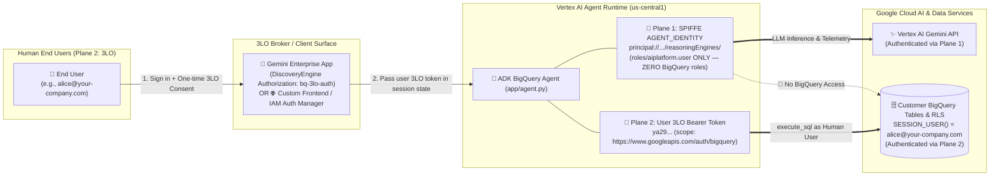

# 🔐 Enterprise BigQuery Agents with 3-Legged OAuth (3LO) & SPIFFE Agent Identity

A production-grade Google Cloud reference architecture and implementation guide for building **multi-user AI agents on Vertex AI Agent Runtime** and **Gemini Enterprise** that query **BigQuery** using **3-Legged OAuth (3LO)** and **SPIFFE Agent Identity (`AGENT_IDENTITY`)**.

Instead of querying BigQuery through an over-privileged Service Account, this architecture separates **AI Compute Identity (Plane 1)** from **Delegated Human Data Identity (Plane 2)**—so every SQL query generated by the **Google ADK** agent runs strictly as the **logged-in human user (`SESSION_USER()`)**, enforcing your existing BigQuery IAM permissions, Row-Level Security (RLS) policies, and per-user Cloud Audit Logs at the storage layer.

---

## 📖 Customer Documentation Series (Start Here)

| Guide | Focus & Key Takeaways |
| :--- | :--- |
| 📘 **[1. Step-by-Step Guide: Setting Up BigQuery 3LO & Agent Identity](docs/01_STEP_BY_STEP_BQ_3LO_SETUP_GUIDE.md)** | • **The Dual Identity Plane** (Plane 1: SPIFFE `AGENT_IDENTITY` vs. Plane 2: User `3LO`)<br/>• **Master Responsibility Matrix**: What happens in Console vs. CLI/API vs. Agent Python Code across Dev-Time, Deploy-Time, and Run-Time<br/>• **Step-by-Step Setup**: 3-Tier BigQuery RBAC/RLS, Redirect URI table (`adk web` vs. Gemini Enterprise vs. IAM Auth Manager), Agent code wiring, runtime sequence diagrams, and Cloud Audit Log verification |
| 🏗️ **[2. BigQuery 3LO Architectural Options, Dual Consumption & 2LO vs. 3LO Comparison](docs/02_3LO_ARCHITECTURAL_OPTIONS_AND_2LO_COMPARISON.md)** | • **Two Official 3LO Patterns**: Option A (Gemini Enterprise + `BigQueryToolset` in [`app/agent.py`](retail-sales-agent/app/agent.py)) vs. Option B (IAM Auth Manager v2 + `GcpAuthProviderScheme` + BigQuery MCP / `AuthenticatedFunctionTool` in [`app/agent_auth_manager_example.py`](retail-sales-agent/app/agent_auth_manager_example.py))<br/>• **Dual Consumption**: Calling the exact same deployed Reasoning Engine from **Gemini Enterprise**, a **Custom Frontend** ([`scripts/custom_frontend_3lo_client_example.py`](scripts/custom_frontend_3lo_client_example.py)), and **`adk web`**<br/>• **2LO vs. 3LO Comparison**: Machine-to-Machine 2LO setup with IAM Auth Manager (`--two-legged-oauth-*`) + 9 official Google Cloud reference links |
| 🪪 **[3. Agent Identity (`AGENT_IDENTITY`) vs. Service Accounts: Architectural Guide & Mental Model Shift](docs/03_AGENT_IDENTITY_VS_SERVICE_ACCOUNTS.md)** | • **Managed SPIFFE Identity**: `principal://agents.global.org-<ORG_ID>.system.id.goog/.../reasoningEngines/<ENGINE_ID>`<br/>• **Cloud Console `Identity` Tab**: Inspecting `Agent identity`, `Auth Providers`, and `Outbound Bindings`<br/>• **8-Dimension Comparison Table** & **5 Mental-Model Call-Outs**: Post-creation IAM binding order, creation-time immutability, ~10-min initial IAM propagation, Preview limitations, and why Plane 1 + Plane 2 work together |
| 🔐 **[4. Google Auth Platform: Branding, Audience, Token Brokers & OAuth Troubleshooting](docs/04_GOOGLE_AUTH_PLATFORM_AND_TROUBLESHOOTING.md)** | • **3-Layer OAuth Architecture**: Google Auth Platform (Layer 1) vs. Relying Party Token Broker (Layer 2) vs. ADK Runtime (Layer 3)<br/>• **Branding & Audience Deep Dive**: Aesthetic vs. functional gates, `Internal` vs. `External (Testing)` 7-day refresh token expiration cliff, and `External (Production)` app verification<br/>• **Rapid Troubleshooting Matrix**: Exact fixes for `redirect_uri_mismatch`, `org_internal`, `access_denied`, and `invalid_client` |
| 🌐 **[5. Extending 3LO Across GCP Services, Non-ADK Frameworks, 3rd-Party SaaS & Security FAQ](docs/05_EXTENDING_3LO_AND_SECURITY_FAQ.md)** | • **Other GCP Services**: Cloud SQL/AlloyDB IAM DB Auth + RLS, Spanner FGAC, GCS Managed Folders, Google Drive, Looker, Vertex AI Search, Dataplex, Apigee API Hub<br/>• **Non-ADK Agents**: LangGraph / LangChain / CrewAI with IAM Auth Manager REST APIs (`:retrieveCredentials` + `:finalize`)<br/>• **3rd-Party SaaS 3LO**: Snowflake, Atlassian Jira/Confluence, Salesforce, ServiceNow, and GitHub + **10 Enterprise CISO & Architecture FAQs** |

---

## 🛡️ Dual-Plane Security Architecture



- **Plane 1 — Agent Workload Identity (`AGENT_IDENTITY`)**: Configured via [`retail-sales-agent/app/.agent_engine_config.json`](retail-sales-agent/app/.agent_engine_config.json) (`{"identity_type": "AGENT_IDENTITY"}`). Grants the agent container least-privilege access to call Vertex AI Gemini (`roles/aiplatform.user`) and write logs/traces, with **zero permissions on BigQuery**.
- **Plane 2 — Delegated User Identity (`3LO`)**: Authenticates the human end-user (`https://www.googleapis.com/auth/bigquery`) and passes their short-lived Bearer token to BigQuery on each tool invocation so `SESSION_USER()`, Row-Level Security (RLS), and Cloud Audit Logs reflect the exact human user.

---

## 🤖 Turnkey Deployment with Any AI Coding Assistant (Antigravity, Claude Code, Codex, Cursor)

This repository is engineered for **zero-skill, one-prompt deployment** using any AI coding assistant (**Antigravity**, **Claude Code**, **OpenAI Codex**, **Cursor**, **Windsurf**, or **Gemini CLI**). Root instruction files ([`AGENTS.md`](AGENTS.md), [`CLAUDE.md`](CLAUDE.md), [`GEMINI.md`](GEMINI.md)) automatically guide your assistant through the entire workflow without requiring any external skills or plugins, and all configuration is consolidated into a **single canonical root `.env` file** (templated in [`.env.example`](.env.example)).

### Copy-Paste Prompt for Your AI Coding Assistant
```text
Deploy this repository to my Google Cloud project. Follow AGENTS.md: ask me for my GCP Project ID and user emails in one consolidated prompt, run the pre-flight check to surface any manual auth or OAuth client steps up-front, and then deploy and verify the full stack.
```

### What Your Coding Assistant Will Do Automatically
1. **Ask You for All Required Inputs in One Consolidated Prompt**:
   - Your target **`PROJECT_ID`**
   - Your **host admin email (`ADMIN_USER`)** (gets full access across all regions) and up to **2–3 test user emails (`NORTH_USER`, `SOUTH_USER`, `WEST_USER`)** who get differential Row-Level Security (RLS) permissions
   - Whether to load the included synthetic `retail_sales.weekly_store_sales` demo dataset or connect to an existing BigQuery table, and whether you already have an OAuth 2.0 Web Client
2. **Run [`deploy/00_preflight_and_configure.py`](deploy/00_preflight_and_configure.py) Up-Front & Highlight Any Manual Actions Immediately**:
   - Writes the **single canonical root `.env` file** and syncs the Python `.venv` via `uv sync`.
   - Verifies up-front that `gcloud` and Application Default Credentials (`gcloud auth application-default login`) are active, that your project and Cloud Billing are active, and that your account has the required IAM permissions (`testIamPermissions` for API enablement, IAM, BigQuery, and Vertex AI).
   - Verifies that `OAUTH_CLIENT_ID` and `OAUTH_CLIENT_SECRET` are set in `.env` (or auto-discovered from `client_secret_*.json`); if not, prints the direct Cloud Console links (`https://console.cloud.google.com/auth/clients/create?project=<PROJECT_ID>`) and exact Redirect URI (`https://vertexaisearch.cloud.google.com/oauth-redirect`).
3. **Execute the Self-Contained Deployment & Verification Scripts**:
   - Runs [`./deploy/01_setup_bq_and_rls.sh`](deploy/01_setup_bq_and_rls.sh) to provision the BigQuery dataset, table, and Row Access Policies.
   - Runs [`./deploy/02_deploy_agent_and_ge.sh`](deploy/02_deploy_agent_and_ge.sh) (which works with or without `agents-cli` via [`deploy/deploy_agent_runtime.py`](deploy/deploy_agent_runtime.py) and [`deploy/manage_ge_app.py`](deploy/manage_ge_app.py)) to deploy the ADK agent with SPIFFE `AGENT_IDENTITY`, inject `.env` variables into the container, bind Plane 1 IAM roles, register the 3LO broker in Gemini Enterprise, and verify the live agent.

---

## 📂 Repository Structure

| File / Directory | Purpose in the 3LO & Agent Identity Architecture |
| :--- | :--- |
| [`.env.example`](.env.example) | **Single Canonical Configuration Template**: Copy to `.env` (or let `00_preflight_and_configure.py` generate `.env`) to configure your Project ID, user emails, and OAuth Client ID/Secret in one place |
| [`AGENTS.md`](AGENTS.md) / [`CLAUDE.md`](CLAUDE.md) / [`GEMINI.md`](GEMINI.md) | **AI Coding Assistant Runbooks**: Step-by-step instructions read automatically by Antigravity, Claude Code, Codex, Cursor, Windsurf, and Gemini CLI |
| [`docs/01_STEP_BY_STEP_BQ_3LO_SETUP_GUIDE.md`](docs/01_STEP_BY_STEP_BQ_3LO_SETUP_GUIDE.md) | **Guide 1**: End-to-end setup guide (Console vs. CLI vs. Code), Redirect URI matrix, cold/warm 3LO sequence diagrams, and Audit Log verification |
| [`docs/02_3LO_ARCHITECTURAL_OPTIONS_AND_2LO_COMPARISON.md`](docs/02_3LO_ARCHITECTURAL_OPTIONS_AND_2LO_COMPARISON.md) | **Guide 2**: Option A (`BigQueryToolset`) vs. Option B (`GcpAuthProviderScheme` + BigQuery MCP), dual consumption, and 2LO setup |
| [`docs/03_AGENT_IDENTITY_VS_SERVICE_ACCOUNTS.md`](docs/03_AGENT_IDENTITY_VS_SERVICE_ACCOUNTS.md) | **Guide 3**: SPIFFE `AGENT_IDENTITY` vs. Service Accounts comparison, Console `Identity` tab walkthrough, and 5 operational call-outs |
| [`docs/04_GOOGLE_AUTH_PLATFORM_AND_TROUBLESHOOTING.md`](docs/04_GOOGLE_AUTH_PLATFORM_AND_TROUBLESHOOTING.md) | **Guide 4**: Google Auth Platform Branding, `Internal` vs. `External` Audience lifecycle, and OAuth error troubleshooting matrix |
| [`docs/05_EXTENDING_3LO_AND_SECURITY_FAQ.md`](docs/05_EXTENDING_3LO_AND_SECURITY_FAQ.md) | **Guide 5**: Extending 3LO to Cloud SQL/Spanner/GCS/Drive/Apigee, LangGraph/CrewAI, Snowflake/Jira/Salesforce, and 10 Security FAQs |
| [`retail-sales-agent/app/agent.py`](retail-sales-agent/app/agent.py) | **Pattern A Agent Implementation**: ADK `BigQueryToolset` + `BigQueryCredentialsConfig` + `_hybrid_3lo_get_valid_credentials` supporting Gemini Enterprise, Custom Frontends, and local `adk web` |
| [`retail-sales-agent/app/agent_auth_manager_example.py`](retail-sales-agent/app/agent_auth_manager_example.py) | **Pattern B Reference Implementation**: Google Cloud IAM Auth Manager v2 (`GcpAuthProvider` + `GcpAuthProviderScheme`) for Managed BigQuery MCP (`https://bigquery.googleapis.com/mcp`), `AuthenticatedFunctionTool`, and 2LO |
| [`retail-sales-agent/app/.agent_engine_config.json`](retail-sales-agent/app/.agent_engine_config.json) | Configures Vertex AI Agent Runtime to provision a per-agent SPIFFE `AGENT_IDENTITY` (`{"identity_type": "AGENT_IDENTITY"}`) |
| [`scripts/custom_frontend_3lo_client_example.py`](scripts/custom_frontend_3lo_client_example.py) | **Custom Frontend Reference Client**: Shows how a custom web/mobile app injects a user's 3LO token into `session.state` (Mode 1) or calls IAM Auth Manager `credentials:finalize` with `consent_nonce` (Mode 2) |
| [`deploy/00_preflight_and_configure.py`](deploy/00_preflight_and_configure.py) | **Up-Front Pre-Flight Validator & `.env` Generator**: Writes the root `.env` file and validates CLI tools, `gcloud`/ADC auth, project access, Cloud Billing, caller IAM permissions (`testIamPermissions`), and OAuth credentials |
| [`deploy/02_deploy_agent_and_ge.sh`](deploy/02_deploy_agent_and_ge.sh) | Automated deployment script: configures Gemini Enterprise 3LO `Authorization`, deploys the agent with `--agent-identity`, binds Plane 1 SPIFFE IAM roles, and publishes with `ALL_USERS` sharing |
| [`deploy/deploy_agent_runtime.py`](deploy/deploy_agent_runtime.py) | Pure-Python Vertex AI Agent Runtime deployer (`IdentityType.AGENT_IDENTITY`) using the `vertexai` SDK when `agents-cli` is not installed |
| [`deploy/manage_ge_app.py`](deploy/manage_ge_app.py) | Python automation for Discovery Engine `Authorization` (`bq-3lo-auth`), post-creation SPIFFE IAM binding (`--bind-agent-identity`), user licensing, and REST API agent registration + `ALL_USERS` sharing |
| [`deploy/01_setup_bq_and_rls.sh`](deploy/01_setup_bq_and_rls.sh) & [`data/`](data/) | *(Optional Demo Collateral)* Provisions the `retail_sales.weekly_store_sales` table and regional RLS policies for configured test personas |

---

## ⚡ Manual CLI Quickstart (If Deploying Without an AI Coding Assistant)

### 1. Run Pre-Flight & Configure Single Root `.env`

```bash
# Option 1: Copy .env.example to .env and fill in your values, then validate:
cp .env.example .env
python3 deploy/00_preflight_and_configure.py

# Option 2: Run the interactive wizard (or pass CLI flags --project-id, --admin-user, --north-user, etc.):
python3 deploy/00_preflight_and_configure.py --interactive

# (Optional) Load the synthetic retail_sales.weekly_store_sales table and attach Row-Level Security (RLS) policies:
./deploy/01_setup_bq_and_rls.sh
```

### 2. Deploy Agent with SPIFFE `AGENT_IDENTITY` & Register 3LO in Gemini Enterprise

```bash
./deploy/02_deploy_agent_and_ge.sh
```

This single script:
1. Configures the Gemini Enterprise App, user licenses, and the `bq-3lo-auth` Discovery Engine `Authorization` resource (`serverSideOauth2` with `access_type=offline&prompt=consent`).
2. Deploys the ADK agent to Vertex AI Agent Runtime with `AGENT_IDENTITY` (using `agents-cli` if installed, or [`deploy/deploy_agent_runtime.py`](deploy/deploy_agent_runtime.py) via the `vertexai` SDK).
3. Automatically inspects the newly minted `principal://agents.global.org-.../reasoningEngines/<ENGINE_ID>` and binds least-privilege Plane 1 IAM roles (`roles/aiplatform.user`, `roles/logging.logWriter`, `roles/telemetry.writer`) with **zero** BigQuery roles.
4. Registers the agent in Gemini Enterprise linked to `bq-3lo-auth` and patches `sharingConfig: {"scope": "ALL_USERS"}`.

### 3. Test from Gemini Enterprise, Custom Frontend CLI, or Local `adk web`

```bash
# Option A: Test via the Gemini Enterprise Web App URL printed at the end of 02_deploy_agent_and_ge.sh

# Option B: Test Custom Frontend 3LO state injection against the deployed Reasoning Engine
(cd retail-sales-agent && uv run python3 ../scripts/custom_frontend_3lo_client_example.py --project-id "<YOUR_PROJECT_ID>")

# Option C: Test multi-persona 3LO tokens locally via the ADK runner
(cd retail-sales-agent && uv run python3 ../scripts/test_agent_personas.py)
```
