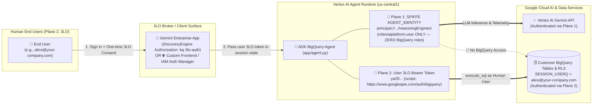

# 🔐 Enterprise BigQuery Agents with 3-Legged OAuth (3LO) & SPIFFE Agent Identity

A production-grade Google Cloud reference architecture and implementation guide for building **multi-user AI agents on Vertex AI Agent Runtime** and **Gemini Enterprise** that query **BigQuery** using **3-Legged OAuth (3LO)** and **SPIFFE Agent Identity (`AGENT_IDENTITY`)**.

Instead of querying BigQuery through an over-privileged Service Account, this architecture separates **AI Compute Identity (Plane 1)** from **Delegated Human Data Identity (Plane 2)**—so every SQL query generated by the **Google ADK** agent runs strictly as the **logged-in human user (`SESSION_USER()`)**, enforcing your existing BigQuery IAM permissions, Row-Level Security (RLS) policies, and per-user Cloud Audit Logs at the storage layer.

---

## 📖 Customer Documentation Series (Start Here)

| Guide | Focus & Key Takeaways |
| :--- | :--- |
| 📘 **[1. Step-by-Step Guide: Setting Up BigQuery 3LO & Agent Identity](docs/01_STEP_BY_STEP_BQ_3LO_SETUP_GUIDE.md)** | • **The Dual Identity Plane** (Plane 1: SPIFFE `AGENT_IDENTITY` vs. Plane 2: User `3LO`)<br/>• **Master Responsibility Matrix**: What happens in Console vs. CLI/API vs. Agent Python Code across Dev-Time, Deploy-Time, and Run-Time<br/>• **Step-by-Step Setup**: Google Auth Platform Branding/Audience, Redirect URI table (`adk web` vs. Gemini Enterprise vs. IAM Auth Manager), Agent code wiring, and runtime sequence diagrams |
| 🏗️ **[2. BigQuery 3LO Architectural Options, Dual Consumption & 2LO vs. 3LO Comparison](docs/02_3LO_ARCHITECTURAL_OPTIONS_AND_2LO_COMPARISON.md)** | • **Two Official 3LO Patterns**: Option A (Gemini Enterprise + `BigQueryToolset` in [`app/agent.py`](retail-sales-agent/app/agent.py)) vs. Option B (IAM Auth Manager v2 + `GcpAuthProviderScheme` + BigQuery MCP / `AuthenticatedFunctionTool` in [`app/agent_auth_manager_example.py`](retail-sales-agent/app/agent_auth_manager_example.py))<br/>• **Dual Consumption**: Calling the exact same deployed Reasoning Engine from **Gemini Enterprise**, a **Custom Frontend** ([`scripts/custom_frontend_3lo_client_example.py`](scripts/custom_frontend_3lo_client_example.py)), and **`adk web`**<br/>• **2LO vs. 3LO Comparison**: Machine-to-Machine 2LO setup with IAM Auth Manager (`--two-legged-oauth-*`) + 9 official Google Cloud reference links |
| 🪪 **[3. Agent Identity (`AGENT_IDENTITY`) vs. Service Accounts: Architectural Guide & Mental Model Shift](docs/03_AGENT_IDENTITY_VS_SERVICE_ACCOUNTS.md)** | • **Managed SPIFFE Identity**: `principal://agents.global.org-<ORG_ID>.system.id.goog/.../reasoningEngines/<ENGINE_ID>`<br/>• **8-Dimension Comparison Table**: Why `AGENT_IDENTITY` eliminates Service Account sprawl, JSON key risk, and confused-deputy vulnerabilities<br/>• **5 Mental-Model Call-Outs**: Post-creation IAM binding order, creation-time immutability, ~10-min initial IAM propagation, Preview limitations (VPC-SC, Groups, Deny), and why Plane 1 + Plane 2 work together |

---

## 🛡️ Dual-Plane Security Architecture



- **Plane 1 — Agent Workload Identity (`AGENT_IDENTITY`)**: Configured via [`retail-sales-agent/app/.agent_engine_config.json`](retail-sales-agent/app/.agent_engine_config.json) (`{"identity_type": "AGENT_IDENTITY"}`). Grants the agent container least-privilege access to call Vertex AI Gemini (`roles/aiplatform.user`) and write logs/traces, with **zero permissions on BigQuery**.
- **Plane 2 — Delegated User Identity (`3LO`)**: Authenticates the human end-user (`https://www.googleapis.com/auth/bigquery`) and passes their short-lived Bearer token to BigQuery on each tool invocation so `SESSION_USER()`, Row-Level Security (RLS), and Cloud Audit Logs reflect the exact human user.

---

## 📂 Repository Structure

| File / Directory | Purpose in the 3LO & Agent Identity Architecture |
| :--- | :--- |
| [`docs/01_STEP_BY_STEP_BQ_3LO_SETUP_GUIDE.md`](docs/01_STEP_BY_STEP_BQ_3LO_SETUP_GUIDE.md) | **Guide 1**: End-to-end setup guide (Console vs. CLI vs. Code), Redirect URI matrix, and cold/warm 3LO sequence diagrams |
| [`docs/02_3LO_ARCHITECTURAL_OPTIONS_AND_2LO_COMPARISON.md`](docs/02_3LO_ARCHITECTURAL_OPTIONS_AND_2LO_COMPARISON.md) | **Guide 2**: Option A (`BigQueryToolset`) vs. Option B (`GcpAuthProviderScheme` + BigQuery MCP), dual consumption, and 2LO setup |
| [`docs/03_AGENT_IDENTITY_VS_SERVICE_ACCOUNTS.md`](docs/03_AGENT_IDENTITY_VS_SERVICE_ACCOUNTS.md) | **Guide 3**: SPIFFE `AGENT_IDENTITY` vs. Service Accounts comparison and 5 operational mental-model call-outs |
| [`retail-sales-agent/app/agent.py`](retail-sales-agent/app/agent.py) | **Pattern A Agent Implementation**: ADK `BigQueryToolset` + `BigQueryCredentialsConfig` + `_hybrid_3lo_get_valid_credentials` supporting Gemini Enterprise, Custom Frontends, and local `adk web` |
| [`retail-sales-agent/app/agent_auth_manager_example.py`](retail-sales-agent/app/agent_auth_manager_example.py) | **Pattern B Reference Implementation**: Google Cloud IAM Auth Manager v2 (`GcpAuthProvider` + `GcpAuthProviderScheme`) for Managed BigQuery MCP (`https://bigquery.googleapis.com/mcp`), `AuthenticatedFunctionTool`, and 2LO |
| [`retail-sales-agent/app/.agent_engine_config.json`](retail-sales-agent/app/.agent_engine_config.json) | Configures Vertex AI Agent Runtime to provision a per-agent SPIFFE `AGENT_IDENTITY` (`{"identity_type": "AGENT_IDENTITY"}`) |
| [`scripts/custom_frontend_3lo_client_example.py`](scripts/custom_frontend_3lo_client_example.py) | **Custom Frontend Reference Client**: Shows how a custom web/mobile app injects a user's 3LO token into `session.state` (Mode 1) or calls IAM Auth Manager `credentials:finalize` with `consent_nonce` (Mode 2) |
| [`deploy/02_deploy_agent_and_ge.sh`](deploy/02_deploy_agent_and_ge.sh) | Automated deployment script: configures Gemini Enterprise 3LO `Authorization`, deploys the agent with `--agent-identity`, binds Plane 1 SPIFFE IAM roles, and publishes with `ALL_USERS` sharing |
| [`deploy/manage_ge_app.py`](deploy/manage_ge_app.py) | Python automation for Discovery Engine `Authorization` (`bq-3lo-auth`), post-creation SPIFFE IAM binding (`--bind-agent-identity`), user licensing, and `ALL_USERS` agent sharing |
| [`deploy/01_setup_bq_and_rls.sh`](deploy/01_setup_bq_and_rls.sh) & [`data/`](data/) | *(Optional Demo Collateral)* Provisions the placeholder `retail_sales.weekly_store_sales` table and regional RLS policies for placeholder test personas (`uno@`, `dos@`, `tres@`, `admin@`) |

---

## ⚡ Quick Deployment & Verification Instructions

> [!NOTE]
> **Using Your Own BigQuery Dataset vs. Optional Demo Collateral**:
> The 3LO + Agent Identity pipeline in [`deploy/02_deploy_agent_and_ge.sh`](deploy/02_deploy_agent_and_ge.sh) works directly with **any customer BigQuery dataset and existing RLS policies**—simply set `PROJECT_ID`, `BQ_DATASET`, and `BQ_TABLE` in `deploy/config.env`.
> If you want a self-contained sandbox table to test per-user RLS filtering (`uno@`, `dos@`, `tres@`, `admin@`), run [`./deploy/01_setup_bq_and_rls.sh`](deploy/01_setup_bq_and_rls.sh) first to load the optional `retail_sales.weekly_store_sales` demo dataset.

### 1. Configure Environment & OAuth 2.0 Web Client

```bash
# 1. Copy the template config and set your PROJECT_ID, BQ_DATASET, BQ_TABLE, and user emails
cp deploy/config.env.example deploy/config.env

# 2. (Optional) If testing in a clean sandbox without an existing RLS table, load the demo table:
./deploy/01_setup_bq_and_rls.sh

# 3. Create an OAuth 2.0 Web Client in Google Cloud Console:
#    URL: https://console.cloud.google.com/auth/clients?project=<YOUR_PROJECT_ID>
#    Authorized Redirect URIs:
#      - https://vertexaisearch.cloud.google.com/oauth-redirect  (For Gemini Enterprise)
#      - http://localhost:8000/dev-ui/                           (For local adk web)
#    Download `client_secret_*.json` into the repository root (or set OAUTH_CLIENT_ID / OAUTH_CLIENT_SECRET in deploy/config.env).
```

### 2. Deploy Agent with SPIFFE `AGENT_IDENTITY` & Register 3LO in Gemini Enterprise

```bash
./deploy/02_deploy_agent_and_ge.sh
```

This single script:
1. Configures the Gemini Enterprise App, user licenses, and the `bq-3lo-auth` Discovery Engine `Authorization` resource (`serverSideOauth2` with `access_type=offline&prompt=consent`).
2. Deploys the ADK agent to Vertex AI Agent Runtime with `--agent-identity` ([`app/.agent_engine_config.json`](retail-sales-agent/app/.agent_engine_config.json)).
3. Automatically inspects the newly minted `principal://agents.global.org-.../reasoningEngines/<ENGINE_ID>` and binds least-privilege Plane 1 IAM roles (`roles/aiplatform.user`, `roles/logging.logWriter`, `roles/telemetry.writer`) with **zero** BigQuery roles.
4. Publishes the agent to Gemini Enterprise linked to `--authorization-id` (`bq-3lo-auth`) and patches `sharingConfig: {"scope": "ALL_USERS"}`.

### 3. Test from Gemini Enterprise, Custom Frontend CLI, or Local `adk web`

```bash
# Option A: Test via the Gemini Enterprise Web App URL printed at the end of 02_deploy_agent_and_ge.sh

# Option B: Test Custom Frontend 3LO state injection against the deployed Reasoning Engine
(cd retail-sales-agent && uv run python3 ../scripts/custom_frontend_3lo_client_example.py)

# Option C: Test multi-persona 3LO tokens locally via the ADK runner
(cd retail-sales-agent && uv run python3 ../scripts/test_agent_personas.py)
```
