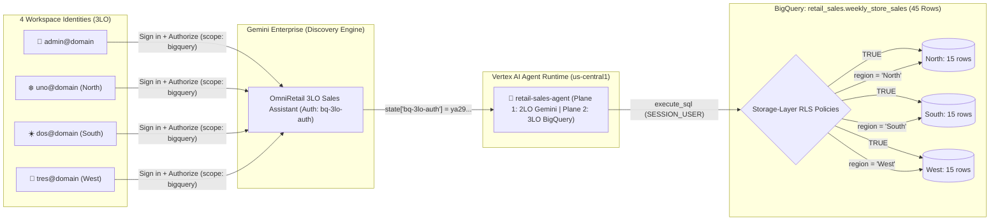

# 🔐 Zero-Trust AI Agents with BigQuery Row-Level Security (RLS) & 3-Legged OAuth (3LO)

A reproducible, workshop-grade Google Cloud reference implementation demonstrating **per-user data isolation for enterprise AI agents**. By pairing **3-Legged OAuth (3LO)** in **Gemini Enterprise** with **BigQuery Row-Level Security (RLS)** on **Vertex AI Agent Runtime**, every SQL query generated by the **Google ADK** agent executes strictly under the **logged-in human user's identity (`SESSION_USER()`)**—eliminating over-privileged database service accounts and neutralizing prompt-injection data leakage at the storage layer.

---

## 📚 Workshop & Architecture Documentation Series

Start here based on whether you are **building**, **presenting**, or **architecting**:

| Guide | Target Audience | Topics Covered |
| :--- | :--- | :--- |
| 🛠️ **[Part 1: Builder & Antigravity Recreation Guide](docs/01_ANTIGRAVITY_BUILDER_GUIDE.md)** | **Engineers, Builders & Workshop Attendees** standing up the stack in their own GCP project | • Input parameters (`PROJECT_ID`, `USER_DOMAIN`, 4 persona accounts)<br/>• Automated scripts vs. **why the OAuth 2.0 Web Client is the single manual Console step**<br/>• Click-by-click `/oauth-redirect` setup, **One-Shot Antigravity Prompt** & CLI walkthrough |
| 🎙️ **[Part 2: Customer Presenter & Console Playbook](docs/02_CUSTOMER_DEMO_PLAYBOOK.md)** | **Customer Engineers & Workshop Instructors** running a live 15-minute demo | • **Acts 1–4 live presentation script** & talking tracks<br/>• **6-Tab Google Cloud Console visual tour** with exact URLs & breadcrumbs<br/>• Side-by-side 4-persona comparison + **live Prompt-Injection security proof** |
| 🗄️ **[Part 3: BigQuery RLS & Agent Data Architecture](docs/03_BQ_RLS_AND_AGENT_DATA_ARCHITECTURE.md)** | **Data & AI Architects** designing NL-to-SQL and multi-service enterprise agents | • **Section A**: BigQuery RLS DDL, Console UI, 3-part IAM triad & *Implicit Deny Cliff*<br/>• **Section B**: `BigQueryToolset` vs. MCP Toolbox vs. Custom SDK vs. Conversational Analytics API; NL-to-SQL flow & runtime gotchas<br/>• **Section B.1**: Connecting 3LO agents to **GCS, Cloud SQL, AlloyDB, Spanner & Firestore**<br/>• **Section B.2**: Using **LangGraph, LangChain, CrewAI, or Custom FastAPI** instead of ADK |
| 🔐 **[Part 4: 3LO Auth, IAM, Agent Identity & 2LO Deep Dive](docs/04_3LO_AUTH_IAM_AND_2LO_DEEP_DIVE.md)** | **Security Architects, CISOs & Platform Teams** governing identity, IAM & auditability | • **3LO vs. 2LO** first principles & **Two Simultaneous Identity Planes** (Agent Compute vs. User Data)<br/>• End-to-end 3LO setup (IAP Brand, Web Client, GE `Authorization` resource, `--authorization-id`, `ALL_USERS` sharing)<br/>• **Master Multi-Layer IAM, Licensing & Vertex AI Agent Identity Checklist**<br/>• **2LO Contrast Guide**: Custom Service Account setup & Cloud Audit Logs verification |

---

## 🏗️ High-Level Architecture



---

## 👥 Four Personas, One Governed Table, Three Regional Storylines

A compact, deterministic 45-row dataset ([`data/weekly_store_sales.csv`](data/weekly_store_sales.csv) — 3 regions × 3 stores × 5 weeks) is loaded into `retail_sales.weekly_store_sales` and protected by **four BigQuery Row Access Policies**:

| Persona | Identity (`SESSION_USER()`) | RLS Policy & Filter Predicate | Visible Scope | Business Storyline Synthesized by the Agent |
| :--- | :--- | :--- | :--- | :--- |
| **👑 Executive Admin** | `admin@<USER_DOMAIN>` | `rls_admin_all_regions` (`TRUE`) | **45 rows** *(All 3 regions)* | Full $4.09M executive comparison across North, South, and West |
| **❄️ North Director** | `uno@<USER_DOMAIN>` | `rls_north_region` (`region = "North"`) | **15 rows** *(North only)* | **Exceeding Target (115.1%)**: 56.6% margin via `VIP_WINTER_BUNDLE_10`, 2.7% returns, 0 stockouts |
| **☀️ South Director** | `dos@<USER_DOMAIN>` | `rls_south_region` (`region = "South"`) | **15 rows** *(South only)* | **Margin & Quality Hit (80.4%)**: `BOGO_50_CLEARANCE_BLITZ` cut margin to 27.5% + *RunPro v4* defects spiked returns to 17.8% |
| **🌊 West Director** | `tres@<USER_DOMAIN>` | `rls_west_region` (`region = "West"`) | **15 rows** *(West only)* | **Supply-Chain Stockouts (68.7%)**: Healthy 49.7% margin, but 172 port/warehouse stockouts on Smart Home Hubs |

---

## ⚡ End-to-End Quickstart

See **[Part 1: Builder & Antigravity Recreation Guide](docs/01_ANTIGRAVITY_BUILDER_GUIDE.md)** for full details and the one-shot Antigravity prompt.

```bash
# 1. Authenticate Admin credentials
gcloud auth login admin@<YOUR_USER_DOMAIN>
gcloud auth application-default login

# 2. Configure target GCP project & 4 persona emails
cp deploy/config.env.example deploy/config.env
# Edit deploy/config.env with your PROJECT_ID and USER_DOMAIN

# 3. Phase 1: Provision BigQuery dataset, load 45 rows, bind IAM & attach 4 RLS policies
./deploy/01_setup_bq_and_rls.sh

# 4. One-Time Console Step (60 sec): Create OAuth 2.0 Web Client in your target project
#    URL: https://console.cloud.google.com/auth/clients?project=<PROJECT_ID>
#    Authorized redirect URIs:
#      - https://vertexaisearch.cloud.google.com/oauth-redirect   (REQUIRED for Gemini Enterprise)
#      - http://localhost:8000/dev-ui/                            (Optional for local adk web)
#    Download `client_secret_*.json` into the root of this repository.

# 5. Phase 2: Provision Gemini Enterprise + 4 User Licenses, register 3LO Auth,
#    deploy ADK Agent to Vertex AI Agent Runtime & publish with ALL_USERS sharing
./deploy/02_deploy_agent_and_ge.sh

# 6. Verify RLS policies & end-to-end 3LO Agent execution from the CLI
python3 scripts/verify_rls_policies.py
(cd retail-sales-agent && uv run python3 ../scripts/test_agent_personas.py)
```

---

## 📂 Repository Structure

```text
bq_3LO/
├── README.md                                          # Hub overview, quickstart & documentation map
├── docs/
│   ├── 01_ANTIGRAVITY_BUILDER_GUIDE.md                # Part 1: End-to-end recreation & Console OAuth setup
│   ├── 02_CUSTOMER_DEMO_PLAYBOOK.md                   # Part 2: 15-min live demo script & Console visual tour
│   ├── 03_BQ_RLS_AND_AGENT_DATA_ARCHITECTURE.md       # Part 3: BQ RLS, NL2SQL, multi-service GCP & LangGraph
│   └── 04_3LO_AUTH_IAM_AND_2LO_DEEP_DIVE.md           # Part 4: 3LO vs 2LO, IAM checklist, Agent Identity & audits
├── retail-sales-agent/                                # Google ADK Agent (Vertex AI Agent Runtime + Gemini Enterprise)
│   ├── app/
│   │   ├── agent.py                                   # GlobalGemini + BigQueryToolset + Hybrid 3LO Resolver
│   │   ├── fast_api_app.py                            # FastAPI / Reasoning Engine / A2A server entrypoint
│   │   └── app_utils/                                 # A2A routes, Reasoning Engine adapter & Cloud Trace telemetry
│   └── pyproject.toml                                 # Agent dependencies (google-adk, google-cloud-bigquery, a2a)
├── deploy/
│   ├── config.env.example                             # Parameterized project, dataset, GE & persona configuration
│   ├── common.sh                                      # Config loader, corporate mTLS disabler & ADC auth bridge
│   ├── 01_setup_bq_and_rls.sh                         # Phase 1: Idempotent BigQuery load, IAM & RLS DDL setup
│   ├── 02_deploy_agent_and_ge.sh                      # Phase 2: Agent Runtime deploy, GE publish & ALL_USERS sharing
│   └── manage_ge_app.py                               # Provision DataStore, Engine, 4 User Licenses, Brand & 3LO Auth
├── scripts/
│   ├── generate_synthetic_data.py                     # Deterministic 45-row regional storyline generator
│   ├── verify_rls_policies.py                         # Inspects RLS policies via REST API & runs live SQL checks
│   └── test_agent_personas.py                         # Local ADK runner injecting 3LO OAuth tokens into session state
└── data/
    ├── weekly_store_sales.csv                         # 45-row weekly store sales dataset (15 rows per region)
    ├── weekly_store_sales.jsonl                       # JSONL export of the dataset
    └── weekly_store_sales_schema.json                 # BigQuery table schema with column descriptions
```
