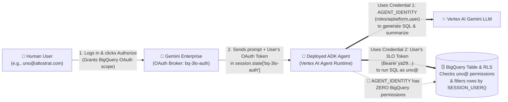
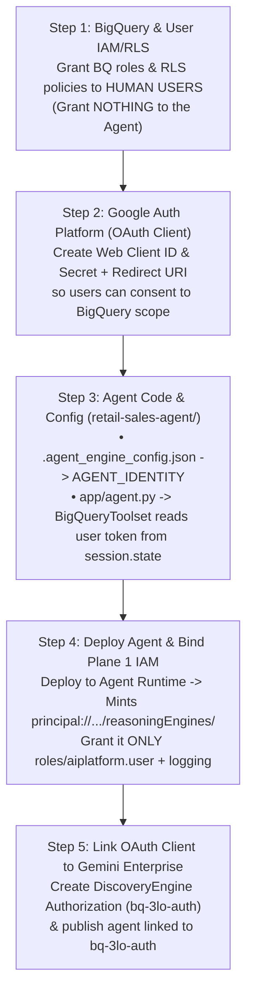
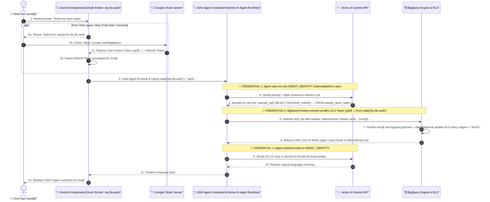

# 🎯 High-Level Overview: How Agent Identity, User Permissions (3LO), and BigQuery Connect

**Internal CE Documentation Navigation**:
**Internal Doc 0: End-to-End Flow Overview** · [🧭 Internal Doc 1: CE Architecture POV & Tough Q&A](01_CE_ARCHITECTURE_POV_AND_TOUGH_QA.md) · [🔐 Internal Doc 2: Google Auth Platform Appendix](02_GOOGLE_AUTH_PLATFORM_APPENDIX.md) · [🎙️ Internal Doc 3: CE Live Demo Console & Code Walkthrough](03_INTERNAL_DEMO_AND_BUILDER_RUNBOOK.md)

---

## 💡 The Core "Aha!" Mental Model (Read This First)

A very common point of confusion is:
> *"I see that `AGENT_IDENTITY` is configured when the agent is created (`{"identity_type": "AGENT_IDENTITY"}`). How does that Agent Identity connect to user permissions and to BigQuery?"*

**The short answer**: **`AGENT_IDENTITY` is NOT what queries BigQuery!** In fact, the Agent Identity is intentionally given **zero** BigQuery permissions.

Instead, the agent operates with **two separate credentials** inside the same container—switching between them depending on **what** it is calling:

| Credential | What It Is | What It Connects To | Why It Exists |
| :--- | :--- | :--- | :--- |
| **1. Agent Identity (`AGENT_IDENTITY`)**<br/>*(The Agent's Machine Badge)* | Auto-created SPIFFE identity:<br/>`principal://agents.global.../reasoningEngines/<ID>` | **Vertex AI Gemini (LLM)**, **Cloud Logging / Trace**, and *(optionally)* **IAM Auth Manager** | Gives the agent container permission to *think* (call Gemini `roles/aiplatform.user`) and *log*—without using a shared Service Account. **Has ZERO BigQuery access.** |
| **2. User 3LO OAuth Token (`Bearer ya29...`)**<br/>*(The Human User's Badge)* | Standard Google OAuth 2.0 token minted when the human user clicks **"Authorize"** | **BigQuery API (`execute_sql`)** | Passed into the agent's session state at runtime so the BigQuery tool runs SQL **as the human user (`SESSION_USER()`)**, enforcing that user's BigQuery IAM & Row-Level Security (RLS). |



> **Note on When `AGENT_IDENTITY` *Does* Touch Auth**:
> - In **Pattern A (`app/agent.py` — Gemini Enterprise)**, Gemini Enterprise handles the OAuth handshake and injects the user's token directly into `session.state["bq-3lo-auth"]`. Here, `AGENT_IDENTITY` only calls Gemini and Cloud Logging.
> - In **Pattern B (`app/agent_auth_manager_example.py` — IAM Auth Manager)**, the agent uses its `AGENT_IDENTITY` (granted `roles/agentidentity.user`) to call Google Cloud's **IAM Auth Manager Token Vault** and ask: *"Give me the BigQuery 3LO OAuth token for the current user."*

---

## 🛠️ Part 1: How the Agent Is Set Up (Development & Configuration Flow)

Here is the step-by-step setup flow—showing where **BigQuery permissions**, **OAuth**, **Agent Code**, and **Agent Identity** are configured and how they link together.



### Step 1: Set Up BigQuery Permissions & RLS for Human Users (Data Layer)
- **What we're trying to do**: Define who is allowed to see which rows in BigQuery. Because the agent will query BigQuery *as the human user*, all BigQuery permissions are granted to **users/groups**, never to the agent.
- **What gets configured** (automated in [`deploy/01_setup_bq_and_rls.sh`](../deploy/01_setup_bq_and_rls.sh)):
  1. **IAM Roles for Users**: Each human user (`uno@`, `dos@`, `tres@`, `admin@`) is granted:
     - `roles/bigquery.jobUser` on the project (permission to run a query job).
     - `roles/bigquery.dataViewer` on the dataset `retail_sales` (permission to read table metadata/rows).
  2. **Row-Level Security (RLS)**: Row Access Policies are attached to `bq-3lo.retail_sales.weekly_store_sales` mapping each user email to their region (e.g., `uno@` → `region = 'North'`, `dos@` → `region = 'South'`).
- **🔗 Console Link**: [BigQuery Studio — `weekly_store_sales`](https://console.cloud.google.com/bigquery?project=bq-3lo&ws=!1m5!1m4!4m3!1sbq-3lo!2sretail_sales!3sweekly_store_sales)

---

### Step 2: Create the OAuth 2.0 Web Client (Google Auth Platform)
- **What we're trying to do**: Create an OAuth 2.0 app so that when a human user chats with the agent, Google can show an **"Allow access to BigQuery"** consent screen and mint a user token (`ya29...`) scoped to `https://www.googleapis.com/auth/bigquery`.
- **What gets configured** (one-time in Cloud Console):
  1. Set OAuth Audience to **Internal** (so internal company users don't see an "Unverified App" warning).
  2. Create an **OAuth 2.0 Web Client** (`client_id` & `client_secret`).
  3. Add the **Authorized Redirect URI** for Gemini Enterprise: `https://vertexaisearch.cloud.google.com/oauth-redirect` (and `http://localhost:8000/dev-ui/` for local testing).
- **🔗 Console Link**: [Google Auth Platform — Clients](https://console.cloud.google.com/auth/clients?project=bq-3lo)

---

### Step 3: Wire the Agent Code & Identity Config (Development Layer)
- **What we're trying to do**: Tell Vertex AI to give our agent its own `AGENT_IDENTITY` container identity, **and** tell the ADK `BigQueryToolset` in Python to ignore that container identity and use the human user's OAuth token instead.
- **Where it happens in code**:
  1. **Enable `AGENT_IDENTITY` ([`retail-sales-agent/app/.agent_engine_config.json`](../retail-sales-agent/app/.agent_engine_config.json))**:
     ```json
     {
       "identity_type": "AGENT_IDENTITY"
     }
     ```
  2. **Wire `BigQueryToolset` to Use the User's 3LO Token ([`retail-sales-agent/app/agent.py`](../retail-sales-agent/app/agent.py))**:
     - `BigQueryToolset` is configured with `BigQueryCredentialsConfig(client_id=..., client_secret=..., scopes=["https://www.googleapis.com/auth/bigquery"])`.
     - Our helper `_hybrid_3lo_get_valid_credentials()` intercepts every BigQuery tool call, looks inside the current conversation's `tool_context.state["bq-3lo-auth"]` for the human user's OAuth token (`ya29...`), and wraps it in `google.oauth2.credentials.Credentials(token=token)`.
     - That per-request user credential is what `BigQueryToolset` passes to `bigquery.Client(project="bq-3lo", credentials=user_creds)`.

---

### Step 4: Deploy the Agent & Grant `AGENT_IDENTITY` Its Runtime Roles (Compute Layer)
- **What we're trying to do**: Deploy the agent to Vertex AI Agent Runtime so Google mints its unique `principal://.../reasoningEngines/<ENGINE_ID>`, and then give that identity just enough permission to call the **Gemini LLM** and write logs.
- **What happens** (automated in [`deploy/02_deploy_agent_and_ge.sh`](../deploy/02_deploy_agent_and_ge.sh)):
  1. `agents-cli deploy -d agent_runtime --agent-identity` creates the Reasoning Engine and outputs its new SPIFFE principal:
     ```text
     principal://agents.global.org-884802839894.system.id.goog/resources/aiplatform/projects/727735722177/locations/us-central1/reasoningEngines/7541693466305101824
     ```
  2. **Important**: A newly created `AGENT_IDENTITY` starts with **zero** permissions on GCP!
  3. Right after creation, `manage_ge_app.py --bind-agent-identity` grants that `principal://...` **only**:
     - `roles/aiplatform.user` (so the agent can call Vertex AI Gemini models)
     - `roles/logging.logWriter` & `roles/telemetry.writer` (for logs and traces)
     - **Zero** `roles/bigquery.*` roles!
- **🔗 Console Links**:
  - [Vertex AI Agent Engine (`Identity` Tab)](https://console.cloud.google.com/vertex-ai/agents/agent-engines/locations/us-central1/agent-engines/7541693466305101824?project=bq-3lo)
  - [Cloud IAM — Project Permissions](https://console.cloud.google.com/iam-admin/iam?project=bq-3lo)

---

### Step 5: Register the 3LO Authorization in Gemini Enterprise & Publish the Agent (Broker Layer)
- **What we're trying to do**: Connect the **OAuth Client (from Step 2)** to the **Deployed Agent (from Step 4)** inside Gemini Enterprise, so Gemini Enterprise knows to obtain a BigQuery OAuth token from the user before calling the agent.
- **What happens** (automated in [`deploy/02_deploy_agent_and_ge.sh`](../deploy/02_deploy_agent_and_ge.sh)):
  1. Creates a Discovery Engine `Authorization` resource named **`bq-3lo-auth`** containing the OAuth `clientId`, `clientSecret`, and Google's OAuth URL requesting `scope=https://www.googleapis.com/auth/bigquery&access_type=offline&prompt=consent`.
  2. Publishes the Reasoning Engine to the Gemini Enterprise App with `--authorization-id .../authorizations/bq-3lo-auth` and shares it with `ALL_USERS`.
- **🔗 Console Link**: [Gemini Enterprise Apps](https://console.cloud.google.com/gen-app-builder/engines?project=bq-3lo)

---

## ⚡ Part 2: How the Runtime Flow Works (Step-by-Step When a User Chats)

Now that everything is set up, here is exactly what happens at runtime when **`uno@`** (our North Region Manager) logs into Gemini Enterprise and asks:
> *"Show me a breakdown of my store sales."*



### Runtime Step-by-Step Breakdown

1. **User Sends Prompt**:
   `uno@` opens the [Gemini Enterprise Web App](https://vertexaisearch.cloud.google.com/home/cid/0d39d12e-18ea-4015-a634-880260b23c5f), selects the **OmniRetail BigQuery 3LO Sales Agent**, and asks for sales data.
2. **OAuth Token Check & Consent (How User Identity Is Captured)**:
   - Gemini Enterprise sees that this agent requires the `bq-3lo-auth` authorization.
   - **First time only**: Gemini Enterprise shows an **"Authorize"** button. `uno@` clicks it and approves BigQuery access. Google OAuth returns an `access_token` (`ya29...`) and a `refresh_token` belonging to `uno@`. Gemini Enterprise stores the refresh token in its encrypted token vault.
   - **Every future query**: Gemini Enterprise silently reuses `uno@`'s token (or refreshes it automatically in the background) with **zero popups**.
3. **Token Injection into the Agent Session**:
   Gemini Enterprise calls our deployed Reasoning Engine on Vertex AI and passes `uno@`'s OAuth access token inside the ADK session state dictionary:
   `session.state["bq-3lo-auth"] = "ya29..."`.
4. **LLM Reasoning via `AGENT_IDENTITY` (Credential 1)**:
   The agent container receives the prompt. To decide what to do, it calls the **Vertex AI Gemini API**. For this call, the container authenticates using its **own `AGENT_IDENTITY` (`principal://.../reasoningEngines/<ID>`)**, which has `roles/aiplatform.user`. Gemini reads the system instructions and decides to invoke the `execute_sql` tool.
5. **Credential Switch Inside `BigQueryToolset` (Credential 2)**:
   When `execute_sql` runs, `BigQueryToolset` calls `_hybrid_3lo_get_valid_credentials(tool_context)` in [`app/agent.py`](../retail-sales-agent/app/agent.py):
   - It pulls `uno@`'s `ya29...` token out of `tool_context.state["bq-3lo-auth"]`.
   - It creates a temporary `bigquery.Client(project="bq-3lo", credentials=Credentials(token="ya29..."))` **scoped only to this single tool call**.
6. **BigQuery Enforces User Permissions & Row-Level Security**:
   BigQuery receives the SQL query authenticated with `uno@`'s Bearer token:
   - BigQuery sets `SESSION_USER() = "uno@..."`.
   - BigQuery checks IAM: Does `uno@` have `roles/bigquery.jobUser` and `roles/bigquery.dataViewer`? **Yes.**
   - BigQuery checks Row Access Policies on `weekly_store_sales`: Which rows match `uno@`? **Only `rls_north_region` (`region = 'North'`).**
   - BigQuery returns **only the 15 `North` rows** (the 30 `South` and `West` rows are filtered out at the storage layer before the agent ever sees them) and logs `principalEmail: "uno@..."` in [Cloud Audit Logs](https://console.cloud.google.com/logs/query?project=bq-3lo).
7. **Final Answer Synthesis via `AGENT_IDENTITY` (Credential 1)**:
   The agent receives the 15 rows from BigQuery, uses its **`AGENT_IDENTITY`** one last time to ask Gemini to summarize the numbers into a clean markdown response, and streams the answer back to `uno@`.
