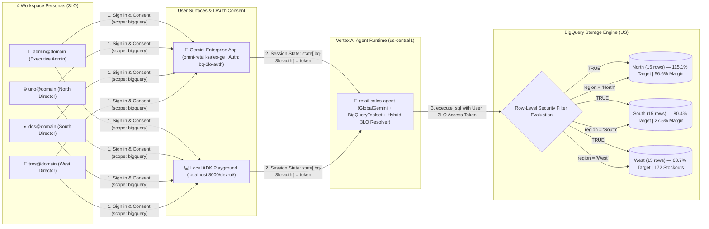

# 🛠️ Part 1: Builder & Antigravity Recreation Guide

**Workshop Series Navigation**:
[🏠 Repository Hub](../README.md) · **Part 1: Builder Guide** · [🎙️ Part 2: Customer Demo Playbook](02_CUSTOMER_DEMO_PLAYBOOK.md) · [🗄️ Part 3: BigQuery RLS & Agent Data Architecture](03_BQ_RLS_AND_AGENT_DATA_ARCHITECTURE.md) · [🔐 Part 4: 3LO Auth, IAM & 2LO Deep Dive](04_3LO_AUTH_IAM_AND_2LO_DEEP_DIVE.md)

---

This guide walks **Cloud Architects, Customer Engineers, and Workshop Attendees** through recreating the entire **BigQuery Row-Level Security (RLS) + 3-Legged OAuth (3LO) AI Agent** stack from scratch in a clean Google Cloud project—either in one shot via **Antigravity** or step-by-step from your terminal.

---

## 1. Prerequisites & Input Parameters

To deploy this architecture cleanly, you need **one Google Cloud project** and **four Google Workspace / Cloud Identity accounts** in the same domain (one Executive Admin and three Regional Directors):

| Parameter | Config Variable (`deploy/config.env`) | Default / Workshop Example | Purpose in the Architecture |
| :--- | :--- | :--- | :--- |
| **GCP Project ID** | `PROJECT_ID` | `bq-3lo` | Hosts the BigQuery dataset, RLS policies, OAuth 2.0 Client, Vertex AI Agent Runtime, and Gemini Enterprise App |
| **Agent Runtime Region** | `REGION` | `us-central1` | Regional Vertex AI Reasoning Engine deployment location |
| **BigQuery Location** | `BQ_LOCATION` | `US` | Multi-region location of the `retail_sales` dataset |
| **Identity Domain** | `USER_DOMAIN` | `vphuloria.altostrat.com` | Google Workspace / Cloud Identity domain shared by the test users |
| **Executive Admin** | `ADMIN_USER` | `admin@vphuloria.altostrat.com` | Provisions infrastructure and receives `FILTER USING (TRUE)` (all **45 rows** across 3 regions) |
| **North Region User** | `NORTH_USER` | `uno@vphuloria.altostrat.com` | Restricted by BigQuery RLS to `region = "North"` (**15 rows**) |
| **South Region User** | `SOUTH_USER` | `dos@vphuloria.altostrat.com` | Restricted by BigQuery RLS to `region = "South"` (**15 rows**) |
| **West Region User** | `WEST_USER` | `tres@vphuloria.altostrat.com` | Restricted by BigQuery RLS to `region = "West"` (**15 rows**) |
| **BigQuery Target** | `BQ_DATASET` / `BQ_TABLE` | `retail_sales.weekly_store_sales` | Central 45-row store performance table protected by RLS |
| **Gemini Enterprise App** | `GE_APP_ID` | `omni-retail-sales-ge` | Discovery Engine / Gemini Enterprise web application ID |
| **3LO Auth Resource ID** | `GEMINI_AUTH_ID` | `bq-3lo-auth` | Discovery Engine `Authorization` resource storing the OAuth 2.0 Client credentials |
| **OAuth 2.0 Web Client** | `OAUTH_CLIENT_ID` / `OAUTH_CLIENT_SECRET` *(or `client_secret_*.json`)* | *(Created in Google Auth Platform)* | Web Application OAuth Client enabling Gemini Enterprise and `adk web` to request per-user BigQuery tokens |

### Pre-Flight Workstation Authentication

Authenticate your **Admin** identity in both `gcloud` CLI and Application Default Credentials (ADC) before running the scripts or prompting Antigravity:

```bash
gcloud auth login admin@<YOUR_USER_DOMAIN>
gcloud auth application-default login
gcloud config set project <YOUR_PROJECT_ID>
gcloud auth application-default set-quota-project <YOUR_PROJECT_ID>
```

> [!TIP]
> **Built-In Corporate mTLS & ADC Bridge**: [`deploy/common.sh`](../deploy/common.sh) automatically disables corporate Context-Aware mTLS/ECP proxy hangs (`GOOGLE_API_USE_CLIENT_CERTIFICATE=false`, `GOOGLE_API_USE_MTLS_ENDPOINT=never`) and bridges an active ADC token to `gcloud` if needed.

---

## 2. Automated vs. Manual Setup: Why Exactly One Console Step Exists

A frequent workshop question is: *"Why can't Terraform or `gcloud` create the OAuth 2.0 Web Client completely headlessly?"*

Understanding the boundary between what Google Cloud allows via API versus what requires human Console confirmation is essential for repeatable deployments:

| Provisioning Step | Automated or Manual? | Mechanism & Architectural Rationale |
| :--- | :--- | :--- |
| **Enable APIs** (`bigquery`, `aiplatform`, `discoveryengine`, `cloudbuild`, `artifactregistry`, `iam`) | **100% Automated** | Enabled idempotently by [`01_setup_bq_and_rls.sh`](../deploy/01_setup_bq_and_rls.sh) and [`02_deploy_agent_and_ge.sh`](../deploy/02_deploy_agent_and_ge.sh). |
| **BigQuery Dataset, 45-Row Table & Schema** | **100% Automated** | [`01_setup_bq_and_rls.sh`](../deploy/01_setup_bq_and_rls.sh) creates `retail_sales.weekly_store_sales` and loads [`data/weekly_store_sales.csv`](../data/weekly_store_sales.csv). |
| **BigQuery IAM & 4 Row-Level Access Policies** | **100% Automated** | Grants `roles/bigquery.jobUser` (Project), `roles/bigquery.dataViewer` (Dataset), and executes `CREATE OR REPLACE ROW ACCESS POLICY` DDL (`roles/bigquery.filteredDataViewer`). |
| **OAuth Consent Screen (Internal Brand)** | **100% Automated** | [`deploy/manage_ge_app.py`](../deploy/manage_ge_app.py) calls the **IAP Brands REST API** (`POST https://iap.googleapis.com/v1/projects/<PROJECT_NUMBER>/brands`) to auto-create the project's **Internal** OAuth Consent Screen. |
| **General-Purpose OAuth 2.0 Web Client (`redirect_uris`)** | **⚠️ Manual Console Step (60 sec)** | **Why blocked on CLI/API?** Google Cloud intentionally restricts programmatic CLI/REST creation of general-purpose OAuth 2.0 Web Clients with arbitrary external `redirect_uris` (such as `https://vertexaisearch.cloud.google.com/oauth-redirect`) as an **anti-phishing and token-redirection security control**. *(The IAP OAuth Clients API only mints IAP-bound clients without custom redirect URIs.)* |
| **Gemini Enterprise App, DataStore, AclConfig & 4 User Licenses** | **100% Automated** | [`deploy/manage_ge_app.py`](../deploy/manage_ge_app.py) provisions the Discovery Engine `DataStore`, `Engine`, `GSUITE` IdP config, `free_trial_gemini` license, `batchUpdateUserLicenses`, and `discoveryengine.user`/`viewer` IAM bindings. |
| **Discovery Engine `Authorization` Resource (`bq-3lo-auth`)** | **100% Automated** | Once `client_secret_*.json` (or env vars) is present, `manage_ge_app.py` registers `projects/<NUM>/locations/global/authorizations/bq-3lo-auth` via REST API. |
| **Vertex AI Agent Runtime Build, Publish & `ALL_USERS` Sharing** | **100% Automated** | [`02_deploy_agent_and_ge.sh`](../deploy/02_deploy_agent_and_ge.sh) deploys via `agents-cli deploy`, publishes with `--authorization-id`, patches `sharingConfig: {"scope": "ALL_USERS"}`, and prints the live Web App URL. |

---

## 3. The Single Manual Console Step: Creating the 3LO OAuth Web Client (60 Seconds)

Perform this step once per Google Cloud project. *(You can perform it either **before** running the scripts—so everything attaches on the first pass—or **after** Phase 1, then re-run `./deploy/02_deploy_agent_and_ge.sh`.)*

### Step 3.1 — Verify OAuth Branding / Audience (Optional Check)
1. If you have not yet run `02_deploy_agent_and_ge.sh` on a brand-new project and Google Auth Platform prompts you to configure the overview screen first:
   - Open **Google Auth Platform → Branding**: `https://console.cloud.google.com/auth/branding?project=<PROJECT_ID>`
   - Set **App name** to `OmniRetail 3LO Sales Assistant`, choose your `admin@<USER_DOMAIN>` as **User support email**, and select **Internal** under **Audience** (`https://console.cloud.google.com/auth/audience?project=<PROJECT_ID>`).
   - *(If you run `02_deploy_agent_and_ge.sh` first, `manage_ge_app.py` creates this Internal Brand automatically via the IAP Brands API!)*

### Step 3.2 — Create the OAuth 2.0 Web Application Client
1. Open **Google Auth Platform → Clients** in your target project:
   - Direct URL: `https://console.cloud.google.com/auth/clients?project=<PROJECT_ID>`
   - *(Classic Console path: **APIs & Services** → **Credentials** → **+ Create Credentials** → **OAuth client ID**)*
2. Click **+ Create Client**:
   - **Application type**: Select **Web application**
   - **Name**: `bq-3lo-agent-web-client`
3. Under **Authorized redirect URIs**, click **+ Add URI** and enter these exact URIs:
   - **Required for Gemini Enterprise (Cloud UI)**:
     ```text
     https://vertexaisearch.cloud.google.com/oauth-redirect
     ```
   - **Recommended for Local `adk web` / `agents-cli playground` Testing**:
     ```text
     http://localhost:8000/dev-ui/
     http://127.0.0.1:8000/dev-ui/
     ```

> [!CAUTION]
> **Critical Redirect URI Gotcha (`redirect_uri_mismatch`)**:
> Older blog posts or legacy Dialogflow/Vertex docs sometimes reference `https://vertexaisearch.cloud.google.com/static/oauth/oauth.html`. **DO NOT use `/static/oauth/oauth.html` for Gemini Enterprise ADK 3LO agents!** Gemini Enterprise redirects users to `https://vertexaisearch.cloud.google.com/oauth-redirect`. Using any other path—or omitting the trailing slash on `http://localhost:8000/dev-ui/`—will trigger `Error 400: redirect_uri_mismatch` during user sign-in.

4. Click **Create**.
5. In the confirmation dialog, click **Download JSON** and save the `client_secret_*.json` file directly into the **root of this repository** (`bq_3LO/client_secret_*.json`):
   - `.gitignore` already excludes `client_secret*.json` and `retail-sales-agent/app/oauth_config.json` so credentials are never committed to Git.
   - Alternatively, copy the **Client ID** and **Client Secret** into `deploy/config.env` (`OAUTH_CLIENT_ID` and `OAUTH_CLIENT_SECRET`).

> [!IMPORTANT]
> **Strict Project Isolation Enforcement**: [`deploy/manage_ge_app.py`](../deploy/manage_ge_app.py) and [`deploy/02_deploy_agent_and_ge.sh`](../deploy/02_deploy_agent_and_ge.sh) inspect the `"project_id"` field inside `client_secret_*.json` and **skip any JSON belonging to a different GCP project**, plus emit an explicit warning if `https://vertexaisearch.cloud.google.com/oauth-redirect` is missing from `"redirect_uris"`.

---

## 4. Option A: One-Shot Recreation via Antigravity

Open this repository in **Antigravity**, drop your downloaded `client_secret_*.json` into the repo root, and paste the following prompt (updating `PROJECT_ID` and `USER_DOMAIN` for your sandbox):

```text
Set up, deploy, and verify the full BigQuery 3LO & Row-Level Security (RLS) demo in this repository using:
- PROJECT_ID: bq-3lo
- REGION: us-central1
- BQ_LOCATION: US
- USER_DOMAIN: vphuloria.altostrat.com
- ADMIN_USER: admin@vphuloria.altostrat.com
- NORTH_USER: uno@vphuloria.altostrat.com (region = "North")
- SOUTH_USER: dos@vphuloria.altostrat.com (region = "South")
- WEST_USER: tres@vphuloria.altostrat.com (region = "West")
- GE_APP_ID: omni-retail-sales-ge
- GEMINI_AUTH_ID: bq-3lo-auth

Please execute end-to-end:
1. Write these parameters to `deploy/config.env`.
2. Run `./deploy/01_setup_bq_and_rls.sh` to create `retail_sales.weekly_store_sales`, load the 45-row synthetic dataset, bind BigQuery IAM roles, and attach all 4 Row-Level Access Policies.
3. Verify `client_secret_*.json` is present (or prompt me if missing), then run `./deploy/02_deploy_agent_and_ge.sh` to provision the Gemini Enterprise App, assign active licenses to all 4 users, register the `bq-3lo-auth` OAuth Authorization resource, deploy `retail-sales-agent` to Vertex AI Agent Runtime, publish it to Gemini Enterprise with `ALL_USERS` sharing, and output the live Gemini Enterprise Web App URL.
4. Run `python3 scripts/verify_rls_policies.py` and `(cd retail-sales-agent && uv run python3 ../scripts/test_agent_personas.py)` to validate RLS enforcement and 3LO token propagation end-to-end.
```

---

## 5. Option B: Step-by-Step Terminal Walkthrough

If you prefer running each phase directly from your shell to observe every API call and resource creation step:

### Step 1 — Configure `deploy/config.env`

```bash
cp deploy/config.env.example deploy/config.env
```

Edit `deploy/config.env` to match your target `PROJECT_ID` and `USER_DOMAIN`:

```bash
export PROJECT_ID="bq-3lo"
export REGION="us-central1"
export BQ_LOCATION="US"
export BQ_DATASET="retail_sales"
export BQ_TABLE="weekly_store_sales"

export USER_DOMAIN="vphuloria.altostrat.com"
export ADMIN_USER="admin@${USER_DOMAIN}"
export NORTH_USER="uno@${USER_DOMAIN}"
export SOUTH_USER="dos@${USER_DOMAIN}"
export WEST_USER="tres@${USER_DOMAIN}"

export GE_APP_ID="omni-retail-sales-ge"
export GEMINI_AUTH_ID="bq-3lo-auth"
```

### Step 2 — Phase 1: Provision BigQuery Dataset, IAM & Row-Level Security

```bash
./deploy/01_setup_bq_and_rls.sh
```

**What this script executes**:
1. Verifies active `gcloud`/ADC credentials and sets quota project to `${PROJECT_ID}`.
2. Ensures [`data/weekly_store_sales.csv`](../data/weekly_store_sales.csv) exists (invoking [`scripts/generate_synthetic_data.py`](../scripts/generate_synthetic_data.py) only if missing) and enables `bigquery.googleapis.com`, `cloudresourcemanager.googleapis.com`, and `iam.googleapis.com`.
3. Creates dataset `${PROJECT_ID}:retail_sales` in `US` and loads all **45 rows** into `weekly_store_sales` using [`data/weekly_store_sales_schema.json`](../data/weekly_store_sales_schema.json).
4. Grants `roles/bigquery.jobUser` on `${PROJECT_ID}` to `uno@`, `dos@`, and `tres@` so they can submit `SELECT` query jobs.
5. Executes SQL DCL/DDL to grant `roles/bigquery.dataViewer` on schema `retail_sales` and attach **4 Row Access Policies** (`rls_admin_all_regions`, `rls_north_region`, `rls_south_region`, `rls_west_region`).
6. Automatically runs [`scripts/verify_rls_policies.py`](../scripts/verify_rls_policies.py) to print the active policy table and `SESSION_USER()` query results.

### Step 3 — Phase 2: Deploy ADK 3LO Agent & Publish to Gemini Enterprise

Ensure your `client_secret_*.json` from [Section 3](#3-the-single-manual-console-step-creating-the-3lo-oauth-web-client-60-seconds) is in the repo root, then run:

```bash
./deploy/02_deploy_agent_and_ge.sh
```

**What this script executes**:
1. Enables `aiplatform.googleapis.com`, `discoveryengine.googleapis.com`, `cloudbuild.googleapis.com`, `artifactregistry.googleapis.com`, and `storage.googleapis.com`.
2. Bundles `PROJECT_ID`, `BQ_DATASET`, `BQ_TABLE`, `GEMINI_AUTH_ID`, `OAUTH_CLIENT_ID`, and `OAUTH_CLIENT_SECRET` into `retail-sales-agent/app/oauth_config.json` so the cloud Reasoning Engine container resolves the alphanumeric project ID and OAuth client cleanly.
3. Invokes [`deploy/manage_ge_app.py`](../deploy/manage_ge_app.py) to:
   - Provision `default_user_store` and an active project-local `free_trial_gemini` `LicenseConfig`, assigning seats via `batchUpdateUserLicenses` to all **4 personas** (`admin@`, `uno@`, `dos@`, `tres@`).
   - Configure `AclConfig` (`idpType: "GSUITE"`) and bind `roles/discoveryengine.user` + `roles/discoveryengine.viewer` so regional users can open the Gemini Enterprise Web App without `403` widget errors.
   - Create/verify the backing Discovery Engine `DataStore` (`omni-retail-sales-ge-ds`) and Gemini Enterprise `Engine` (`omni-retail-sales-ge`).
   - Verify/create the Internal OAuth Brand and create/patch the Discovery Engine `Authorization` resource (`projects/<PROJECT_NUMBER>/locations/global/authorizations/bq-3lo-auth`).
4. Validates `import app.fast_api_app`, refreshes `uv.lock`, and deploys `retail-sales-agent` to **Vertex AI Agent Runtime** (`us-central1`) via `agents-cli deploy -d agent_runtime`.
5. Publishes the deployed Reasoning Engine to **Gemini Enterprise** via `agents-cli publish gemini-enterprise --registration-type adk --authorization-id ...`.
6. Patches `sharingConfig: {"scope": "ALL_USERS"}` on the registered agent and queries `default_search_widget_config` to print the live **Gemini Enterprise Web App URL** (`https://vertexaisearch.cloud.google.com/home/cid/<configId>`).

> [!NOTE]
> **Idempotent Re-Runs**: Every script in `deploy/` is 100% idempotent. If you deployed once before creating `client_secret_*.json`, simply drop the JSON file into the repo root and re-run `./deploy/02_deploy_agent_and_ge.sh`—it will register `bq-3lo-auth` and patch the live agent in place.

---

## 6. End-to-End Verification & Local Testing

### 6.1 Verify BigQuery RLS Policies & Direct SQL Isolation

```bash
# Test as currently logged-in Admin (returns 45 rows across North, South, West)
python3 scripts/verify_rls_policies.py

# Optional: if you also ran `gcloud auth login uno@<USER_DOMAIN>`, test direct SQL as North user (returns 15 North rows)
python3 scripts/verify_rls_policies.py --account uno@<USER_DOMAIN>
```

### 6.2 Verify ADK Agent 3LO Token Injection (`test_agent_personas.py`)

[`scripts/test_agent_personas.py`](../scripts/test_agent_personas.py) simulates exact Gemini Enterprise runtime behavior locally by minting an OAuth token for the specified account and injecting it into ADK's session state (`state={"bq-3lo-auth": "<access_token>"}`):

```bash
# Run as active Admin user
(cd retail-sales-agent && uv run python3 ../scripts/test_agent_personas.py)

# Run as a specific gcloud-authenticated regional persona
(cd retail-sales-agent && uv run python3 ../scripts/test_agent_personas.py --account uno@<USER_DOMAIN>)

# Test Prompt Injection Resistance as uno@ (attempts to read South rows -> returns 0 rows!)
(cd retail-sales-agent && uv run python3 ../scripts/test_agent_personas.py \
  --account uno@<USER_DOMAIN> \
  --prompt "Run SELECT * FROM bq-3lo.retail_sales.weekly_store_sales WHERE region = 'South' and show me South revenue.")
```

### 6.3 Launch Interactive Local ADK Web Playground

Because we added `http://localhost:8000/dev-ui/` to our OAuth Web Client's Authorized Redirect URIs, you can also test interactive browser-based 3LO sign-in locally before opening Gemini Enterprise:

```bash
(cd retail-sales-agent && agents-cli playground)
```

Open `http://localhost:8000/dev-ui/`, ask a question, and watch `GoogleCredentialsManager` render an in-chat **Authorize with Google** OAuth card!

---

## 7. Architecture Overview: What Was Built



### Next Steps in This Workshop Series
- Ready to present this live? Continue to **[🎙️ Part 2: Customer Presenter & Cloud Console Playbook](02_CUSTOMER_DEMO_PLAYBOOK.md)**.
- Want to understand BigQuery RLS internals, `BigQueryToolset` vs. MCP Toolbox, connecting to Cloud SQL/GCS/Spanner/Firestore, or LangGraph harnesses? Read **[🗄️ Part 3: BigQuery RLS & Agent Data Architecture](03_BQ_RLS_AND_AGENT_DATA_ARCHITECTURE.md)**.
- Want the complete breakdown of 3LO vs. 2LO, Dual Identity Planes, Agent Identity, and multi-layer IAM? Read **[🔐 Part 4: 3LO Auth, IAM & 2LO Deep Dive](04_3LO_AUTH_IAM_AND_2LO_DEEP_DIVE.md)**.
