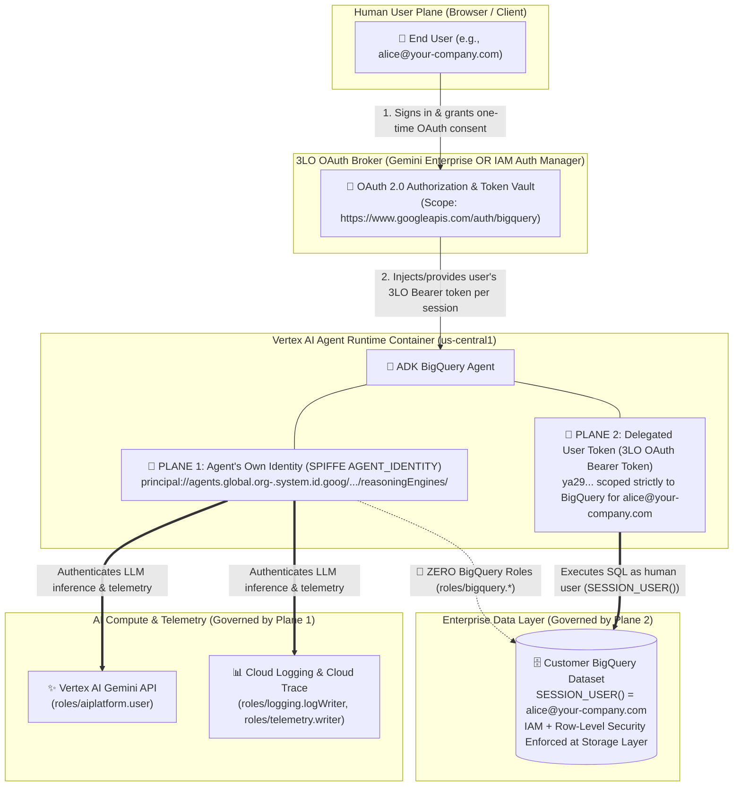
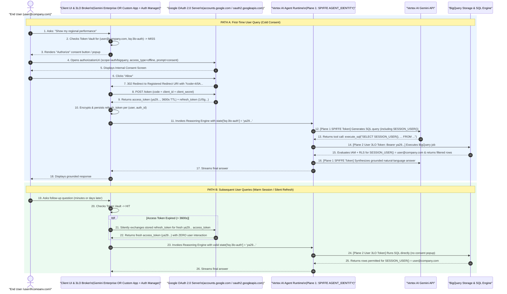

# Step-by-Step Guide: Setting Up BigQuery 3-Legged OAuth (3LO) & Agent Identity

**Customer Documentation Navigation**:
[🏠 Repository Hub (`README.md`)](../README.md) · **Guide 1: Step-by-Step 3LO Setup** · [🏗️ Guide 2: 3LO Options & 2LO Comparison](02_3LO_ARCHITECTURAL_OPTIONS_AND_2LO_COMPARISON.md) · [🪪 Guide 3: Agent Identity vs. Service Accounts](03_AGENT_IDENTITY_VS_SERVICE_ACCOUNTS.md) · [🔐 Guide 4: Google Auth Platform & Troubleshooting](04_GOOGLE_AUTH_PLATFORM_AND_TROUBLESHOOTING.md) · [🌐 Guide 5: Extending 3LO & Security FAQ](05_EXTENDING_3LO_AND_SECURITY_FAQ.md)

---

This guide walks through the end-to-end engineering steps required to configure **3-Legged OAuth (3LO)** and **SPIFFE Agent Identity (`AGENT_IDENTITY`)** so an enterprise AI agent on **Vertex AI Agent Runtime** queries **BigQuery** strictly under the **logged-in human user's identity (`SESSION_USER()`)**.

> [!NOTE]
> **Bring Your Own BigQuery Tables & RLS Policies**:
> This guide assumes your organization already manages its own BigQuery datasets, IAM permissions, and Row-Level Security (RLS) policies. Whenever this repository references `retail_sales.weekly_store_sales` or personas such as `uno@`, `dos@`, `tres@`, and `admin@`, treat them strictly as **placeholder demo tables and test personas** used to validate per-user RLS filtering.

---

## 1. Executive Overview & The Dual Identity Plane

When an AI agent queries sensitive enterprise tables in BigQuery, relying on a single shared Service Account creates an immediate governance problem: BigQuery sees every query as coming from the agent's machine credential rather than the human employee asking the question. That breaks `SESSION_USER()` Row-Level Security, obscures Cloud Audit Logs, and exposes the entire table to prompt-injection attacks.

To solve this, production BigQuery agents on Google Cloud operate across **two strictly separated authentication planes simultaneously**:



### Why Both Planes Are Required

1. **Plane 1 — The Agent's Own Workload Identity (SPIFFE `AGENT_IDENTITY`)**:
   - **Principal Format**:
     `principal://agents.global.org-<ORG_ID>.system.id.goog/resources/aiplatform/projects/<PROJECT_NUMBER>/locations/<REGION>/reasoningEngines/<ENGINE_ID>`
   - **Purpose**: Authenticates the agent container to Google Cloud infrastructure so it can invoke Vertex AI Gemini models (`roles/aiplatform.user`), emit logs/traces (`roles/logging.logWriter`, `roles/telemetry.writer`), and—when using IAM Auth Manager—request brokered tokens (`roles/agentidentity.user`).
   - **Least-Privilege Guarantee**: Plane 1 is granted **zero** BigQuery roles (`roles/bigquery.*`). Even if application code or a prompt injection attempts to initialize a default `bigquery.Client()` using container credentials, BigQuery rejects the call with `403 Access Denied`.
2. **Plane 2 — The Delegated Human Identity (3-Legged OAuth / 3LO)**:
   - **Principal**: The logged-in human end-user (`alice@your-company.com`; represented in our demo scripts by placeholder users `uno@`, `dos@`, `tres@`, and `admin@`).
   - **Purpose**: Passes a user-consented OAuth 2.0 Bearer token (`https://www.googleapis.com/auth/bigquery`) into the agent's BigQuery toolset.
   - **Data Governance Guarantee**: Every BigQuery job runs under the human user's identity, ensuring BigQuery evaluates dataset IAM, Row Access Policies (`SESSION_USER()`), Column-Level Security policy tags, and Cloud Audit Logs (`principalEmail`) as that exact person.

---

### Master Responsibility Matrix: Console vs. CLI/API vs. Agent Code

Use this matrix as your architectural blueprint for where and when every piece of the 3LO + Agent Identity stack is configured:

| Step | Where It Happens | When It Happens | What Happens Under the Hood |
| :--- | :--- | :--- | :--- |
| **1. Customer BigQuery IAM & RLS Verification** | **BigQuery SQL / IAM**<br/>(`bq` CLI, Terraform, or BigQuery Studio) | **Pre-Existing / One-Time Data Setup** | End-users (or Google Workspace groups) receive `roles/bigquery.jobUser` + `roles/bigquery.dataViewer` and Row Access Policies (`FILTER USING (region = ...)`). The Agent Identity gets **no** BigQuery roles. |
| **2A. OAuth Consent Screen (Branding & Audience)** | **Google Cloud Console** (`APIs & Services > Google Auth Platform > Branding & Audience`) or IAP Brands API | **One-Time Project Setup** | Registers the project's OAuth Brand title, support email, and sets Audience to **Internal** (allowing Workspace users to consent to `auth/bigquery` without external app verification). |
| **2B. OAuth 2.0 Web Client & Redirect URIs** | **Google Cloud Console**<br/>(`APIs & Services > Google Auth Platform > Clients`) | **One-Time Project Setup** | Creates the OAuth 2.0 Web Application `client_id` and `client_secret` and whitelists the exact callback URL (`redirect_uri`) for your chosen 3LO broker (`adk web`, Gemini Enterprise, or IAM Auth Manager). |
| **3. Agent 3LO Credential Wiring** | **Agent Python Code**<br/>([`app/agent.py`](../retail-sales-agent/app/agent.py) or [`app/agent_auth_manager_example.py`](../retail-sales-agent/app/agent_auth_manager_example.py)) | **Dev-Time** | Configures `BigQueryToolset` with `BigQueryCredentialsConfig` + `_hybrid_3lo_get_valid_credentials` (Pattern A) OR `McpToolset` / `AuthenticatedFunctionTool` with `GcpAuthProviderScheme` (Pattern B). |
| **4A. Deploy Agent with SPIFFE `AGENT_IDENTITY`** | **CLI + Config File**<br/>([`app/.agent_engine_config.json`](../retail-sales-agent/app/.agent_engine_config.json) & `agents-cli deploy --agent-identity`) | **Deploy-Time** | Provisions the Vertex AI Reasoning Engine with `identityType: AGENT_IDENTITY` and mints its unique `principal://agents.global.org-...` SPIFFE identity. |
| **4B. Bind Plane 1 IAM Roles to Agent Identity** | **CLI / REST API**<br/>([`deploy/manage_ge_app.py --bind-agent-identity`](../deploy/manage_ge_app.py)) | **Deploy-Time (Post-Creation)** | Reads `spec.effectiveIdentity` from the newly created Reasoning Engine and grants `roles/aiplatform.user`, `roles/logging.logWriter`, and `roles/telemetry.writer` (plus `roles/agentidentity.user` if using Auth Manager). |
| **4C. Register OAuth Client in 3LO Broker & Publish Agent** | **CLI / REST API / Console**<br/>(`DiscoveryEngine Authorization` or `gcloud agent-identity auth-providers create`) | **Deploy-Time** | Stores the OAuth Client ID, Secret, and `authorizationUri` (`access_type=offline&prompt=consent`) in Gemini Enterprise (`bq-3lo-auth`) or IAM Auth Manager, links it to the agent, and sets `sharingConfig: ALL_USERS`. |
| **5A. First-Time User OAuth Consent (Cold Start)** | **End-User Browser + Google OAuth Server + 3LO Broker** | **Run-Time (First Query per User)** | Broker detects no stored token for the user, displays the **Authorize** popup, exchanges the resulting authorization `code` for an `access_token` (`ya29...`) + `refresh_token` (`1//...`), and stores the refresh token encrypted per user. |
| **5B. Delegated SQL Execution (Warm Turns)** | **3LO Broker + Agent Runtime + BigQuery API** | **Run-Time (Every User Prompt)** | Broker injects a valid `ya29...` token (silently refreshing via `refresh_token` if >1 hr old). Agent instantiates a per-request credential for `BigQueryToolset` and runs SQL where `SESSION_USER()` equals the human user. |

---

## 2. Step-by-Step Implementation (Console vs. CLI vs. Code)

### Step 1: Verify Customer BigQuery Permissions & RLS (Pre-Existing Data Layer)

Before connecting your agent, verify that your BigQuery project and target dataset enforce least-privilege access across all **three tiers of BigQuery security** for your human users while excluding the agent's machine identity:

1. **Tier A — Project-Level Compute Permission (`roles/bigquery.jobUser`)**:
   - Granted to human end-users (or Google Workspace groups) at the project level (`IAM & Admin > IAM`).
   - Allows the user's 3LO token to spin up serverless `SELECT` query jobs in the compute project, while granting **zero** permission to read any dataset or table.
2. **Tier B — Dataset / Table Metadata Permission (`roles/bigquery.dataViewer`)**:
   - Granted on the target dataset or table (`BigQuery Studio > Share > Manage permissions`).
   - Once Row-Level Security (RLS) is enabled on a table, `roles/bigquery.dataViewer` only grants table schema/metadata visibility—actual row visibility is governed strictly by Row Access Policies.
3. **Tier C — Storage-Layer Row-Level Security (`CREATE ROW ACCESS POLICY` / `roles/bigquery.filteredDataViewer`)**:
   - Attaches row-level filter predicates (`FILTER USING (region = 'North')` or dynamic lookup subqueries keyed by `SESSION_USER()`) and automatically binds `roles/bigquery.filteredDataViewer` to each grantee.
   - **Important — The "Implicit Deny Cliff"**: Creating the **first** Row Access Policy on a BigQuery table immediately revokes implicit row access for all other users (including Project Owners and Data Admins). Always include an explicit `FILTER USING (TRUE)` policy (such as `rls_admin_all_regions`) for your administrators or ETL service principals so they continue to see all rows.
   - **Storage-Layer Pre-Filtering (Immune to Prompt Injection)**: BigQuery evaluates RLS predicates at the storage scan layer *before* any user SQL `WHERE`, `JOIN`, or aggregation runs. Even if a user prompt-injects the agent into running `SELECT * FROM weekly_store_sales WHERE region = 'South'`, BigQuery intersects `WHERE (region = 'South') AND (region = 'North')` at scan time and returns `0 rows`.
4. **Agent Machine Identity (Plane 1)**:
   - **Zero BigQuery Roles**: Verify that neither `principal://agents.global...` nor the default Reasoning Engine service agent holds `roles/bigquery.dataViewer` or `roles/bigquery.admin` on your sensitive dataset.

*(In this demo repository, [`deploy/01_setup_bq_and_rls.sh`](../deploy/01_setup_bq_and_rls.sh) provisions the placeholder `retail_sales.weekly_store_sales` table and binds regional RLS policies for placeholder users `uno@`, `dos@`, `tres@`, and `admin@`. For your own tables, skip `01_setup_bq_and_rls.sh` and point `BQ_DATASET` and `BQ_TABLE` in the root `.env` file to your existing dataset.)*

---

### Step 2: Configure Google Auth Platform (Console: `APIs & Services > Google Auth Platform`)

Creating an OAuth 2.0 Web Application Client ID and Secret is a **one-time setup per GCP project** performed in the **Google Cloud Console**. (Google Cloud intentionally blocks automated CLI/API creation of generic Web Application OAuth clients to prevent unauthorized credential minting.)

#### 2.1 Configure Branding & Audience

1. Open the **Google Auth Platform Overview** in Google Cloud Console:
   `https://console.cloud.google.com/auth/overview?project=<YOUR_PROJECT_ID>`
2. Click **Branding** in the left navigation (`https://console.cloud.google.com/auth/branding?project=<YOUR_PROJECT_ID>`):
   - **App name**: Enter a clear enterprise name (e.g., `Enterprise BigQuery 3LO Agent`).
   - **User support email**: Select your admin email address.
3. Click **Audience** in the left navigation (`https://console.cloud.google.com/auth/audience?project=<YOUR_PROJECT_ID>`):
   - **User Type**: Select **Internal** if all users belong to your Google Workspace / Cloud Identity organization, or **External** if serving external partner domains.
   > [!TIP]
   > **Why `Internal` Audience Is Recommended for Enterprise Deployments**:
   > Setting Audience to **Internal** allows anyone in your Google Workspace domain to immediately consent to sensitive scopes like `https://www.googleapis.com/auth/bigquery` without requiring external Google OAuth App Verification or showing an "Unverified App" warning screen.

*(Note: [`deploy/manage_ge_app.py`](../deploy/manage_ge_app.py) also automates creation of the Internal OAuth Brand via the IAP Brands API `POST https://iap.googleapis.com/v1/projects/<PROJECT_NUMBER>/brands` if one does not yet exist.)*

#### 2.2 Create the OAuth 2.0 Web Application Client ID & Secret

1. Open **Google Auth Platform → Clients**:
   `https://console.cloud.google.com/auth/clients?project=<YOUR_PROJECT_ID>`
2. Click **+ Create Client** at the top of the page.
3. Select **Application type**: **Web application**.
4. Enter **Name**: `bq-3lo-agent-web-client`.
5. Under **Authorized redirect URIs**, click **+ Add URI** and add the exact callback URLs corresponding to the 3LO broker/frontend(s) you plan to use.

#### 2.3 Crucial Redirect URI Table (By 3LO Broker / Frontend)

During a 3-Legged OAuth flow, Google's authorization server (`accounts.google.com`) redirects the user's browser back to the **3LO Broker or UI Frontend** that initiated the handshake so that broker can exchange the temporary `code` for an `access_token` and `refresh_token`. Therefore, **the Authorized Redirect URI you register on your OAuth Web Client depends on which broker/frontend handles the callback** (you can register all three on the same Web Client!):

| 3LO Broker / Frontend Surface | Exact Authorized Redirect URI to Add in Console | Why This URI Is Required & Common Gotchas |
| :--- | :--- | :--- |
| **1. Local ADK Web UI**<br/>(`adk web` / `agents-cli playground`) | `http://localhost:8000/dev-ui/`<br/>*(and optionally `http://127.0.0.1:8000/dev-ui/`)* | Used during local browser testing when ADK's built-in `GoogleCredentialsManager` runs the OAuth loop directly in the developer UI. **Must include the trailing slash `/`** or Google OAuth returns `Error 400: redirect_uri_mismatch`. |
| **2. Gemini Enterprise Web App**<br/>(`DiscoveryEngine Authorization`) | `https://vertexaisearch.cloud.google.com/oauth-redirect` | **Mandatory for Gemini Enterprise (`serverSideOauth2`)**. When a user clicks **Authorize** in the Gemini Enterprise chat UI, Google redirects the authorization code to this exact global endpoint. *(Never use the deprecated `/static/oauth/oauth.html` path.)* |
| **3. Google Cloud IAM Auth Manager**<br/>(`agentidentity.googleapis.com/v1` `authProviders`) | `https://agentidentitycredentials.googleapis.com/v1/projects/<PROJECT_ID>/locations/<LOCATION>/authProviders/<AUTH_PROVIDER_NAME>/oauthcallback` | **Mandatory when using IAM Auth Manager (`GcpAuthProvider`)** for custom frontends or BigQuery MCP (`https://bigquery.googleapis.com/mcp`). Replace `<PROJECT_ID>`, `<LOCATION>` (e.g., `us-central1`), and `<AUTH_PROVIDER_NAME>` with your Auth Provider's exact resource identifiers. |

6. Click **Create**, then copy your `Client ID` and `Client Secret` into `OAUTH_CLIENT_ID` and `OAUTH_CLIENT_SECRET` in the root `.env` file (or save the downloaded `client_secret_*.json` file into the root of your repository).

---

### Step 3: Configure 3LO in Agent Code (`app/agent.py` & `app/agent_auth_manager_example.py`)

This repository includes working reference implementations for **both** official Google Cloud ADK 3LO patterns. Choose **Pattern A** or **Pattern B** based on your architecture (see [Guide 2](02_3LO_ARCHITECTURAL_OPTIONS_AND_2LO_COMPARISON.md) for a full comparison).

---

#### Pattern A: Native ADK `BigQueryToolset` + Hybrid 3LO Resolver ([`retail-sales-agent/app/agent.py`](../retail-sales-agent/app/agent.py))

**Best for**: **Gemini Enterprise Web App**, **Custom Frontends passing a user OAuth token in session state**, and **local `adk web` development**.

In [`retail-sales-agent/app/agent.py`](../retail-sales-agent/app/agent.py), 3LO is wired in two parts:

```python
# From retail-sales-agent/app/agent.py (Lines 74-135)
def _extract_token(val: object) -> Optional[str]:
    if isinstance(val, str) and val.strip():
        return val.strip()
    if isinstance(val, dict):
        tok = val.get("access_token") or (val.get("oauth2") or {}).get("access_token")
        return tok.strip() if isinstance(tok, str) and tok.strip() else None
    return None


async def _hybrid_3lo_get_valid_credentials(
    self: GoogleCredentialsManager, tool_context: ToolContext
) -> Optional[google.auth.credentials.Credentials]:
    """Resolves user OAuth credentials across Gemini Enterprise 3LO, Custom Frontends, local dev ADC, and ADK Web."""
    auth_id = SETTINGS["GEMINI_AUTH_ID"]  # Default: "bq-3lo-auth"
    state_dict = (
        tool_context.state.to_dict()
        if hasattr(tool_context.state, "to_dict")
        else dict(tool_context.state)
    )

    # 1. Gemini Enterprise 3LO & Custom Frontend Token Injection:
    #    - Gemini Enterprise injects the user's OAuth token under AUTH_ID (or .../authorizations/AUTH_ID).
    #    - Custom frontends can pass the user's 3LO token in session state under AUTH_ID or 'custom_access_token'.
    candidate_keys = (
        auth_id,
        f"temp:{auth_id}",
        "custom_access_token",
        "user_access_token",
        "bq_access_token",
    )
    for key in candidate_keys:
        if token := _extract_token(tool_context.state.get(key)):
            return google.oauth2.credentials.Credentials(token=token)
    for key, val in state_dict.items():
        if key.endswith(f"/authorizations/{auth_id}") and (token := _extract_token(val)):
            return google.oauth2.credentials.Credentials(token=token)

    # 2. Local ADC Fallback: only when explicitly requested via BQ_FORCE_LOCAL_ADC=true or no OAuth client is set
    if os.environ.get("BQ_FORCE_LOCAL_ADC", "").lower() == "true" or not SETTINGS["OAUTH_CLIENT_ID"]:
        return google.auth.default(scopes=["https://www.googleapis.com/auth/bigquery"])[0]

    # 3. ADK Web / Custom Frontend Interactive OAuth: delegate to ADK's built-in 3LO OAuth consent flow
    return await _ORIG_GET_VALID_CREDENTIALS(self, tool_context)


GoogleCredentialsManager.get_valid_credentials = _hybrid_3lo_get_valid_credentials

bigquery_toolset = BigQueryToolset(
    credentials_config=BigQueryCredentialsConfig(
        client_id=SETTINGS["OAUTH_CLIENT_ID"] or "CONFIGURE_OAUTH_CLIENT_ID",
        client_secret=SETTINGS["OAUTH_CLIENT_SECRET"] or "CONFIGURE_OAUTH_CLIENT_SECRET",
        scopes=["https://www.googleapis.com/auth/bigquery"],
    ),
    bigquery_tool_config=BigQueryToolConfig(
        write_mode=WriteMode.BLOCKED,
        compute_project_id=SETTINGS["PROJECT_ID"],
        location=SETTINGS["BQ_LOCATION"],
        application_name="bq-3lo-retail-sales-agent",
        job_labels={"app": "bq-3lo-agent"},
    ),
    tool_filter=["execute_sql", "get_table_info", "list_dataset_ids", "list_table_ids"],
)
```

##### Line-by-Line Explanation: What Happens in Code

1. **`tool_context.state` Lookup (Lines 97–109)**:
   - When Gemini Enterprise invokes your deployed Reasoning Engine, it has *already* completed the server-side 3LO OAuth handshake using its `Authorization` resource (`bq-3lo-auth`) and injects the user's fresh OAuth `access_token` (`ya29...`) into the ADK session state dictionary under `"bq-3lo-auth"` (or `"projects/.../authorizations/bq-3lo-auth"`).
   - Similarly, a custom web/mobile frontend (see [`scripts/custom_frontend_3lo_client_example.py`](../scripts/custom_frontend_3lo_client_example.py)) can inject the user's OAuth token into `session.state["bq-3lo-auth"]` or `session.state["custom_access_token"]`.
   - `_hybrid_3lo_get_valid_credentials` inspects `tool_context.state` on every tool invocation and immediately wraps that short-lived Bearer token in `google.oauth2.credentials.Credentials(token=token)`.
2. **Why 3LO Credentials Are Created Per-Request and Never Cached Globally**:
   - Notice that `google.oauth2.credentials.Credentials(token=token)` is instantiated fresh inside `_hybrid_3lo_get_valid_credentials` on **every tool call** using `tool_context.state`.
   - **Never store user credentials in a module-level global variable or singleton client**—a single Reasoning Engine container serves concurrent requests from multiple users (`alice@`, `bob@`). Creating the credential per tool call from `tool_context.state` guarantees strict request-level isolation.
3. **Interactive OAuth Fallback for `adk web` (Line 116)**:
   - When a developer tests locally via `adk web` (where no Gemini Enterprise portal sits in front of the agent), `tool_context.state` does not contain a pre-injected token. The resolver delegates to ADK's built-in `_ORIG_GET_VALID_CREDENTIALS`, which uses `BigQueryCredentialsConfig(client_id=..., client_secret=...)` to render an interactive OAuth consent prompt right inside the `adk web` browser UI (`http://localhost:8000/dev-ui/`).
4. **How `BigQueryToolset` Passes the User's Bearer Token to BigQuery (Lines 121–135)**:
   - On each `execute_sql` or `get_table_info` call, `BigQueryToolset` invokes `GoogleCredentialsManager.get_valid_credentials(tool_context)` and passes the returned `Credentials(token=...)` object to `google.cloud.bigquery.Client(project=compute_project_id, credentials=creds)`.
   - The BigQuery REST API receives `Authorization: Bearer ya29...` belonging to the human user, billing compute slots to `compute_project_id` while evaluating IAM and `SESSION_USER()` RLS policies as that human user.

---

#### Pattern B: IAM Auth Manager v2 (`GcpAuthProvider` + `GcpAuthProviderScheme`) ([`retail-sales-agent/app/agent_auth_manager_example.py`](../retail-sales-agent/app/agent_auth_manager_example.py))

**Best for**: Connecting to **Google's Managed BigQuery MCP Server (`https://bigquery.googleapis.com/mcp`)** via `McpToolset` OR wrapping custom Python functions in **`AuthenticatedFunctionTool`** backed by **Google Cloud IAM Auth Manager (`agentidentity.googleapis.com/v1`)**.

```python
# From retail-sales-agent/app/agent_auth_manager_example.py (Lines 86-145)
from google.adk.auth.auth_credential import AuthCredential
from google.adk.auth.auth_tool import AuthConfig
from google.adk.auth.credential_manager import CredentialManager
from google.adk.integrations.agent_identity import GcpAuthProvider, GcpAuthProviderScheme
from google.adk.tools.authenticated_function_tool import AuthenticatedFunctionTool
from google.adk.tools.mcp_tool.mcp_session_manager import StreamableHTTPConnectionParams
from google.adk.tools.mcp_tool.mcp_toolset import McpToolset
from google.cloud import bigquery
import google.oauth2.credentials

AUTH_PROVIDER_3LO_NAME = (
    f"projects/{PROJECT_ID}/locations/{LOCATION}/authProviders/bigquery-3lo-authprovider"
)
CONTINUE_URI = "http://127.0.0.1:8501/validateUserId"

# Pattern B1: Managed BigQuery MCP Server (https://bigquery.googleapis.com/mcp)
def build_bigquery_mcp_3lo_toolset() -> McpToolset:
    CredentialManager.register_auth_provider(GcpAuthProvider())

    bigquery_mcp_auth_scheme = GcpAuthProviderScheme(
        name=AUTH_PROVIDER_3LO_NAME,
        scopes=["https://www.googleapis.com/auth/bigquery"],
        continue_uri=CONTINUE_URI,
    )
    return McpToolset(
        connection_params=StreamableHTTPConnectionParams(url="https://bigquery.googleapis.com/mcp"),
        auth_scheme=bigquery_mcp_auth_scheme,
        errlog=None,
    )

# Pattern B2: Custom Python Function wrapped in AuthenticatedFunctionTool
async def query_bigquery_with_3lo_token(
    credential: AuthCredential, sql_query: str
) -> dict:
    token = credential.http.credentials.token
    # Per-request client bound to this user's short-lived 3LO Bearer token
    user_creds = google.oauth2.credentials.Credentials(token=token)
    bq_client = bigquery.Client(project=PROJECT_ID, credentials=user_creds)
    rows = [dict(row.items()) for row in bq_client.query(sql_query).result()]
    return {"status": "success", "row_count": len(rows), "rows": rows}

def build_authenticated_function_3lo_tool() -> AuthenticatedFunctionTool:
    CredentialManager.register_auth_provider(GcpAuthProvider())
    return AuthenticatedFunctionTool(
        func=query_bigquery_with_3lo_token,
        auth_config=AuthConfig(
            auth_scheme=GcpAuthProviderScheme(
                name=AUTH_PROVIDER_3LO_NAME,
                scopes=["https://www.googleapis.com/auth/bigquery"],
                continue_uri=CONTINUE_URI,
            )
        ),
    )
```

- **How Pattern B Works**:
  1. `CredentialManager.register_auth_provider(GcpAuthProvider())` registers the Google Cloud IAM Auth Manager plugin (`pip install "google-adk[agent-identity]"`).
  2. `GcpAuthProviderScheme` points to the regional `authProviders` resource (`projects/<PROJECT_ID>/locations/<LOCATION>/authProviders/<NAME>`) and specifies the client callback `continue_uri` (`/validateUserId`).
  3. At runtime, the agent uses its **Plane 1 SPIFFE Agent Identity** (which holds `roles/agentidentity.user` on the Auth Provider) to request a 3LO user token from `agentidentitycredentials.googleapis.com` and passes that token either to `https://bigquery.googleapis.com/mcp` (`McpToolset`) or into `credential.http.credentials.token` (`AuthenticatedFunctionTool`).

---

### Step 4: Deploy with SPIFFE Agent Identity & Register 3LO Broker (Deploy-Time CLI & Console)

#### 4.1 Configure & Deploy SPIFFE `AGENT_IDENTITY` on Vertex AI Agent Runtime

1. **Declarative Config ([`retail-sales-agent/app/.agent_engine_config.json`](../retail-sales-agent/app/.agent_engine_config.json))**:
   ```json
   {
     "identity_type": "AGENT_IDENTITY"
   }
   ```
2. **Deploy Command (Executed by [`deploy/02_deploy_agent_and_ge.sh`](../deploy/02_deploy_agent_and_ge.sh))**:
   ```bash
   cd retail-sales-agent
   agents-cli deploy -d agent_runtime \
     --project "${PROJECT_ID}" \
     --region "${REGION}" \
     --service-name "retail-sales-agent-id" \
     --agent-identity \
     --no-confirm-project
   ```
3. **Inspect the Newly Minted SPIFFE Principal**:
   Once deployed, Vertex AI Agent Runtime assigns an immutable cryptographic identity under `spec.effectiveIdentity`:
   ```text
   principal://agents.global.org-<ORG_ID>.system.id.goog/resources/aiplatform/projects/<PROJECT_NUMBER>/locations/<REGION>/reasoningEngines/<ENGINE_ID>
   ```

#### 4.2 Grant Plane 1 Least-Privilege IAM Roles to the SPIFFE Principal

Because a brand-new `AGENT_IDENTITY` starts with **zero IAM permissions**, you must grant it Plane 1 runtime roles *after* the Reasoning Engine resource is created (automated in [`deploy/02_deploy_agent_and_ge.sh`](../deploy/02_deploy_agent_and_ge.sh) via `python3 deploy/manage_ge_app.py --project-id "${PROJECT_ID}" --bind-agent-identity "${AGENT_RUNTIME_ID}"`):

```bash
export PRINCIPAL="principal://agents.global.org-<ORG_ID>.system.id.goog/resources/aiplatform/projects/<PROJECT_NUMBER>/locations/<REGION>/reasoningEngines/<ENGINE_ID>"

# Grant Plane 1 AI Compute & Observability roles (NO BigQuery roles!)
for ROLE in \
  roles/aiplatform.user \
  roles/logging.logWriter \
  roles/telemetry.writer \
  roles/monitoring.metricWriter \
  roles/serviceusage.serviceUsageConsumer; do
  gcloud projects add-iam-policy-binding "${PROJECT_ID}" \
    --member="${PRINCIPAL}" \
    --role="${ROLE}"
done
```

#### 4.3 Register Your OAuth Client in the 3LO Broker

Depending on whether you use **Gemini Enterprise** (Pattern A) or **IAM Auth Manager** (Pattern B), register your OAuth 2.0 Web Client credentials as follows:

##### Broker Option 1: Gemini Enterprise (`DiscoveryEngine Authorization` — Used in [`deploy/02_deploy_agent_and_ge.sh`](../deploy/02_deploy_agent_and_ge.sh))

1. **Create the Discovery Engine `Authorization` Resource (`bq-3lo-auth`)**:
   ```bash
   curl -X POST \
     -H "Authorization: Bearer $(gcloud auth print-access-token)" \
     -H "Content-Type: application/json" \
     -H "x-goog-user-project: ${PROJECT_ID}" \
     "https://discoveryengine.googleapis.com/v1alpha/projects/${PROJECT_NUMBER}/locations/global/authorizations?authorizationId=bq-3lo-auth" \
     -d '{
       "name": "projects/'"${PROJECT_NUMBER}"'/locations/global/authorizations/bq-3lo-auth",
       "serverSideOauth2": {
         "clientId": "<OAUTH_CLIENT_ID>",
         "clientSecret": "<OAUTH_CLIENT_SECRET>",
         "authorizationUri": "https://accounts.google.com/o/oauth2/v2/auth?client_id=<OAUTH_CLIENT_ID>&scope=https%3A%2F%2Fwww.googleapis.com%2Fauth%2Fbigquery&include_granted_scopes=true&response_type=code&access_type=offline&prompt=consent",
         "tokenUri": "https://oauth2.googleapis.com/token"
       }
     }'
   ```
2. **Publish the Agent with `--authorization-id` and Enable `ALL_USERS` Sharing**:
   ```bash
   agents-cli publish gemini-enterprise \
     --registration-type adk \
     --agent-runtime-id "projects/${PROJECT_NUMBER}/locations/${REGION}/reasoningEngines/${ENGINE_ID}" \
     --gemini-enterprise-app-id "projects/${PROJECT_NUMBER}/locations/global/collections/default_collection/engines/${GE_APP_ID}" \
     --display-name "OmniRetail BigQuery 3LO Sales Agent" \
     --description "Analyzes BigQuery data using per-user 3LO and Row-Level Security." \
     --tool-description "Analyzes BigQuery data using per-user 3LO and Row-Level Security." \
     --project-id "${PROJECT_ID}" \
     --project-number "${PROJECT_NUMBER}" \
     --authorization-id "projects/${PROJECT_NUMBER}/locations/global/authorizations/bq-3lo-auth"
   ```
   *(Followed by [`deploy/manage_ge_app.py --finalize-agent-display-name`](../deploy/manage_ge_app.py) to patch `sharingConfig: {"scope": "ALL_USERS"}`.)*

##### Broker Option 2: Google Cloud IAM Auth Manager (`agentidentity.googleapis.com/v1` — For Pattern B)

1. **Create the Regional 3LO `AuthProvider` Resource**:
   ```bash
   gcloud alpha agent-identity auth-providers create bigquery-3lo-authprovider \
     --project="${PROJECT_ID}" \
     --location="us-central1" \
     --oauth-client-id="<OAUTH_CLIENT_ID>" \
     --oauth-client-secret="<OAUTH_CLIENT_SECRET>" \
     --authorization-uri="https://accounts.google.com/o/oauth2/v2/auth" \
     --token-uri="https://oauth2.googleapis.com/token"
   ```
2. **Grant `roles/agentidentity.user` on the Auth Provider to the Agent's SPIFFE Principal**:
   ```bash
   gcloud alpha agent-identity auth-providers add-iam-policy-binding bigquery-3lo-authprovider \
     --project="${PROJECT_ID}" \
     --location="us-central1" \
     --member="${PRINCIPAL}" \
     --role="roles/agentidentity.user"
   ```

---

## 3. Dev-Time vs. Deploy-Time vs. Run-Time Deep Dive (Under the Hood)

To understand what happens when an end-user actually chats with the deployed agent, compare **Path A (First-Time User Query / Cold Consent)** and **Path B (Subsequent User Queries / Warm Session & Silent Refresh)**:



### Step-by-Step Lifecycle Breakdown

1. **First-Time User Query (Cold Consent — Steps 1–18)**:
   - When `user@company.com` sends their first prompt, the 3LO broker checks its encrypted token store for a credential matching `(user@company.com, bq-3lo-auth)`.
   - Because none exists yet, the UI pauses before invoking the tool and presents the **Authorize** button.
   - Clicking **Authorize** opens Google's OAuth 2.0 server with `scope=https://www.googleapis.com/auth/bigquery`, `access_type=offline`, and `prompt=consent`.
   - Once the user clicks **Allow**, Google redirects to the registered Redirect URI (`https://vertexaisearch.cloud.google.com/oauth-redirect` for Gemini Enterprise, or `.../oauthcallback` for IAM Auth Manager).
   - The broker exchanges the one-time `code` for both a short-lived `access_token` (`ya29...`, valid for 1 hour) and a long-lived `refresh_token` (`1//0g...`), stores the tokens encrypted under that user's identity, and passes `ya29...` into the agent session.
   - Inside the container, the agent uses **Plane 1 (`AGENT_IDENTITY`)** to call Gemini and **Plane 2 (`ya29...`)** to execute the SQL query in BigQuery with `SESSION_USER() = user@company.com`.
2. **Subsequent User Queries (Warm Session & Silent Refresh — Steps 19–26)**:
   - On every subsequent turn in the same session, the valid `ya29...` token is reused immediately without prompting the user.
   - If the user returns hours or days later after the 1-hour `access_token` has expired, the broker automatically uses the stored `refresh_token` (`access_type=offline`) to mint a fresh `ya29...` token behind the scenes—so **the user never sees the consent screen again** unless they explicitly revoke access in their Google Account settings.

### 3.1 Verifying Per-User Execution & RLS Policies in Cloud Audit Logs

You can prove to security and compliance auditors that the BigQuery engine evaluated the query under the **human user's identity** (not a shared agent service account) by inspecting **Cloud Audit Logs (Data Access Logs)**:

1. Open **Cloud Console -> Logging -> Logs Explorer**: `https://console.cloud.google.com/logs/query?project=<YOUR_PROJECT_ID>`
2. Run the following query to inspect BigQuery `tableDataRead` events:
   ```text
   resource.type="bigquery_dataset"
   protoPayload.serviceName="bigquery.googleapis.com"
   protoPayload.metadata.tableDataRead:*
   ```
3. Expand the most recent log entry and verify the following two fields inside `protoPayload`:
   - **`protoPayload.authenticationInfo.principalEmail`**: Shows the human end-user's email (e.g., `uno@your-company.com` or `dos@your-company.com`), **never** a shared backend service account.
   - **`protoPayload.metadata.tableDataRead.rowAccessPolicies`**: Lists the exact BigQuery Row-Level Access Policy evaluated during the storage scan (e.g., `projects/<YOUR_PROJECT_ID>/datasets/retail_sales/tables/weekly_store_sales/rowAccessPolicies/rls_north_region`).

---

## 4. Caveats & How to Adapt for Other Scenarios

### 4.1 Numeric `GOOGLE_CLOUD_PROJECT` Inside Vertex AI Agent Runtime Containers

> [!WARNING]
> **Critical Runtime Pitfall**: Inside a deployed Vertex AI Agent Runtime (Reasoning Engine) container, Google Cloud automatically sets the environment variable `GOOGLE_CLOUD_PROJECT` to the **numeric project number** (e.g., `123456789012`) rather than the **alphanumeric project ID** (e.g., `your-gcp-project-id`).

- **Why It Matters**: If your agent prompt or SQL generator interpolates `os.environ["GOOGLE_CLOUD_PROJECT"]` into a fully qualified BigQuery table name (e.g., ``SELECT * FROM `123456789012.retail_sales.weekly_store_sales` ``), BigQuery table resolution or RLS metadata checks may fail or confuse the LLM.
- **How [`app/agent.py`](../retail-sales-agent/app/agent.py) Prevents It**:
  [`app/agent.py`](../retail-sales-agent/app/agent.py) explicitly checks `if env_proj.isdigit(): env_proj = ""` and resolves the alphanumeric `PROJECT_ID` from `BQ_PROJECT_ID` (passed at container deployment via `--set-env-vars` / `env_vars` from the root `.env` file). Always pass an explicit alphanumeric `BQ_PROJECT_ID` when constructing SQL table references and `BigQueryToolConfig(compute_project_id=...)`.

### 4.2 Multi-User Licensing, `AclConfig` (`idpType=GSUITE`), and `sharingConfig: ALL_USERS` in Gemini Enterprise

When multiple users in your organization access a 3LO agent through **Gemini Enterprise**, three platform settings must be active (all three are automated by [`deploy/manage_ge_app.py`](../deploy/manage_ge_app.py)):

1. **Per-User Gemini Enterprise License (`userLicenses`)**: Every end-user must hold an active `ASSIGNED` license in `default_user_store` (or `enableLicenseAutoRegister: true` linked to an active `LicenseConfig`). Without a license, users receive `HTTP 400: You are not assigned an active license`.
2. **Workspace Identity Provider (`AclConfig: idpType = GSUITE`) + Project IAM**: The project's global Discovery Engine `aclConfig` must be set to `GSUITE`, and users (or your domain group `domain:your-company.com`) need `roles/discoveryengine.user` + `roles/discoveryengine.viewer`. Without this, opening the web app returns `403 PERMISSION_DENIED: WidgetService.LookupWidgetConfig`.
3. **Agent-Level Sharing (`sharingConfig: {"scope": "ALL_USERS"}`)**: Newly published agents in Gemini Enterprise default to private creator-only visibility. Patching `sharingConfig.scope = "ALL_USERS"` ensures every licensed user in the app sees and can invoke the agent.

### 4.3 Adapting for Custom Frontends (`scripts/custom_frontend_3lo_client_example.py`) vs. Gemini Enterprise

If you are building your own **React, Next.js, Streamlit, or FastAPI frontend** instead of (or in addition to) Gemini Enterprise, you do **not** need to rewrite [`app/agent.py`](../retail-sales-agent/app/agent.py):

- Examine [`scripts/custom_frontend_3lo_client_example.py`](../scripts/custom_frontend_3lo_client_example.py): your custom frontend simply authenticates the user with Google OAuth (`scope=https://www.googleapis.com/auth/bigquery`) and passes the user's `access_token` inside `remote_agent.create_session(user_id=..., state={"bq-3lo-auth": user_oauth_token})`.
- Because `_hybrid_3lo_get_valid_credentials` in [`app/agent.py`](../retail-sales-agent/app/agent.py) checks `tool_context.state["bq-3lo-auth"]` and `tool_context.state["custom_access_token"]`, **the exact same deployed Reasoning Engine serves both Gemini Enterprise and your custom frontend simultaneously**. See [Guide 2](02_3LO_ARCHITECTURAL_OPTIONS_AND_2LO_COMPARISON.md) for the complete dual-consumption architecture.

---

**Next Guide**: [🏗️ Guide 2: BigQuery 3LO Architectural Options, Dual Consumption & 2LO vs. 3LO Comparison →](02_3LO_ARCHITECTURAL_OPTIONS_AND_2LO_COMPARISON.md)
