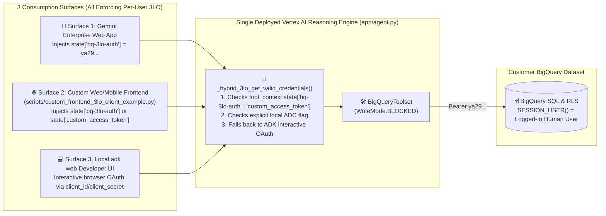

# BigQuery 3LO Architectural Options, Dual Consumption & 2LO vs. 3LO Comparison

**Customer Documentation Navigation**:
[🏠 Repository Hub (`README.md`)](../README.md) · [🛠️ Guide 1: Step-by-Step 3LO Setup](01_STEP_BY_STEP_BQ_3LO_SETUP_GUIDE.md) · **Guide 2: 3LO Options & 2LO Comparison** · [🪪 Guide 3: Agent Identity vs. Service Accounts](03_AGENT_IDENTITY_VS_SERVICE_ACCOUNTS.md) · [🔐 Guide 4: Google Auth Platform & Troubleshooting](04_GOOGLE_AUTH_PLATFORM_AND_TROUBLESHOOTING.md) · [🌐 Guide 5: Extending 3LO & Security FAQ](05_EXTENDING_3LO_AND_SECURITY_FAQ.md)

---

When architecting an enterprise AI agent on **Vertex AI Agent Runtime** that accesses **BigQuery**, Google Cloud and the **Agent Development Kit (ADK)** provide two official patterns for **3-Legged OAuth (3LO)**, plus native support for **2-Legged OAuth (2LO)** when machine-to-machine authentication is appropriate.

This guide compares both 3LO patterns side-by-side, shows how to consume the **same deployed agent** from both **Gemini Enterprise** and a **Custom Frontend**, and explains how your setup changes if a workload requires **2LO**.

---

## 1. The Two Official Google Cloud 3LO Patterns for ADK Agents

Both patterns enforce per-user BigQuery access (`SESSION_USER()`) and pair with **SPIFFE Agent Identity (`AGENT_IDENTITY`)** on Plane 1, but they differ in **which Google Cloud service brokers the OAuth token** and **which ADK tool abstraction consumes it**:

- **Option A — Gemini Enterprise (`DiscoveryEngine Authorization`) + Native ADK `BigQueryToolset`** (implemented in [`retail-sales-agent/app/agent.py`](../retail-sales-agent/app/agent.py))
- **Option B — Google Cloud IAM Auth Manager v2 (`agentidentity.googleapis.com` `authProviders`) + `GcpAuthProviderScheme` + BigQuery MCP / `AuthenticatedFunctionTool`** (implemented in [`retail-sales-agent/app/agent_auth_manager_example.py`](../retail-sales-agent/app/agent_auth_manager_example.py))

```mermaid
flowchart TB
    subgraph OptionA["OPTION A: Gemini Enterprise + Native ADK BigQueryToolset (app/agent.py)"]
        direction LR
        U1["👤 End User"] -->|"OAuth Consent\n(/oauth-redirect)"| GE["🏢 Gemini Enterprise\n(DiscoveryEngine Authorization:\nbq-3lo-auth)"]
        GE -->|"Injects token in\nsession.state['bq-3lo-auth']"| RE1["🤖 Agent Runtime\n(_hybrid_3lo_get_valid_credentials\n+ BigQueryToolset)"]
        RE1 -->|"google-cloud-bigquery\nBearer ya29..."| BQ1[("🗄️ BigQuery API\n(SESSION_USER())")]
    end

    subgraph OptionB["OPTION B: IAM Auth Manager v2 + GcpAuthProviderScheme (app/agent_auth_manager_example.py)"]
        direction LR
        U2["👤 End User"] -->|"1. OAuth Consent (/oauthcallback)\n2. Redirects consent_nonce to\nClient /validateUserId"| CUI["🌐 Custom Client App\n(Calls credentials:finalize\nwith consent_nonce)"]
        CUI <-->|"Streams ADK Events"| RE2["🤖 Agent Runtime\n(SPIFFE AGENT_IDENTITY\n+ GcpAuthProviderScheme)"]
        RE2 <-->|"Plane 1 SPIFFE Token\n(roles/agentidentity.user)"| AM["🔐 IAM Auth Manager\n(agentidentity.googleapis.com\nauthProviders)"]
        RE2 -->|"McpToolset OR\nAuthenticatedFunctionTool"| BQ2[("🗄️ BigQuery MCP Server\n(bigquery.googleapis.com/mcp)\nOR BigQuery Python Client")]
    end
```



### Side-by-Side Comparison Matrix: Option A vs. Option B

| Architectural Dimension | Option A: Gemini Enterprise + `BigQueryToolset` ([`app/agent.py`](../retail-sales-agent/app/agent.py)) | Option B: IAM Auth Manager v2 + `GcpAuthProviderScheme` ([`app/agent_auth_manager_example.py`](../retail-sales-agent/app/agent_auth_manager_example.py)) |
| :--- | :--- | :--- |
| **Reference File in This Repo** | [`retail-sales-agent/app/agent.py`](../retail-sales-agent/app/agent.py) | [`retail-sales-agent/app/agent_auth_manager_example.py`](../retail-sales-agent/app/agent_auth_manager_example.py) |
| **Primary UI Surface** | **Gemini Enterprise Web App**, **Local `adk web`**, and **Custom Frontends** via state injection | **Custom Web/Mobile Frontends** implementing `/validateUserId` (`credentials:finalize`) |
| **OAuth Token Broker & Vault** | **Discovery Engine `Authorization`** (`projects/<NUM>/locations/global/authorizations/bq-3lo-auth`) | **IAM Auth Manager `AuthProvider`** (`projects/<ID>/locations/<REGION>/authProviders/<NAME>`) |
| **Registered OAuth Redirect URI** | `https://vertexaisearch.cloud.google.com/oauth-redirect` *(plus `http://localhost:8000/dev-ui/` for local `adk web`)* | `https://agentidentitycredentials.googleapis.com/v1/projects/<ID>/locations/<LOC>/authProviders/<NAME>/oauthcallback` |
| **ADK Tool Class** | `BigQueryToolset` (`from google.adk.integrations.bigquery import BigQueryToolset`) | `McpToolset` (pointed at `https://bigquery.googleapis.com/mcp`) **OR** `AuthenticatedFunctionTool` |
| **ADK Credential Config Class** | `BigQueryCredentialsConfig(client_id=..., client_secret=..., scopes=[...])` + `GoogleCredentialsManager` | `GcpAuthProvider()` + `GcpAuthProviderScheme(name=..., scopes=[...], continue_uri=...)` |
| **Plane 1 Agent Identity Role Required for Broker** | Standard Plane 1 runtime roles (`roles/aiplatform.user`, `roles/logging.logWriter`, `roles/telemetry.writer`) | Standard Plane 1 runtime roles **PLUS** `roles/agentidentity.user` on the `AuthProvider` resource |
| **Client-Side `/validateUserId` Endpoint Needed?** | **No** — Gemini Enterprise (or `adk web`) completes the callback and token storage automatically | **Yes** — Your custom frontend must expose a `continue_uri` (e.g., `/validateUserId`) that receives `consent_nonce` and calls `credentials:finalize` |

---

### Trade-Offs & Technical Decision Matrix

#### 1. Why `BigQueryToolset` Uses `BigQueryCredentialsConfig` While `McpToolset` / `AuthenticatedFunctionTool` Uses `GcpAuthProviderScheme`

In the Google ADK Python SDK (`google-adk`), tool integrations use two distinct internal credential pipelines:

- **Native Google Cloud Toolsets (`BigQueryToolset`)**: Built on `GoogleCredentialsConfig` and `GoogleCredentialsManager` (`google.adk.tools._google_credentials`). They expect a `BigQueryCredentialsConfig` object and resolve tokens through `GoogleCredentialsManager.get_valid_credentials(tool_context)`.
- **MCP & Generic Authenticated Tools (`McpToolset`, `AuthenticatedFunctionTool`)**: Built on ADK's pluggable `CredentialManager` registry (`google.adk.auth.credential_manager`). By calling `CredentialManager.register_auth_provider(GcpAuthProvider())`, you plug Google Cloud's IAM Auth Manager (`GcpAuthProviderScheme`) directly into `McpToolset` (to authenticate against Google's managed BigQuery MCP server at `https://bigquery.googleapis.com/mcp`) or `AuthenticatedFunctionTool`.

#### 2. Why Option B Requires a Client Implementing `/validateUserId` (`credentials:finalize` with `consent_nonce`)

When using **IAM Auth Manager v2** (`agentidentity.googleapis.com/v1`), Google Cloud enforces an extra anti-CSRF / session-binding step (documented in [Configure user-delegated authentication (3LO)](https://docs.cloud.google.com/iam/docs/auth-with-3lo-v2#update-client)):

1. After the user approves the Google OAuth consent screen, Google redirects to `https://agentidentitycredentials.googleapis.com/v1/.../oauthcallback`.
2. IAM Auth Manager exchanges the OAuth `code` for tokens, generates a cryptographic **`consent_nonce`**, and redirects the user's browser to your application's **`continue_uri`** (e.g., `https://your-custom-ui.example.com/validateUserId?consent_nonce=...`).
3. Your custom frontend backend verifies the logged-in user's session and sends an authenticated `POST` request to `https://agentidentitycredentials.googleapis.com/v1/.../credentials:finalize` with `{"consentNonce": consent_nonce}` (see `finalize_auth_manager_3lo_consent()` in [`scripts/custom_frontend_3lo_client_example.py`](../scripts/custom_frontend_3lo_client_example.py)).
4. This binds the newly minted OAuth token to the authenticated session user inside IAM Auth Manager before the agent is allowed to use it.

#### 3. When to Choose Option A vs. Option B

- **Choose Option A ([`app/agent.py`](../retail-sales-agent/app/agent.py))** when:
  - Your users access the agent through **Gemini Enterprise** (or **both** Gemini Enterprise and a custom frontend).
  - You want zero custom OAuth callback endpoints to host or maintain.
  - You want first-class local testing in `adk web` (`http://localhost:8000/dev-ui/`).
- **Choose Option B ([`app/agent_auth_manager_example.py`](../retail-sales-agent/app/agent_auth_manager_example.py))** when:
  - You are building a **standalone custom web/mobile application** (without Gemini Enterprise) and want Google Cloud **IAM Auth Manager** to act as your centralized, regional token vault.
  - You want to connect your agent directly to **Google's Managed BigQuery MCP Server (`https://bigquery.googleapis.com/mcp`)** using `McpToolset`, or you are mixing BigQuery tools with third-party 3LO/2LO OAuth providers managed in IAM Auth Manager.

---

## 2. Consuming the Same Agent from Both Gemini Enterprise AND a Custom Frontend

A common enterprise requirement is deploying **one single Vertex AI Reasoning Engine** (`AGENT_IDENTITY`) and exposing it to **multiple user interfaces simultaneously**:

1. **Internal Workforce Portal**: **Gemini Enterprise Web App** (`vertexaisearch.cloud.google.com`)
2. **Custom Line-of-Business App**: A custom **React / Next.js / Streamlit / FastAPI** web or mobile application
3. **Developer Sandbox**: Local **`adk web`** UI (`http://localhost:8000/dev-ui/`)

Because [`retail-sales-agent/app/agent.py`](../retail-sales-agent/app/agent.py) uses `_hybrid_3lo_get_valid_credentials`, **all three surfaces work out-of-the-box against the exact same deployed Reasoning Engine without changing a single line of agent code**:



### How the Custom Frontend Calls the Deployed Agent ([`scripts/custom_frontend_3lo_client_example.py`](../scripts/custom_frontend_3lo_client_example.py))

When your custom frontend authenticates a user via Google Sign-In / OAuth 2.0 (requesting scope `https://www.googleapis.com/auth/bigquery`), it passes the user's OAuth access token in `state` when creating or updating the Vertex AI Reasoning Engine session:

```python
# From scripts/custom_frontend_3lo_client_example.py
import vertexai
from vertexai import agent_engines

vertexai.init(project="your-gcp-project-id", location="us-central1")
remote_agent = agent_engines.get(
    "projects/<YOUR_PROJECT_NUMBER>/locations/us-central1/reasoningEngines/<YOUR_ENGINE_ID>"
)

# 1. Create a session for the logged-in human user and inject their 3LO token into state
session = remote_agent.create_session(
    user_id="alice@your-company.com",
    state={
        "bq-3lo-auth": user_oauth_token,        # Matches GEMINI_AUTH_ID in app/agent.py
        "custom_access_token": user_oauth_token # Explicit alias for custom frontends
    },
)
session_id = session["id"] if isinstance(session, dict) else session.id

# 2. Stream the agent response — BigQuery executes SQL as alice@your-company.com!
for event in remote_agent.stream_query(
    user_id="alice@your-company.com",
    session_id=session_id,
    message="Which user am I authenticated as via SESSION_USER(), and what data can I see?",
):
    ...
```

You can test this directly from your terminal using any authenticated `gcloud` user profile:

```bash
python3 scripts/custom_frontend_3lo_client_example.py \
  --project-id "<YOUR_PROJECT_ID>" \
  --location "us-central1" \
  --reasoning-engine-id "<YOUR_REASONING_ENGINE_ID>" \
  --user-id "uno@<YOUR_DOMAIN>"
```

---

## 3. How Setup Changes If You Need 2-Legged OAuth (2LO — Machine-to-Machine)

Not every tool call requires per-user 3LO. Sometimes an agent needs to query a **shared enterprise product catalog**, **store directory**, or **third-party machine-to-machine API** where every user is allowed to see the same non-personalized dataset—or where the agent runs headlessly via a scheduled workflow with no human in the loop.

### 3.1 Side-by-Side Comparison: 3LO (User-Delegated) vs. 2LO (Machine-to-Machine)

| Dimension | 3-Legged OAuth (3LO — User-Delegated) | 2-Legged OAuth (2LO — Machine-to-Machine) |
| :--- | :--- | :--- |
| **OAuth 2.0 Grant Type** | `authorization_code` (with `refresh_token`) | `client_credentials` (via IAM Auth Manager) **OR** Google Cloud Workload ADC (`AGENT_IDENTITY` / Service Account) |
| **Who Authenticates to BigQuery?** | The **human end-user** (`alice@company.com`) | The **machine identity** (2LO OAuth Client, SPIFFE `AGENT_IDENTITY`, or Service Account) |
| **What `SESSION_USER()` Returns in BigQuery** | `alice@company.com` (differs per logged-in user) | The machine/service principal (identical across all users) |
| **Effect on BigQuery Row-Level Security (RLS)** | **Per-User RLS Works Natively**: User A sees Region North; User B sees Region South | **Per-User RLS Does NOT Differentiate Users**: Every user receives the rows granted to the shared machine identity |
| **User Consent Popup Required?** | **Yes** — One-time **Authorize** click on first use | **No** — Zero browser redirects or consent prompts (`continue_uri` is omitted) |
| **When to Use** | Multi-tenant or role-restricted tables (Sales, HR, Finance, Healthcare, Customer P&L) | Non-personalized reference data (public store catalogs, SKU lookup tables, shared operational metadata, headless batch agents) |

---

### 3.2 Setting Up 2LO with Google Cloud IAM Auth Manager (v2 API)

Google Cloud IAM Auth Manager natively supports **2-Legged OAuth (`client_credentials`)** alongside 3LO (documented at [`https://docs.cloud.google.com/iam/docs/auth-with-2lo-v2`](https://docs.cloud.google.com/iam/docs/auth-with-2lo-v2)).

#### Step 1: Create a 2LO `AuthProvider` via `gcloud` CLI

Notice that for 2LO you pass `--two-legged-oauth-*` flags instead of an interactive `--authorization-uri`, and **no Redirect URI is needed**:

```bash
gcloud alpha agent-identity auth-providers create corp-api-2lo-authprovider \
  --project="${PROJECT_ID}" \
  --location="us-central1" \
  --two-legged-oauth-client-id="<2LO_CLIENT_ID>" \
  --two-legged-oauth-client-secret="<2LO_CLIENT_SECRET>" \
  --two-legged-oauth-token-uri="https://oauth2.example.com/token"
```

#### Step 2: Grant `roles/agentidentity.user` to the Agent's SPIFFE `principal://...`

Your Reasoning Engine's **Plane 1 SPIFFE Agent Identity** authenticates to IAM Auth Manager to retrieve the 2LO token:

```bash
export PRINCIPAL="principal://agents.global.org-<ORG_ID>.system.id.goog/resources/aiplatform/projects/<PROJECT_NUMBER>/locations/us-central1/reasoningEngines/<ENGINE_ID>"

gcloud alpha agent-identity auth-providers add-iam-policy-binding corp-api-2lo-authprovider \
  --project="${PROJECT_ID}" \
  --location="us-central1" \
  --member="${PRINCIPAL}" \
  --role="roles/agentidentity.user"
```

#### Step 3: Use `GcpAuthProviderScheme` in ADK Without `continue_uri` ([`app/agent_auth_manager_example.py`](../retail-sales-agent/app/agent_auth_manager_example.py))

In [`retail-sales-agent/app/agent_auth_manager_example.py`](../retail-sales-agent/app/agent_auth_manager_example.py) (Lines 152–165), notice how `build_2lo_auth_scheme()` omits `continue_uri` because no browser redirect ever takes place:

```python
# From retail-sales-agent/app/agent_auth_manager_example.py (Lines 152-165)
from google.adk.auth.credential_manager import CredentialManager
from google.adk.integrations.agent_identity import GcpAuthProvider, GcpAuthProviderScheme

AUTH_PROVIDER_2LO_NAME = (
    f"projects/{PROJECT_ID}/locations/{LOCATION}/authProviders/corp-api-2lo-authprovider"
)

def build_2lo_auth_scheme(scopes: list[str] | None = None) -> GcpAuthProviderScheme:
    """
    Constructs a 2LO (OAuth 2.0 Client Credentials) scheme via IAM Auth Manager.
    Notice: No `continue_uri` is needed for 2LO because no human redirect occurs.
    """
    CredentialManager.register_auth_provider(GcpAuthProvider())

    return GcpAuthProviderScheme(
        name=AUTH_PROVIDER_2LO_NAME,
        scopes=scopes or ["https://www.googleapis.com/auth/bigquery"],
    )
```

*(Tip: If your 2LO target is a native Google Cloud BigQuery table in the same organization and you do not need an external OAuth `client_credentials` token broker, you can also pass `google.auth.default(scopes=["https://www.googleapis.com/auth/bigquery"])[0]` directly into `BigQueryCredentialsConfig(credentials=adc_credentials)` and grant `roles/bigquery.jobUser` + `roles/bigquery.dataViewer` on the shared public dataset to your agent's `principal://...` or dedicated Service Account. See [Guide 3: Agent Identity vs. Service Accounts](03_AGENT_IDENTITY_VS_SERVICE_ACCOUNTS.md) for details.)*

---

## 4. Official Google Cloud & ADK Reference Links

Use this table as your quick bookmark reference to the 9 official Google Cloud documentation guides, codelabs, and ADK sample repositories covering Agent Identity, 3LO, 2LO, and BigQuery MCP:

| # | Official Resource | Primary Topic Covered | URL |
| :--- | :--- | :--- | :--- |
| **1** | **Google Cloud IAM Docs — Agent Identity Overview** | Managed SPIFFE `AGENT_IDENTITY` (`principal://agents.global.org-...`), lifecycle, supported services, and Preview limitations | [`https://docs.cloud.google.com/iam/docs/agent-identity-overview`](https://docs.cloud.google.com/iam/docs/agent-identity-overview) |
| **2** | **Google Cloud IAM Docs — Authenticate with Agent's Own Identity** | Deploying an ADK agent on Vertex AI Agent Runtime with `identity_type: AGENT_IDENTITY` and granting IAM roles post-creation | [`https://docs.cloud.google.com/iam/docs/auth-agent-own-identity`](https://docs.cloud.google.com/iam/docs/auth-agent-own-identity) |
| **3** | **Google Cloud IAM Docs — Configure User-Delegated Auth (3LO v2)** | Setting up IAM Auth Manager 3LO (`authProviders`), `/oauthcallback`, `/validateUserId` (`credentials:finalize`), and BigQuery MCP (`https://bigquery.googleapis.com/mcp`) | [`https://docs.cloud.google.com/iam/docs/auth-with-3lo-v2`](https://docs.cloud.google.com/iam/docs/auth-with-3lo-v2) |
| **4** | **Google Cloud IAM Docs — Configure Machine-to-Machine Auth (2LO v2)** | Setting up IAM Auth Manager 2LO (`--two-legged-oauth-*`), granting `roles/agentidentity.user`, and using `GcpAuthProviderScheme` without `continue_uri` | [`https://docs.cloud.google.com/iam/docs/auth-with-2lo-v2`](https://docs.cloud.google.com/iam/docs/auth-with-2lo-v2) |
| **5** | **Google Developers Codelab — Agent Identity & Auth Manager** | Hands-on codelab building an ADK agent with `AGENT_IDENTITY`, IAM Auth Manager 3LO, and `AuthenticatedFunctionTool` | [`https://codelabs.developers.google.com/agent-identity-auth-manager`](https://codelabs.developers.google.com/agent-identity-auth-manager) |
| **6** | **Vertex AI Agent Engine Docs — Agent Identity** | Configuring `identity_type="AGENT_IDENTITY"` in Vertex AI Agent Engine SDK and inspecting `spec.effectiveIdentity` | [`https://cloud.google.com/vertex-ai/generative-ai/docs/agent-engine/agent-identity`](https://cloud.google.com/vertex-ai/generative-ai/docs/agent-engine/agent-identity) |
| **7** | **Gemini Enterprise (Discovery Engine) Docs — Agent Authorization** | Registering `serverSideOauth2` `Authorization` resources and `https://vertexaisearch.cloud.google.com/oauth-redirect` for Gemini Enterprise agents | [`https://cloud.google.com/generative-ai-app-builder/docs/configure-oauth`](https://cloud.google.com/generative-ai-app-builder/docs/configure-oauth) |
| **8** | **ADK Python GitHub Sample — `integrations/gcp_auth`** | Official `adk-python` sample code for `GcpAuthProvider`, `GcpAuthProviderScheme`, and `McpToolset` with BigQuery MCP | [`https://github.com/google/adk-python/tree/main/contributing/samples/integrations/gcp_auth`](https://github.com/google/adk-python/tree/main/contributing/samples/integrations/gcp_auth) |
| **9** | **ADK Docs — Built-in BigQuery Toolset (`BigQueryToolset`)** | Official ADK documentation for `BigQueryToolset`, `BigQueryCredentialsConfig`, and `BigQueryToolConfig` (`WriteMode.BLOCKED`) | [`https://google.github.io/adk-docs/tools/built-in-tools/#bigquery`](https://google.github.io/adk-docs/tools/built-in-tools/#bigquery) |

---

**Next Guide**: [🪪 Guide 3: Agent Identity (`AGENT_IDENTITY`) vs. Service Accounts: Architectural Guide & Mental Model Shift →](03_AGENT_IDENTITY_VS_SERVICE_ACCOUNTS.md)
