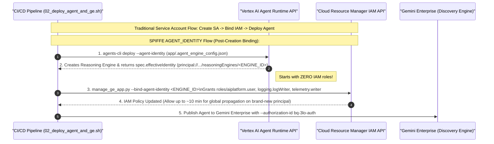
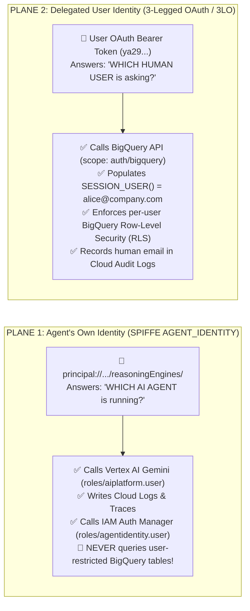

# Agent Identity (`AGENT_IDENTITY`) vs. Service Accounts: Architectural Guide & Mental Model Shift

**Customer Documentation Navigation**:
[🏠 Repository Hub (`README.md`)](../README.md) · [🛠️ Guide 1: Step-by-Step 3LO & Agent Identity Setup](01_STEP_BY_STEP_BQ_3LO_SETUP_GUIDE.md) · [🏗️ Guide 2: 3LO Architectural Options & 2LO Comparison](02_3LO_ARCHITECTURAL_OPTIONS_AND_2LO_COMPARISON.md) · **Guide 3: Agent Identity vs. Service Accounts**

---

As enterprises scale from a single prototype AI agent to dozens or hundreds of specialized agents running on **Vertex AI Agent Runtime (Agent Engine)**, traditional IAM Service Accounts quickly become an operational bottleneck and a "confused deputy" security risk.

This guide explains **Google Cloud Agent Identity (`AGENT_IDENTITY`)**, compares it across 8 security and operational dimensions against traditional Service Accounts, and walks through the **5 critical mental-model shifts** every Cloud Architect and DevOps team must know before deploying.

---

## 1. What Is Google Cloud Agent Identity (`AGENT_IDENTITY`)?

**Google Cloud Agent Identity** provides a **managed, per-agent SPIFFE cryptographic workload identity** natively bound to an individual Vertex AI Reasoning Engine resource (`reasoningEngines/<ENGINE_ID>`). Instead of running under a shared project-wide Service Agent (`service-<PROJECT_NUMBER>@gcp-sa-aiplatform-re.iam.gserviceaccount.com`) or requiring platform teams to manually provision and govern a separate IAM Service Account for every agent, Vertex AI automatically mints an immutable principal for the agent when it is deployed.

### Managed SPIFFE Principal Format

Every Reasoning Engine deployed with `AGENT_IDENTITY` receives a globally unique principal identifier formatted as:

```text
principal://agents.global.org-<ORG_ID>.system.id.goog/resources/aiplatform/projects/<PROJECT_NUMBER>/locations/<REGION>/reasoningEngines/<ENGINE_ID>
```

| Segment | Meaning | Example Value in This Repo |
| :--- | :--- | :--- |
| `agents.global.org-<ORG_ID>.system.id.goog` | Organization-scoped Google Cloud Agent Identity trust domain | `agents.global.org-1052266810716.system.id.goog` |
| `projects/<PROJECT_NUMBER>` | Numeric project number hosting the Reasoning Engine | `projects/727735722177` |
| `locations/<REGION>` | Vertex AI deployment region | `locations/us-central1` |
| `reasoningEngines/<ENGINE_ID>` | Unique Reasoning Engine resource ID | `reasoningEngines/5957886548912373760` |

### How `AGENT_IDENTITY` Is Enabled in This Repository

1. **Declarative Agent Engine Config ([`retail-sales-agent/app/.agent_engine_config.json`](../retail-sales-agent/app/.agent_engine_config.json))**:
   ```json
   {
     "identity_type": "AGENT_IDENTITY"
   }
   ```
2. **CLI Deployment Flag ([`deploy/02_deploy_agent_and_ge.sh`](../deploy/02_deploy_agent_and_ge.sh))**:
   ```bash
   agents-cli deploy -d agent_runtime \
     --project "${PROJECT_ID}" \
     --region "${REGION}" \
     --service-name "retail-sales-agent-id" \
     --agent-identity \
     --no-confirm-project
   ```
3. **Inspecting the Effective Identity via REST API or `gcloud`**:
   When you inspect the deployed Reasoning Engine resource (`GET https://us-central1-aiplatform.googleapis.com/v1beta1/projects/<PROJECT_NUMBER>/locations/us-central1/reasoningEngines/<ENGINE_ID>`), Vertex AI returns both `identityType` and `effectiveIdentity`:
   ```json
   {
     "name": "projects/727735722177/locations/us-central1/reasoningEngines/5957886548912373760",
     "spec": {
       "identityType": "AGENT_IDENTITY",
       "effectiveIdentity": "agents.global.org-1052266810716.system.id.goog/resources/aiplatform/projects/727735722177/locations/us-central1/reasoningEngines/5957886548912373760"
     }
   }
   ```

---

## 2. Key Advantages of Agent Identity Over Traditional Service Accounts

| Dimension | SPIFFE Agent Identity (`AGENT_IDENTITY`) | Traditional IAM Service Accounts (`SERVICE_ACCOUNT`) |
| :--- | :--- | :--- |
| **1. Identity Granularity** | **Strict 1:1 Per-Agent Identity**: Every Reasoning Engine automatically receives its own unique `principal://.../reasoningEngines/<ENGINE_ID>` without consuming project Service Account quotas. | **Shared Default SA or Quota Sprawl**: Omitting `--service-account` shares a single over-privileged default service agent across all agents; creating dedicated SAs hits project SA quota limits (100 SAs/project by default). |
| **2. Key & Credential Management** | **Zero Exportable Keys**: Impossible to create or download JSON private keys for an `AGENT_IDENTITY`. Credentials exist only as short-lived, hardware-backed workload tokens inside the Agent Runtime container. | **Key Leakage Risk**: Unless strictly blocked by `iam.disableServiceAccountKeyCreation`, developers can accidentally generate long-lived JSON keys (`gcloud iam service-accounts keys create`). |
| **3. Blast Radius & Confused Deputy Prevention** | **Zero Default Permissions**: A newly created `AGENT_IDENTITY` starts with **zero** IAM roles on the project, eliminating cross-agent privilege inheritance. | **Broad Shared Privileges**: If two agents share a Service Account, any permission granted for Agent A is immediately usable by Agent B (classic confused deputy vulnerability). |
| **4. Lifecycle Binding** | **Auto-Created & Auto-Destroyed**: The identity is born when `reasoningEngines.create` runs and is cryptographically retired the moment the Reasoning Engine is deleted—preventing orphaned IAM identities. | **Decoupled Manual Lifecycle**: Deleting a Reasoning Engine leaves its custom Service Account and IAM bindings behind as orphaned "zombie" credentials unless cleaned up by external automation. |
| **5. Cloud Audit Logging Attribution** | **Exact Agent Attribution**: Cloud Audit Logs record the exact `reasoningEngines/<ENGINE_ID>` principal in `authenticationInfo.principalEmail` / `principalSubject`, showing *which specific agent* made each call. | **Ambiguous Attribution**: If multiple agents share a Service Account, Cloud Audit Logs cannot distinguish which agent invoked an API without custom application labels. |
| **6. IAM Auth Manager (`roles/agentidentity.user`) Integration** | **Native First-Class Integration**: Required to authenticate against Google Cloud IAM Auth Manager (`agentidentity.googleapis.com/v1` `authProviders`) for managed 3LO and 2LO token brokering. | **Not Supported as an Agent Identity Principal**: Traditional Service Accounts do not carry per-agent `reasoningEngines/<ENGINE_ID>` SPIFFE claims. |
| **7. Quota & Governance Isolation** | **Per-Agent IAM Policies**: Security teams can audit, grant, or revoke permissions on a single agent resource ID without touching any other workload in the project. | **Coupled IAM Policies**: Revoking a role on a shared Service Account breaks every agent attached to that SA. |
| **8. Zero `iam.serviceAccountUser` Escalation Risk** | **No Impersonation Graph**: Developers deploying or updating an agent cannot attach an existing high-privilege Service Account to escalate privileges. | **Lateral Movement Risk**: Any principal granted `roles/iam.serviceAccountUser` on a privileged Service Account can deploy a new workload acting as that Service Account. |

---

## 3. Shifting Your Mental Model: Critical Call-Outs & Gotchas

Moving from Service Accounts to `AGENT_IDENTITY` changes the order of operations in your CI/CD pipeline. Review these **5 critical call-outs** before deploying to production:



---

### Call-Out 1: Post-Creation IAM Binding Order (The "Chicken-and-Egg" Sequence)

- **With Traditional Service Accounts**: You create the Service Account *first*, grant it IAM roles (`roles/aiplatform.user`, etc.), and *then* deploy the Reasoning Engine referencing `--service-account`.
- **With `AGENT_IDENTITY`**: The SPIFFE principal (`principal://.../reasoningEngines/<ENGINE_ID>`) includes the randomly generated `<ENGINE_ID>`, which **does not exist until after the Reasoning Engine resource is created**!Furthermore, the newly created identity starts with **zero permissions**—meaning it cannot even call Vertex AI Gemini (`403 PERMISSION_DENIED` on `aiplatform.endpoints.predict`) until you grant it Plane 1 IAM roles.
- **How This Repo Automates It**:
  Examine [`deploy/02_deploy_agent_and_ge.sh`](../deploy/02_deploy_agent_and_ge.sh) (Lines 62–76) and `bind_agent_identity()` in [`deploy/manage_ge_app.py`](../deploy/manage_ge_app.py) (Lines 425–489):
  1. First, `agents-cli deploy -d agent_runtime --agent-identity` creates the Reasoning Engine and writes its resource name to `deployment_metadata.json`.
  2. Immediately afterward, `02_deploy_agent_and_ge.sh` calls:
     ```bash
     python3 "${DEPLOY_DIR}/manage_ge_app.py" \
       --project-id "${PROJECT_ID}" \
       --bind-agent-identity "${AGENT_RUNTIME_ID}"
     ```
  3. `bind_agent_identity()` queries the Reasoning Engine's `spec.effectiveIdentity` and binds Plane 1 least-privilege roles (`roles/aiplatform.user`, `roles/logging.logWriter`, `roles/telemetry.writer`, `roles/monitoring.metricWriter`, `roles/serviceusage.serviceUsageConsumer`)—with **zero** BigQuery roles.

---

### Call-Out 2: Creation-Time Immutability

- **The Rule**: `identity_type` (`AGENT_IDENTITY` vs. `SERVICE_ACCOUNT`) is **immutable** once a Reasoning Engine resource is created. You cannot update an existing `SERVICE_ACCOUNT`-based Reasoning Engine in-place to switch it to `AGENT_IDENTITY`.
- **How to Migrate an Existing Agent**:
  Deploy a **new** Reasoning Engine instance with `--agent-identity` (using a new `--service-name` or removing `remote_agent_runtime_id` from `deployment_metadata.json`), bind its Plane 1 IAM roles, and update your Gemini Enterprise agent registration (or custom frontend) to point to the new Reasoning Engine ID. *(And if you ever need to roll back instantaneously during a migration, run [`./deploy/rollback_to_baseline.sh`](../deploy/rollback_to_baseline.sh).)*

---

### Call-Out 3: Initial IAM Propagation Latency (~10 Minutes)

- **The Rule**: As noted in the official [Authenticate using an agent's own identity documentation](https://docs.cloud.google.com/iam/docs/auth-agent-own-identity), when you bind IAM roles to a brand-new `principal://agents.global.org-...` identity for the very first time, **IAM policy propagation across Google Cloud services can take up to ~10 minutes** (though it often completes in 1–2 minutes).
- **Operational Best Practice**:
  - After running `02_deploy_agent_and_ge.sh` for a brand-new Reasoning Engine, wait 1–2 minutes before sending your first live prompt if you immediately see a transient `403 PERMISSION_DENIED` calling Vertex AI Gemini.
  - On subsequent code updates to the **same** `<ENGINE_ID>`, the `principal://...` identifier does not change, so IAM bindings remain warm with zero propagation delay!

---

### Call-Out 4: Preview Limitations & Supported Services

Google Cloud Agent Identity (`AGENT_IDENTITY`) is currently a **Preview** capability ([`https://docs.cloud.google.com/iam/docs/agent-identity-overview`](https://docs.cloud.google.com/iam/docs/agent-identity-overview)). Keep these current architectural boundaries in mind when designing production topologies:

| Constraint Area | Current Preview Behavior & Architectural Guidance |
| :--- | :--- |
| **VPC Service Controls (VPC-SC)** | **Not yet supported with `AGENT_IDENTITY`**. If your Reasoning Engine must run inside a strict VPC Service Controls perimeter today, use a dedicated least-privilege custom Service Account (`--service-account`) until VPC-SC support for `AGENT_IDENTITY` reaches GA. |
| **Google Groups Membership** | An `AGENT_IDENTITY` (`principal://...`) **cannot be added as a member of a Google Group**. Bind IAM roles directly to the `principal://...` identifier in project/resource IAM policies. |
| **IAM Deny Policies** | **IAM Deny policies** do not currently evaluate `principal://agents.global.org-...` principals. Enforce least privilege by only granting explicit Allow bindings (remember: `AGENT_IDENTITY` starts with zero permissions by default). |
| **Supported IAM Role Grants** | Works with standard Google Cloud IAM Allow policies on projects and resources (including Vertex AI `roles/aiplatform.user`, Cloud Logging `roles/logging.logWriter`, Cloud Trace `roles/telemetry.writer`, BigQuery, Cloud Storage, Secret Manager, and IAM Auth Manager `roles/agentidentity.user`). |

---

### Call-Out 5: Agent Identity (Plane 1) Does NOT Replace 3LO (Plane 2)!

The most important architectural takeaway of this repository is understanding how **Agent Identity (`AGENT_IDENTITY`)** and **3-Legged OAuth (`3LO`)** complement each other rather than compete:



- **Why `AGENT_IDENTITY` Alone Cannot Enforce Per-User BigQuery RLS**:
  Even though `AGENT_IDENTITY` gives your agent its own unique cryptographic principal, **all human users chatting with that agent share that same Reasoning Engine resource**. If you granted `roles/bigquery.dataViewer` directly to `principal://.../reasoningEngines/<ENGINE_ID>`, BigQuery `SESSION_USER()` would evaluate to the agent's SPIFFE identity for every user, defeating per-user Row-Level Security.
- **Why Pairing `AGENT_IDENTITY` (Plane 1) + `3LO` (Plane 2) Is the Gold Standard**:
  - **Plane 1 (`AGENT_IDENTITY`)** eliminates shared Service Accounts and JSON keys for the agent's own infrastructure calls (Gemini LLM inference, telemetry, and IAM Auth Manager).
  - **Plane 2 (`3LO`)** ensures every BigQuery SQL query executes strictly under the logged-in human user's OAuth token (`SESSION_USER()`), giving you cryptographic defense-in-depth at both the compute layer and the data layer.

---

**Return to Hub**: [🏠 Repository Hub (`README.md`)](../README.md) · [🛠️ Guide 1: Step-by-Step 3LO & Agent Identity Setup](01_STEP_BY_STEP_BQ_3LO_SETUP_GUIDE.md) · [🏗️ Guide 2: 3LO Architectural Options & 2LO Comparison](02_3LO_ARCHITECTURAL_OPTIONS_AND_2LO_COMPARISON.md)
