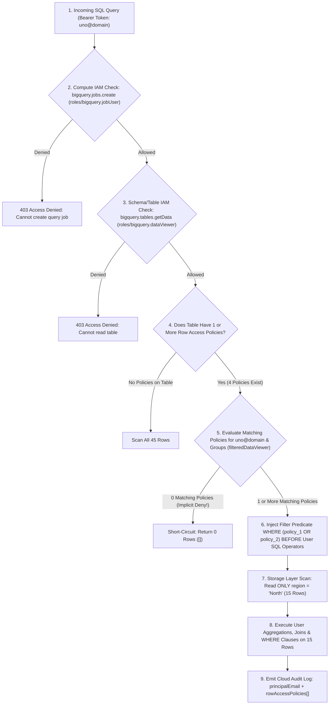
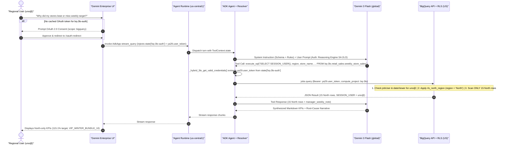

# 🗄️ Part 3: BigQuery Row-Level Security (RLS) & Agent Data Architecture

**Workshop Series Navigation**:
[🏠 Repository Hub](../README.md) · [🛠️ Part 1: Builder Guide](01_ANTIGRAVITY_BUILDER_GUIDE.md) · [🎙️ Part 2: Customer Demo Playbook](02_CUSTOMER_DEMO_PLAYBOOK.md) · **Part 3: BigQuery RLS & Agent Data Architecture** · [🔐 Part 4: 3LO Auth, IAM & 2LO Deep Dive](04_3LO_AUTH_IAM_AND_2LO_DEEP_DIVE.md)

---

This deep-dive answers four foundational architectural questions for building enterprise data agents on Google Cloud:

- **[Section A](#section-a-how-row-based-access-control-rls-is-set-up-in-bigquery)**: How is **Row-Level Security (RLS)** architected, configured (via SQL DDL & Cloud Console UI), governed by IAM, and protected against edge-case gotchas in BigQuery?
- **[Section B](#section-b-how-agents-connect-to-bigquery--perform-nl-to-sql)**: How do AI agents connect to BigQuery (`BigQueryToolset` vs. MCP Toolbox vs. Custom SDK vs. Conversational Analytics API), how does **NL-to-SQL** work under the hood, and how do you customize SQL generation and handle runtime caveats?
- **[Section B.1](#section-b1-connecting-the-agent-to-other-gcp-services)**: What stays identical—and what changes—when connecting a 3LO agent to **Cloud SQL, AlloyDB, Cloud Storage (GCS), Spanner, Firestore/Firebase, or Vertex AI Search**?
- **[Section B.2](#section-b2-using-non-adk-harnesses-langchain-langgraph-crewai-custom-fastapi)**: What stays identical—and what changes—when replacing Google ADK with **LangGraph, LangChain, CrewAI, or a custom FastAPI agent**?

---

## Section A: How Row-Based Access Control (RLS) Is Set Up in BigQuery

### A.1 RLS Architecture & Query Evaluation Flow

BigQuery Row-Level Security (implemented via **Row Access Policies**) lets you store multi-regional or multi-tenant records in a **single physical table** while dynamically restricting which rows each Google identity (`user:`, `group:`, `domain:`, or `serviceAccount:`) can read.

Crucially, RLS is **not** a view wrapper or post-processing filter—it is enforced inside the **BigQuery storage read layer** *before* any user SQL `WHERE`, `JOIN`, `GROUP BY`, `COUNT(*)`, or window function (`OVER()`) executes:



#### Multi-Policy Union Semantics (`OR` Logic)
If a principal matches **multiple** Row Access Policies on the same table (for example, `uno@` belongs to both `rls_north_region` and a temporary cross-coverage policy `rls_west_region`), BigQuery combines matching predicates with **`OR`**:
```sql
(region = "North") OR (region = "West")
```
Then BigQuery intersects that combined filter with the query's own `WHERE` clause using **`AND`**.

---

### A.2 Step-by-Step Setup: SQL DDL & Google Cloud Console UI

#### Method 1: Automated SQL DDL / DCL (Used in [`deploy/01_setup_bq_and_rls.sh`](../deploy/01_setup_bq_and_rls.sh))

BigQuery manages Row Access Policies natively via Standard SQL (GoogleSQL) DDL statements:

```sql
-- 1. Grant Dataset-level schema/table read access to all 4 personas
GRANT `roles/bigquery.dataViewer`
ON SCHEMA `bq-3lo.retail_sales`
TO "user:admin@vphuloria.altostrat.com",
   "user:uno@vphuloria.altostrat.com",
   "user:dos@vphuloria.altostrat.com",
   "user:tres@vphuloria.altostrat.com";

-- 2. Mandatory Admin Policy: Explicit full-table access across all regions
CREATE OR REPLACE ROW ACCESS POLICY rls_admin_all_regions
ON `bq-3lo.retail_sales.weekly_store_sales`
GRANT TO ("user:admin@vphuloria.altostrat.com")
FILTER USING (TRUE);

-- 3. Regional Policies: Each Regional Director sees strictly their assigned region
CREATE OR REPLACE ROW ACCESS POLICY rls_north_region
ON `bq-3lo.retail_sales.weekly_store_sales`
GRANT TO ("user:uno@vphuloria.altostrat.com")
FILTER USING (region = "North");

CREATE OR REPLACE ROW ACCESS POLICY rls_south_region
ON `bq-3lo.retail_sales.weekly_store_sales`
GRANT TO ("user:dos@vphuloria.altostrat.com")
FILTER USING (region = "South");

CREATE OR REPLACE ROW ACCESS POLICY rls_west_region
ON `bq-3lo.retail_sales.weekly_store_sales`
GRANT TO ("user:tres@vphuloria.altostrat.com")
FILTER USING (region = "West");
```

> [!TIP]
> **Production Best Practice — Grant to Google Groups**: In enterprise production, replace individual `"user:uno@..."` strings with synchronized Google Workspace / Cloud Identity groups such as `"group:retail-directors-north@corp.com"`. Adding or removing employees in your corporate IdP (Okta, Entra ID, Google Workspace) immediately updates BigQuery row access with zero SQL DDL changes!

#### Inspecting & Deleting Policies via CLI, REST API & SQL DDL

You can list all attached Row Access Policies and their grantees from the terminal via the BigQuery CLI or our verification script (which queries the BigQuery `rowAccessPolicies.list` + `getIamPolicy` REST endpoints):
```bash
# 1. List Row Access Policies via bq CLI
bq ls --row_access_policies bq-3lo:retail_sales.weekly_store_sales

# 2. Full verification table (Policy ID, Filter Predicate, Grantee Emails & Live Query Test)
python3 scripts/verify_rls_policies.py
```

To delete one or all Row Access Policies using BigQuery SQL DDL:
```sql
-- Drop a SINGLE policy (works ONLY when at least one other policy remains on the table)
DROP ROW ACCESS POLICY IF EXISTS rls_west_region
ON `bq-3lo.retail_sales.weekly_store_sales`;

-- Drop ALL policies (REQUIRED when removing the very last policy on a table!)
DROP ALL ROW ACCESS POLICIES
ON `bq-3lo.retail_sales.weekly_store_sales`;
```

#### Method 2: Google Cloud Console UI (Click-by-Click Inspection & Management)

1. **View Attached Row Access Policies on the Table**:
   - Open **BigQuery Studio** logged in as **`admin@`** (requires `roles/bigquery.admin` or `roles/bigquery.dataOwner` which includes `bigquery.rowAccessPolicies.list` and `bigquery.rowAccessPolicies.getIamPolicy`): `https://console.cloud.google.com/bigquery?project=<PROJECT_ID>`
   - In the left **Explorer** pane, expand **`<PROJECT_ID>`** → **`retail_sales`** → click **`weekly_store_sales`**.
   - In the top action toolbar of the table pane (`🔍 Query` · `💬 Chat` · `✏️ Edit ▾` · `Open in ▾` · `Share ▾` · **`More ▾`** · `↻ Refresh`), click **`More ▾` → `View row access policies`**.
   - The **Row access policies** right-hand panel slides open, listing every policy ID (`rls_admin_all_regions`, `rls_north_region`, `rls_south_region`, `rls_west_region`) and its **`filter_expression`** predicate.
   - Click **`VIEW`** next to any policy in that panel to open **View permissions**, which displays the grantee email(s) bound to the `bigquery.filteredDataViewer` role.
2. **View Dataset-Level Permissions in Console**:
   - In the **Explorer** pane, click the **`retail_sales`** dataset → click **Sharing** (top action bar) → **Permissions**.
   - Expand **BigQuery Data Viewer** to verify `admin@`, `uno@`, `dos@`, and `tres@` are listed.
3. **Create or Edit Policies in Console**:
   - BigQuery creates and updates Row Access Policies via DDL in the **BigQuery Studio Query Editor** (`🔍 Query` button). Running `CREATE OR REPLACE ROW ACCESS POLICY ...` requires `roles/bigquery.admin` or `roles/bigquery.dataOwner` (`bigquery.rowAccessPolicies.create` + `bigquery.rowAccessPolicies.setIamPolicy`).

---

### A.3 Required Companion IAM Roles (The 3-Part Permission Triad)

A common pitfall when configuring BigQuery RLS for the first time is granting *only* the Row Access Policy and wondering why the user gets `403 Access Denied`. Every restricted 3LO user requires **three complementary permissions** across three resource hierarchy levels:

| Layer | Resource Scope | Required Role | Underlying Permission(s) | Why It Is Needed (And What Happens Without It) |
| :--- | :--- | :--- | :--- | :--- |
| **1. Compute Layer** | **GCP Project** (`bq-3lo`) | `roles/bigquery.jobUser` | `bigquery.jobs.create` | Allows the user's 3LO token to **submit a SQL query job** billed to `bq-3lo`. Grants **zero** access to any dataset or table. Without it: `Access Denied: Project bq-3lo: User does not have bigquery.jobs.create permission`. |
| **2. Schema Layer** | **Dataset** (`retail_sales`) *or Table* | `roles/bigquery.dataViewer` | `bigquery.tables.get`, `bigquery.tables.getData`, `bigquery.datasets.get` | Allows resolving table metadata and column names. Once any RLS policy exists on the table, `dataViewer` **no longer grants row access** on its own—it must be paired with Layer 3! Without it: `Access Denied: Table ...: User does not have permission to query table`. |
| **3. Row Filter Layer** | **Row Access Policy** (`rls_north_region`) | `roles/bigquery.filteredDataViewer` *(Auto-granted by DDL)* | `bigquery.rowAccessPolicies.getFilteredData` | Automatically granted to everyone in `GRANT TO (...)` when `CREATE OR REPLACE ROW ACCESS POLICY` executes. Determines **which subset of rows** Layer 2 is permitted to return. |

---

### A.4 Critical Gotchas & Architectural Rationales

#### 1. The "Implicit Deny Cliff" (Why `admin@` Needs `FILTER USING (TRUE)`)
> [!WARNING]
> **Creating the very first Row Access Policy on a BigQuery table immediately switches the table from "Open to Data Viewers" to "Default-Deny for Everyone"—including Project Owners (`roles/owner`) and BigQuery Admins (`roles/bigquery.admin`)!**

- **What happens if you forget `rls_admin_all_regions`?** If `admin@` runs `CREATE ROW ACCESS POLICY rls_north_region ... GRANT TO ("user:uno@...")` without also creating a `FILTER USING (TRUE)` policy for `admin@`, then `admin@` immediately sees **0 rows** when running `SELECT * FROM weekly_store_sales`! (Admins still retain DDL permission to `CREATE`/`DROP` policies, which is intentional separation of administrative control vs. data reading, or allows admins to restore their own access.)
- **Why `DROP ALL ROW ACCESS POLICIES` exists**: Conversely, deleting the *final* remaining policy on a table would silently revert the table back to full-table access for all `dataViewer` principals. To prevent accidental data exposure, BigQuery blocks `DROP ROW ACCESS POLICY` on the last policy and forces you to explicitly execute `DROP ALL ROW ACCESS POLICIES ON table_name`.

#### 2. `COUNT(*)`, Aggregations, Joins & Side-Channel Safety
- Because RLS filter injection occurs **below** the SQL query execution plan, restricted users **cannot** probe hidden rows via aggregates (`SELECT COUNT(*)` returns `15`, not `45`), `MIN()`/`MAX()`, `HAVING`, or division-by-zero side-channel attacks on filtered rows (BigQuery evaluates RLS predicates before user expressions).
- **Why we include `SESSION_USER()` in Agent SQL**: Calling `SELECT SESSION_USER() AS authenticated_user` inside `execute_sql` gives deterministic, non-spoofable proof of which Google identity BigQuery evaluated at the storage layer.

#### 3. Performance, Partitioning, Clustering & Feature Interactions
- **Clustering Alignment**: Clustering large tables on the RLS predicate column (e.g., `CLUSTER BY region, store_id`) allows BigQuery to prune storage blocks during the RLS scan, keeping both query latency and bytes scanned minimal.
- **GoogleSQL Required**: Queries against RLS-protected tables must use Standard SQL (`--use_legacy_sql=false`), which is default in `BigQueryToolset`.
- **Subquery Lookups vs. Direct Predicates**: BigQuery `FILTER USING` supports direct boolean expressions (`region = "North"`) as well as lookup subqueries against an entitlement mapping table in the same project—e.g.:
  ```sql
  FILTER USING (region IN (SELECT allowed_region FROM `bq-3lo.retail_sales.user_entitlements` WHERE user_email = SESSION_USER()))
  ```
  Direct predicates paired with Google Groups (`GRANT TO ("group:north-directors@...")`) execute fastest because BigQuery avoids an extra entitlement subquery join on every read.
- **Time Travel & Wildcard Tables**: Users cannot bypass RLS via `FOR SYSTEM_TIME AS OF` (RLS policies apply across time-travel snapshots; note that if a policy was newly added, querying historical snapshots prior to policy creation is blocked for non-admin filtered viewers) and wildcard table scans (`retail_sales.*`) fail safely if any matched table enforces RLS unless queried directly.

---

## Section B: How Agents Connect to BigQuery & Perform NL-to-SQL

### B.1 Four BigQuery-to-Agent Connection Patterns Compared

When connecting an LLM agent to BigQuery on Google Cloud, architects choose from **four primary integration mechanisms**:

| Dimension | 1. Native ADK `BigQueryToolset` *(Used in This Repo)* | 2. MCP Toolbox for Databases (`genai-toolbox`) | 3. Custom Python Tool (`google-cloud-bigquery` SDK) | 4. BigQuery Conversational Analytics API (`geminidataanalytics`) |
| :--- | :--- | :--- | :--- | :--- |
| **How It Works** | First-party Python toolset bundled inside `google-adk` (`google.adk.integrations.bigquery`). | Standalone open-source Google MCP server configured via declarative `tools.yaml` (runs on Cloud Run or sidecar). | Developer writes Python functions (`def get_sales_by_store(...)`) using `bigquery.Client()`. | Managed Google Cloud API hosting a specialized BigQuery Data Agent with curated Golden Queries & Looker/BQ context. |
| **SQL Generation Mode** | **Open-ended LLM NL2SQL**: Agent's LLM writes arbitrary `SELECT` SQL via `execute_sql`. | **Both**: Supports **pre-authored parameterized SQL** (`SELECT ... WHERE store_id = @store`) *or* open `bigquery-execute-sql`. | **Fixed / Template SQL**: Python code owns the exact SQL string; LLM only supplies typed parameters. | **Managed NL2SQL + Charting/Python**: Google's managed Data Agent service generates & validates SQL. |
| **Built-In Tools Provided** | `list_dataset_ids`, `list_table_ids`, `get_table_info`, `execute_sql`, `forecast` (`AI.FORECAST`), `analyze_contribution`. | Custom YAML tools + `bigquery-sql`, `bigquery-list-table-ids`, `bigquery-get-table-info`, etc. | Whatever Python functions you author and register in `tools=[...]`. | High-level `chat` / conversational turn endpoint returning SQL, data, and Vega-Lite specs. |
| **3LO User Token Support** | **Native** (`BigQueryCredentialsConfig` + `GoogleCredentialsManager` / `tool_context.state`). | **Supported** (via OAuth2 `authServices` / header token forwarding, requires hosting an MCP server). | **Manual** (developer extracts token from context and builds per-request `bigquery.Client(credentials=...)`). | **Supported** (pass end-user OAuth credentials in API header to enforce BigQuery IAM & RLS). |
| **Best Fit When...** | Building ADK agents on Agent Runtime + Gemini Enterprise needing ad-hoc analytical reasoning with zero extra infra. | Sharing governed, **parameterized SQL tools** across polyglot agents (ADK, LangGraph, Cursor, Claude) with strict query whitelisting. | Simple, narrow transactional lookups where open-ended `SELECT` generation is undesirable. | Embedding a turnkey conversational BI analyst over complex multi-table schemas without managing prompts. |

---

### B.2 How NL-to-SQL Works in This Repo (Out-of-the-Box vs. Prompt-Guided)

Attendees often ask: *"Does `BigQueryToolset` convert natural language to SQL by itself, or does the LLM write the SQL?"*

Here is the exact division of responsibilities in [`retail-sales-agent/app/agent.py`](../retail-sales-agent/app/agent.py):

1. **What `BigQueryToolset` Provides Out of the Box (Deterministic Plumbing & Guardrails)**:
   - **Schema Introspection Tools**: `list_dataset_ids`, `list_table_ids`, and `get_table_info` (returns column names, types, and descriptions from `weekly_store_sales_schema.json`).
   - **Write-Blocked SQL Execution (`execute_sql`)**: Enforces `WriteMode.BLOCKED` at the client/session level so the LLM cannot run `INSERT`, `UPDATE`, `DELETE`, `DROP`, or `CREATE` statements even if prompted to do so.
   - **3LO Credential Resolution**: Calls `GoogleCredentialsManager.get_valid_credentials(tool_context)` before every BigQuery API call to obtain the end-user's OAuth 2.0 token (`scope: https://www.googleapis.com/auth/bigquery`).
   - **Structured Result Serialization**: Executes the BigQuery Job in `compute_project_id="bq-3lo"` with attribution label `datacloud:antigravity` and serializes rows back to the LLM as clean JSON.
2. **What the Agent's LLM (`Gemini`) Performs (Reasoning & NL-to-SQL)**:
   - Parses the user's natural-language question (*"Why did my stores miss target last week?"*).
   - Uses the schema embedded in `AGENT_INSTRUCTION` (or calls `get_table_info` if inspecting an unknown table) to author GoogleSQL—including `SESSION_USER()` and `manager_weekly_note`.
   - Calls `execute_sql(query="SELECT ...")`.
   - Synthesizes both **quantitative KPIs** (`net_revenue_usd`, `target_attainment_pct`, `gross_margin_pct`, `return_rate_pct`, `stockout_incidents`) and **qualitative text** (`manager_weekly_note`) into a clear executive answer.

#### End-to-End Sequence Diagram: Life of a 3LO Natural-Language Query



---

### B.3 Customizing SQL Generation, Guardrails & Output Formatting

In [`retail-sales-agent/app/agent.py`](../retail-sales-agent/app/agent.py), we customize `BigQueryToolset` across five levers:

1. **Pre-Baking Table Schema & Metric Formulas in `AGENT_INSTRUCTION`**:
   - Without schema context in the prompt, an agent needs **3 sequential LLM + tool round-trips** (`list_dataset_ids` → `list_table_ids` → `get_table_info` → `execute_sql`), adding 4–8 seconds of latency.
   - Embedding the 21 column definitions and exact formulas (e.g., `target_attainment_pct = (net_revenue_usd / weekly_target_usd) * 100`) in `AGENT_INSTRUCTION` lets Gemini generate accurate SQL on **Turn 1** with zero hallucinated column names.
2. **Controlling Mutability with `WriteMode`**:
   - `WriteMode.BLOCKED` *(used here)*: Strictly read-only `SELECT` queries. Blocks all DDL/DML.
   - `WriteMode.PROTECTED`: Allows writes *only* to temporary session tables (`CREATE TEMP TABLE ...`) for multi-step scratchpad analytics without mutating production datasets.
   - `WriteMode.ALLOWED`: Full DDL/DML execution (use only for dedicated data-engineering agents with human-in-the-loop confirmation).
3. **Scoping Exposed Tools via `tool_filter`**:
   ```python
   bigquery_toolset = BigQueryToolset(
       credentials_config=bq_credentials_config,
       bigquery_tool_config=bq_tool_config,
       tool_filter=["execute_sql", "get_table_info", "list_dataset_ids", "list_table_ids"],
   )
   ```
   *(You can also enable `"forecast"` and `"analyze_contribution"` to expose BigQuery ML's `AI.FORECAST` and contribution analysis tools!)*
4. **Routing Compute Billing & Attribution (`BigQueryToolConfig`)**:
   - `compute_project_id=SETTINGS["PROJECT_ID"]` ensures BigQuery query jobs bill to `bq-3lo` (where `uno@` holds `roles/bigquery.jobUser`).
   - `job_labels={"datacloud": "antigravity"}` tags every agent-generated BigQuery job for cost attribution in `INFORMATION_SCHEMA.JOBS`.
5. **Semantic Layer / Authorized Views**:
   - For 100-table enterprise schemas, join and pre-calculate complex metrics inside governed BigQuery Views (note: underlying base tables with RLS automatically enforce their RLS policies even when queried through regular views!).

---

### B.4 Production Caveats & Runtime Gotchas Solved in This Repo

1. **Gotcha #1 — Vertex AI Agent Runtime Sets `GOOGLE_CLOUD_PROJECT` to the Numeric Project Number**:
   - Inside a deployed Vertex AI Reasoning Engine container, Google Cloud sets `os.environ["GOOGLE_CLOUD_PROJECT"]` to the **numeric project number** (e.g., `"727735722177"`) rather than the alphanumeric Project ID (`"bq-3lo"`).
   - If your prompt interpolates `GOOGLE_CLOUD_PROJECT` directly into `` `727735722177.retail_sales.weekly_store_sales` ``, BigQuery SQL fails with `Invalid project ID '727735722177'`.
   - **How this repo fixes it**: `_load_demo_settings()` in [`agent.py`](../retail-sales-agent/app/agent.py) explicitly discards pure-digit values (`if env_proj.isdigit(): env_proj = ""`) and reads the alphanumeric `PROJECT_ID` packaged into `app/oauth_config.json` by [`02_deploy_agent_and_ge.sh`](../deploy/02_deploy_agent_and_ge.sh).
2. **Gotcha #2 — Preview Gemini Models (`gemini-3-flash-preview`) Require `location="global"`**:
   - Vertex AI Agent Runtime deploys into a regional control plane (`us-central1`) and sets `GOOGLE_CLOUD_LOCATION="us-central1"` in the container. However, preview Gemini models (`gemini-3-flash-preview`) are served exclusively on Vertex AI's **`global`** endpoint (`404 Publisher Model not found` in `us-central1`).
   - Meanwhile, the A2A agent card builder ([`app/app_utils/a2a.py`](../retail-sales-agent/app/app_utils/a2a.py)) must still build regional Reasoning Engine URLs (`https://us-central1-aiplatform.googleapis.com/...`) using `GOOGLE_CLOUD_AGENT_ENGINE_LOCATION`.
   - **How this repo fixes it**: Our `GlobalGemini(Gemini)` wrapper pins `os.environ["GOOGLE_CLOUD_LOCATION"] = "global"` lazily inside its `api_client` property while `a2a.py` reads `GOOGLE_CLOUD_AGENT_ENGINE_LOCATION`.

---

## Section B.1: Connecting the Agent to Other GCP Services

What happens if your enterprise agent needs per-user data isolation not just in BigQuery, but across **Cloud Storage (GCS), Cloud SQL, AlloyDB, Cloud Spanner, Firestore / Firebase, or Vertex AI Search**?

### The Core Architectural Split

Not all Google Cloud data services evaluate a **Google OAuth 2.0 3LO Access Token** the same way! Services divide into **two architectural categories**:

1. **GCP IAM-Native Data Plane Services** *(BigQuery, GCS, Vertex AI Search, Google Drive)*: The storage API natively inspects the human user's Google OAuth 2.0 token (`ya29....`) on every read and enforces fine-grained access natively.
2. **Database-Engine-Governed or Non-GCP-Token Services** *(Cloud SQL, AlloyDB, Spanner, Firestore/Firebase)*: Access inside rows/collections is governed either by **internal database roles/session variables** or by **Firebase Auth ID tokens** rather than GCP IAM OAuth scopes!

### Cross-Service 3LO Architecture Matrix

| Target GCP Service | What Remains Identical to This Repo | What Changes (OAuth Scopes, Client Plumbing & Fine-Grained Security) | Native Per-User Row/Object Isolation Mechanism |
| :--- | :--- | :--- | :--- |
| **Google Cloud Storage (GCS)** | • Web OAuth Client & `/oauth-redirect`<br/>• Discovery Engine `Authorization` resource<br/>• Token injected in `tool_context.state`<br/>• Reasoning Engine hosting | • **OAuth Scope**: `https://www.googleapis.com/auth/devstorage.read_only`<br/>• **SDK Client**: Instantiate `storage.Client(credentials=Credentials(token=user_token))` per tool call. | **100% Native 3LO**: **GCS Managed Folders**, **IAM Conditions** on object prefixes (`resource.name.startsWith(...)`), or bucket IAM. |
| **Vertex AI Search (Discovery Engine Data Stores)** | • Gemini Enterprise App & `AclConfig` (`idpType: GSUITE`)<br/>• User licenses & Workspace identity | • **Often Zero Extra OAuth Prompt Needed!** When a Data Store with **Document ACLs** enabled is attached directly to the Gemini Enterprise App (or queried via `SearchService` with user identity), Discovery Engine filters retrieved chunks natively by the signed-in Workspace user/group. | **100% Native**: Document-level ACLs (`aclInfo.readers`) synced from Google Drive, GCS, Jira, SharePoint, or custom connectors. |
| **Cloud SQL (PostgreSQL / MySQL) & AlloyDB** | • Web OAuth Client & `/oauth-redirect`<br/>• Discovery Engine `Authorization` resource<br/>• Token injected in `tool_context.state` | • **OAuth Scope**: `https://www.googleapis.com/auth/sqlservice.login`<br/>• **Option A (True End-to-End 3LO)**: Enable **IAM Database Authentication** (`cloudsql.iam_authentication=on`), create IAM DB users (`uno@domain`), grant `roles/cloudsql.instanceUser`, and pass the user's 3LO access token as the **DB password** via `cloud-sql-python-connector` (`enable_iam_auth=True`)! Postgres `SESSION_USER` becomes `uno@domain`.<br/>• **Option B (Parameterized Middleware / MCP Toolbox)**: Connect with a shared DB pool via **MCP Toolbox for Databases** (`genai-toolbox`) and bind verified OAuth user email claims to SQL parameters (`WHERE manager_email = $1`). | • **Option A**: Native PostgreSQL RLS (`ALTER TABLE ... ENABLE ROW LEVEL SECURITY; CREATE POLICY ... USING (manager_email = current_user);`).<br/>• **Option B**: Parameterized `WHERE` clauses enforced inside locked `tools.yaml` templates (LLM cannot alter the SQL). |
| **Cloud Spanner** | • Web OAuth Client & GE `Authorization`<br/>• Token injected in `tool_context.state` | • **OAuth Scope**: `https://www.googleapis.com/auth/spanner.data`<br/>• Pass `Credentials(token=user_token)` to Spanner client *and* specify the Spanner **Database Role** mapped to that user via IAM Conditions (`roles/spanner.fineGrainedAccessUser`). | **Spanner Fine-Grained Access Control (FGAC)**: Table/column/view grants bound to Spanner Database Roles (note: Spanner FGAC is role-based rather than arbitrary `SESSION_USER()` row predicates; for dynamic per-email row filtering, pair Spanner with **MCP Toolbox** parameterized queries). |
| **Firestore / Firebase** | • Gemini Enterprise front-end & Reasoning Engine runtime | ⚠️ **CRITICAL GOTCHA**: **Firestore Security Rules** (`allow read: if request.auth.token.email == resource.data.owner`) **DO NOT evaluate Google Cloud OAuth 2.0 access tokens!** Calling `google-cloud-firestore` with a `datastore` or `cloud-platform` OAuth token evaluates coarse **GCP Project IAM** (`roles/datastore.user` = reads *every* document!) and completely bypasses Firebase Security Rules.<br/>• **Solution**: Either exchange the user's Google OAuth ID/access token with **Firebase Authentication / Identity Platform** (`signInWithIdp`) to mint a **Firebase Auth ID Token** and query via the Firestore REST/Client SDK, OR enforce per-user document filtering inside a trusted backend/MCP tool layer. | **Firebase Security Rules** (requires Firebase Auth / Identity Platform ID token) **OR** trusted backend tool filtering. |

---

## Section B.2: Using Non-ADK Harnesses (LangChain, LangGraph, CrewAI, Custom FastAPI)

What if your engineering team standardizes on **LangGraph**, **LangChain**, **CrewAI**, or a **custom FastAPI agent** instead of Google ADK?

The key architectural insight is that **90% of the security and cloud infrastructure is framework-agnostic**. BigQuery RLS, Google OAuth 2.0, Vertex AI Agent Runtime, and Gemini Enterprise do not care which Python library orchestrates your LLM loop—only how the HTTP/RPC boundary hands your tool the user's 3LO access token!

### ADK vs. Non-ADK Harness Comparison

| Architectural Layer | Google ADK (`retail-sales-agent`) | LangGraph / LangChain / CrewAI / Custom FastAPI | Identical or Changed? |
| :--- | :--- | :--- | :--- |
| **BigQuery Dataset, IAM Triad & 4 RLS Policies** | `01_setup_bq_and_rls.sh` (`jobUser` + `dataViewer` + `CREATE ROW ACCESS POLICY`) | Exact same BigQuery table, IAM bindings, and SQL Row Access Policies | **100% Identical** |
| **Google Auth Platform Web OAuth Client** | Redirect URI: `https://vertexaisearch.cloud.google.com/oauth-redirect` | Exact same Web OAuth Client & Redirect URI | **100% Identical** |
| **Gemini Enterprise App, User Licenses & `Authorization` Resource** | `manage_ge_app.py` registers `bq-3lo-auth` (`serverSideOauth2`) | Exact same Gemini Enterprise App, Licenses, and `bq-3lo-auth` resource | **100% Identical** |
| **Hosting Runtime & Gemini Enterprise Registration** | Deployed to **Agent Runtime**; published via `--registration-type adk --authorization-id ...` | **Option 1**: Deploy to **Agent Runtime** (`LanggraphAgent` or custom Reasoning Engine wrapper).<br/>**Option 2**: Host on **Cloud Run** (or Agent Runtime) exposing an **A2A (Agent2Agent)** endpoint and publish via `--registration-type a2a --authorization-id ...`. | **Minor Adapter Change** |
| **Where the 3LO Token Arrives at Runtime** | Automatically populated inside `tool_context.state["bq-3lo-auth"]` | Extracted from the incoming Reasoning Engine `input` payload / A2A request headers (`Authorization` or session metadata) and passed via framework context (e.g., LangGraph `RunnableConfig["configurable"]["oauth_token"]`). | **Changed in Agent Code** |
| **BigQuery Tool Execution** | `BigQueryToolset` + `GoogleCredentialsManager` | Custom `@tool` function instantiating a **per-request** `bigquery.Client(credentials=Credentials(token=...))` *(or MCP Toolbox client with header forwarding)*. | **Changed in Agent Code** |

---

### Concrete Reference Pattern: LangGraph + BigQuery 3LO Tool

When building in **LangGraph** (or CrewAI / FastAPI), follow one cardinal security rule:

> [!CAUTION]
> **Never Instantiate a Global `bigquery.Client()` Singleton in a 3LO Agent!**
> A module-level `bq_client = bigquery.Client()` binds to the container's Service Account (2LO) or caches one user's credentials across concurrent async requests. You **must** construct `google.oauth2.credentials.Credentials(token=user_token)` and `bigquery.Client(...)` **inside the tool call** using the request-scoped token!

```python
import google.oauth2.credentials
from google.cloud import bigquery
from langchain_core.runnables import RunnableConfig
from langchain_core.tools import tool
from langchain_google_vertexai import ChatVertexAI
from langgraph.prebuilt import create_react_agent

PROJECT_ID = "bq-3lo"
FQ_TABLE = "bq-3lo.retail_sales.weekly_store_sales"


@tool
def query_retail_sales_bq(sql_query: str, config: RunnableConfig) -> list[dict]:
    """Executes a read-only GoogleSQL SELECT query against BigQuery using the end-user's 3LO OAuth token."""
    # 1. Extract the per-request 3LO OAuth access token injected by the entrypoint
    configurable = config.get("configurable", {})
    user_access_token = configurable.get("bq-3lo-auth") or configurable.get("oauth_token")
    if not user_access_token:
        raise PermissionError("Missing 3-Legged OAuth access token for BigQuery.")

    # 2. Enforce Read-Only Guardrail (equivalent to ADK's WriteMode.BLOCKED)
    normalized = sql_query.strip().upper()
    if not (normalized.startswith("SELECT") or normalized.startswith("WITH")):
        raise ValueError("Only read-only SELECT/WITH queries are permitted.")

    # 3. Build request-scoped Credentials & BigQuery Client (enforces BigQuery RLS for this human user!)
    user_creds = google.oauth2.credentials.Credentials(token=user_access_token)
    bq_client = bigquery.Client(project=PROJECT_ID, credentials=user_creds, location="US")

    job_config = bigquery.QueryJobConfig(
        labels={"datacloud": "antigravity", "harness": "langgraph"},
        maximum_bytes_billed=100 * 1024 * 1024,  # Optional 100 MB cost circuit-breaker
    )
    rows = bq_client.query(sql_query, job_config=job_config).result()
    return [dict(row.items()) for row in rows]


# Plane 1 (2LO): ChatVertexAI uses the container's Service Account to invoke Gemini
llm = ChatVertexAI(model="gemini-3-flash-preview", project=PROJECT_ID, location="global")
langgraph_agent = create_react_agent(llm, tools=[query_retail_sales_bq])


# Per-request invocation (inside Reasoning Engine .query() or FastAPI A2A handler):
async def handle_user_turn(user_prompt: str, user_3lo_token: str) -> str:
    result = await langgraph_agent.ainvoke(
        {"messages": [("user", user_prompt)]},
        config={"configurable": {"bq-3lo-auth": user_3lo_token}},
    )
    return result["messages"][-1].content
```

---

### Continue to Part 4
Now that you understand how BigQuery RLS filters data at the storage layer and how ADK, MCP, other GCP services, and non-ADK frameworks execute queries, continue to **[🔐 Part 4: 3LO Auth, IAM, Agent Identity & 2LO Deep Dive](04_3LO_AUTH_IAM_AND_2LO_DEEP_DIVE.md)** for the complete end-to-end authentication, multi-layer IAM checklist, and 2LO contrast guide.
