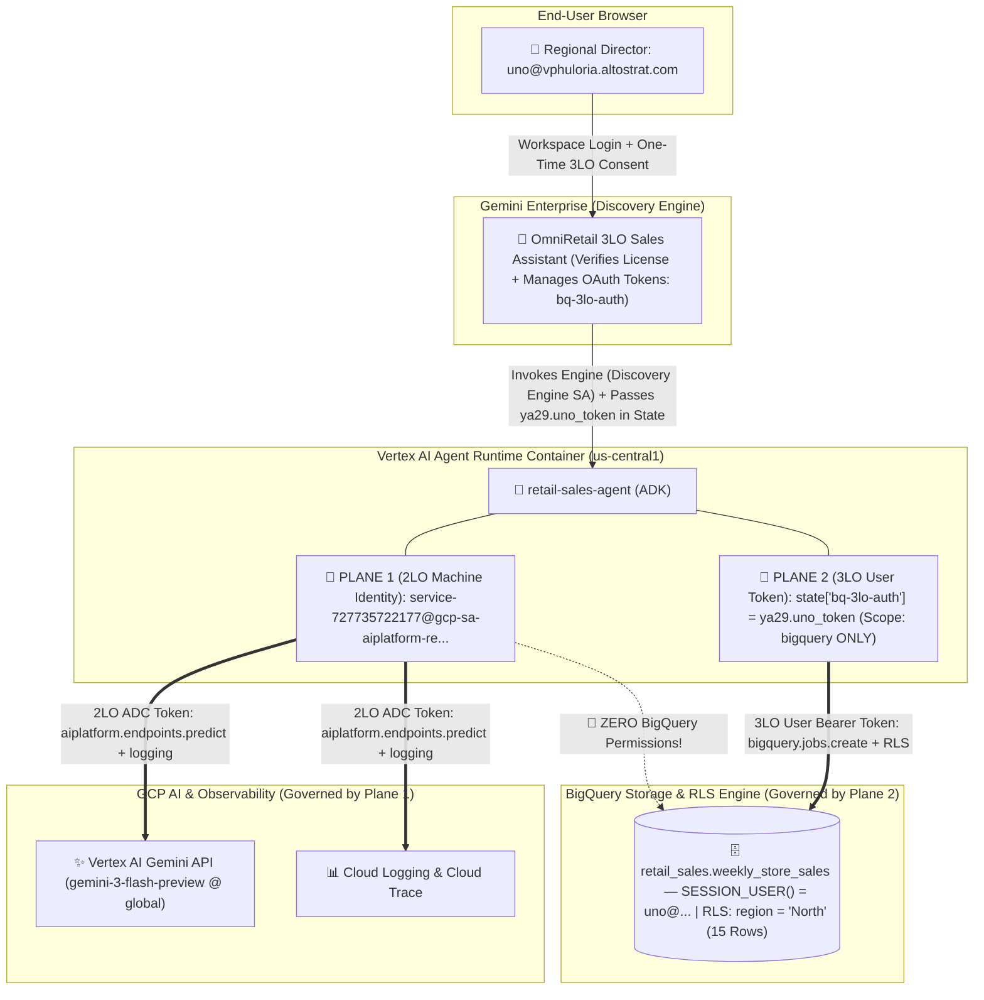
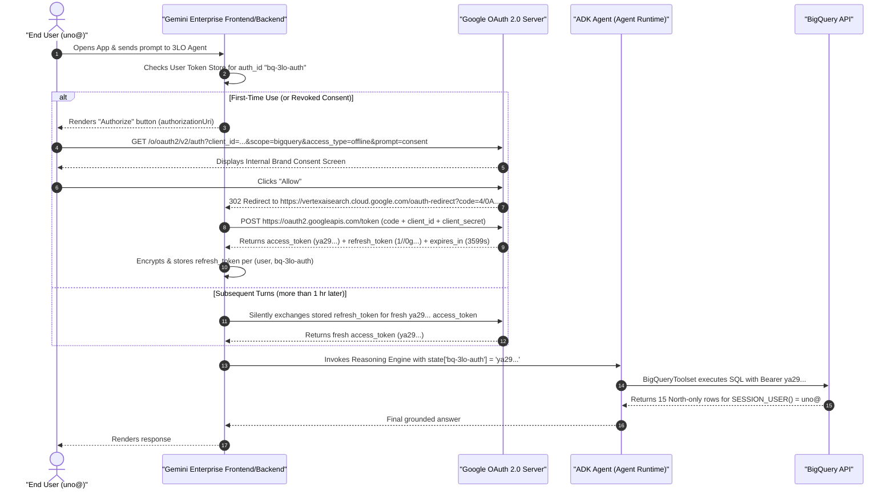

# 🔐 Part 4: 3-Legged OAuth (3LO), Multi-Layer IAM, Agent Identity & 2LO Deep Dive

**Workshop Series Navigation**:
[🏠 Repository Hub](../README.md) · [🛠️ Part 1: Builder Guide](01_ANTIGRAVITY_BUILDER_GUIDE.md) · [🎙️ Part 2: Customer Demo Playbook](02_CUSTOMER_DEMO_PLAYBOOK.md) · [🗄️ Part 3: BigQuery RLS & Agent Data Architecture](03_BQ_RLS_AND_AGENT_DATA_ARCHITECTURE.md) · **Part 4: 3LO Auth, IAM & 2LO Deep Dive**

---

This guide provides a complete start-to-finish reference on **identity, authentication, authorization, and licensing** for enterprise AI agents on **Vertex AI Agent Runtime** and **Gemini Enterprise**:

1. **[3LO vs. 2LO — First Principles & The Dual Identity Planes](#1-3-legged-oauth-3lo-vs-2-legged-auth-2lo--first-principles)**
2. **[End-to-End 3LO Setup Walkthrough (Console, REST API, CLI & ADK Code)](#2-end-to-end-3lo-setup-walkthrough-code--console--apicli)**
3. **[Complete Multi-Layer IAM, Licensing & Agent Identity Checklist](#3-complete-multi-layer-iam-licensing--agent-identity-checklist)**
4. **[How 2-Legged Auth (2LO) Is Set Up, Managed & Audited in Console](#4-how-2-legged-auth-2lo-is-set-up-managed--checked-in-console)**

---

## 1. 3-Legged OAuth (3LO) vs. 2-Legged Auth (2LO) — First Principles

### Why "3-Legged" vs. "2-Legged"?

- **2-Legged Auth (2LO — Workload / Service Account Auth)**: Involves **two parties**—(1) the **AI Agent Workload** (authenticating via the GCP Metadata Server as a Service Account or Agent Identity) and (2) the **Target GCP Resource** (e.g., BigQuery). No human consents at runtime, and BigQuery sees *every* user's query as coming from the **exact same machine identity**.
- **3-Legged OAuth (3LO — Delegated Human User Auth)**: Involves **three parties**—(1) the **Human Resource Owner** (`uno@domain`), (2) the **Client Application** (Gemini Enterprise + ADK Agent identified by an OAuth 2.0 Web Client), and (3) **Google's Authorization & Resource Servers** (`accounts.google.com` + BigQuery API). The human explicitly authorizes the agent to query BigQuery *on their behalf* with a narrow OAuth scope (`https://www.googleapis.com/auth/bigquery`).

### Side-by-Side Architectural Comparison

| Dimension | 3-Legged OAuth (3LO) *(Used in This Repo)* | 2-Legged Auth (2LO / Service Account) |
| :--- | :--- | :--- |
| **BigQuery `SESSION_USER()`** | The logged-in human user (`uno@vphuloria.altostrat.com`) | The agent's Service Account (`service-...@gcp-sa-aiplatform-re.iam.gserviceaccount.com` or custom SA) |
| **Per-User BigQuery RLS Enforcement** | **Native & Automatic**: Each user matches their own Row Access Policy (`rls_north_region`, `rls_south_region`, etc.) | **Impossible via `SESSION_USER()`**: Every user shares one Service Account identity, so BigQuery returns the SA's full row set to the LLM |
| **Prompt-Injection Blast Radius** | **Zero Cross-Tenant Leakage**: Storage engine rejects unauthorized rows even if the LLM runs `SELECT *` | **High**: A successful prompt injection can extract any row the Service Account has permission to read |
| **Cloud Audit Log `principalEmail`** | Exact human employee (`uno@domain`) — satisfies SOC2 / HIPAA / SOX per-user auditability | Shared Service Account — requires custom application-layer correlation logs to know *who* asked |
| **End-User UX** | One-time **"Authorize"** consent click on first use (refresh token stored server-side by Gemini Enterprise) | Zero OAuth consent clicks (completely invisible to end users) |
| **OAuth Web Client & `--authorization-id`** | **Required** (`bq-3lo-auth` Discovery Engine `Authorization` resource) | **Not Needed** (uses Application Default Credentials on the runtime container) |
| **Ideal Enterprise Use Cases** | Sales/HR/Finance tables, multi-tenant customer portals, personal Drive/Gmail/Calendar tools, governed data warehouses | Shared public product catalogs, store-locator directories, public documentation RAG, autonomous cron/batch background agents |

---

### Crucial Concept: Two Identity Planes Run Simultaneously in a 3LO Agent!

A common misconception is thinking that enabling 3LO replaces the Agent Runtime's Service Account everywhere. In reality, **two orthogonal identity planes operate simultaneously on every single turn**—giving you strict least-privilege separation between **AI Compute** and **User Data**:



- **Plane 1 — The Agent's Own Machine Identity (2LO)**:
  - **Principal**: `service-<PROJECT_NUMBER>@gcp-sa-aiplatform-re.iam.gserviceaccount.com` *(or a custom `--service-account` / Vertex AI Agent Identity)*.
  - **What it calls**: Vertex AI Gemini model endpoints (`GlobalGemini`), Cloud Logging (`google-cloud-logging`), and Cloud Trace (`OpenTelemetry`).
  - **What it CANNOT call**: It has **zero** roles on `retail_sales.weekly_store_sales`. Even if container code accidentally called `bigquery.Client()` with default credentials, BigQuery would reject it with `403 Access Denied`!
- **Plane 2 — The End-User's Delegated OAuth Token (3LO)**:
  - **Principal**: `uno@`, `dos@`, `tres@`, or `admin@`.
  - **Scope**: Narrowly restricted to `https://www.googleapis.com/auth/bigquery` (cannot call Vertex AI, cannot read GCS, cannot modify IAM).
  - **What it calls**: Used **exclusively** inside `BigQueryToolset` when submitting `execute_sql` / `get_table_info` requests.

---

## 2. End-to-End 3LO Setup Walkthrough (Code + Console + API/CLI)

### Complete 3LO Handshake & Token Lifecycle Sequence



---

### Step 1: OAuth Consent Screen — Branding & Audience

Before any OAuth 2.0 Client can mint tokens in a GCP project, the project needs an **OAuth Brand (Consent Screen)**.

- **How [`deploy/manage_ge_app.py`](../deploy/manage_ge_app.py) Automates It**:
  Calls the **Identity-Aware Proxy (IAP) Brands REST API**:
  ```bash
  curl -X POST \
    -H "Authorization: Bearer $(gcloud auth print-access-token)" \
    -H "Content-Type: application/json" \
    -H "x-goog-user-project: ${PROJECT_ID}" \
    "https://iap.googleapis.com/v1/projects/${PROJECT_NUMBER}/brands" \
    -d '{
      "applicationTitle": "OmniRetail 3LO Sales Assistant",
      "supportEmail": "admin@vphuloria.altostrat.com"
    }'
  ```
- **Where to View / Edit in Google Cloud Console**:
  1. **Branding**: `https://console.cloud.google.com/auth/branding?project=<PROJECT_ID>` (**Google Auth Platform** → **Branding**).
  2. **Audience**: `https://console.cloud.google.com/auth/audience?project=<PROJECT_ID>` (**Google Auth Platform** → **Audience**).
     - **Why `Internal` Audience Matters**: Setting Audience to **Internal** restricts sign-in to users within your Google Workspace / Cloud Identity organization (`vphuloria.altostrat.com`) and **allows immediate use of sensitive scopes like `https://www.googleapis.com/auth/bigquery` without external Google OAuth App Verification** or "Unverified App" warning screens! *(If you must serve external `@gmail.com` or partner-domain users, switch Audience to **External** and add test users while in `Testing` publishing status, or complete OAuth verification for production.)*
  3. **Data Access (Scopes)**: `https://console.cloud.google.com/auth/scopes?project=<PROJECT_ID>` — optional pre-declaration of `https://www.googleapis.com/auth/bigquery`.

---

### Step 2: OAuth 2.0 Web Application Client & Redirect URIs

- **Where to Create / Inspect in Google Cloud Console**:
  - Open **Google Auth Platform → Clients**: `https://console.cloud.google.com/auth/clients?project=<PROJECT_ID>`
  - Click **+ Create Client** → **Application type: Web application** → Name: `bq-3lo-agent-web-client`.
- **Exact Authorized Redirect URIs & Why Each Exists**:

| Redirect URI | Surface That Uses It | Notes & Gotchas |
| :--- | :--- | :--- |
| `https://vertexaisearch.cloud.google.com/oauth-redirect` | **Gemini Enterprise Web App** (`vertexaisearch.cloud.google.com`) | **MANDATORY for Cloud UI.** Must be character-for-character exact. **Never** use legacy `/static/oauth/oauth.html`—doing so causes `Error 400: redirect_uri_mismatch`! |
| `http://localhost:8000/dev-ui/` | **Local `adk web` / `agents-cli playground`** (`localhost`) | **Include the trailing slash `/`**—ADK's browser UI redirects back to `/dev-ui/`. |
| `http://127.0.0.1:8000/dev-ui/` | **Local `adk web`** accessed via `127.0.0.1` | Helpful when testing locally across loopback aliases. |

- **Why Strict Project Isolation Matters**:
  Always create the OAuth 2.0 Web Client **inside the same project (`bq-3lo`)** rather than reusing a `client_secret_*.json` from another sandbox project. If the OAuth Client lives in Project A while your agent runs in Project B, users see Project A's app branding, OAuth token revocations/quotas are governed by Project A, and deleting Project A silently breaks Project B's production agent. [`deploy/manage_ge_app.py`](../deploy/manage_ge_app.py) explicitly checks `block["project_id"] == PROJECT_ID` to enforce this rule.

---

### Step 3: Discovery Engine `Authorization` Resource (`bq-3lo-auth`)

Gemini Enterprise stores your OAuth 2.0 Client credentials and OAuth endpoints inside a global Discovery Engine **`Authorization`** resource:
`projects/<PROJECT_NUMBER>/locations/global/authorizations/bq-3lo-auth`

#### Automated REST API Call (Executed by `ensure_ge_oauth_authorization()` in [`deploy/manage_ge_app.py`](../deploy/manage_ge_app.py))

```bash
curl -X POST \
  -H "Authorization: Bearer $(gcloud auth print-access-token)" \
  -H "Content-Type: application/json" \
  -H "x-goog-user-project: ${PROJECT_ID}" \
  "https://discoveryengine.googleapis.com/v1alpha/projects/${PROJECT_NUMBER}/locations/global/authorizations?authorizationId=bq-3lo-auth" \
  -d '{
    "name": "projects/'"${PROJECT_NUMBER}"'/locations/global/authorizations/bq-3lo-auth",
    "serverSideOauth2": {
      "clientId": "<OAUTH_CLIENT_ID>",
      "clientSecret": "<OAUTH_CLIENT_SECRET>",
      "authorizationUri": "https://accounts.google.com/o/oauth2/v2/auth?client_id=<OAUTH_CLIENT_ID>&scope=https%3A%2F%2Fwww.googleapis.com%2Fauth%2Fbigquery&include_granted_scopes=true&response_type=code&access_type=offline&prompt=consent",
      "tokenUri": "https://oauth2.googleapis.com/token"
    }
  }'
```

> [!IMPORTANT]
> **Why `access_type=offline` and `prompt=consent` Are Essential in `authorizationUri`**:
> Google OAuth access tokens (`ya29....`) expire after **3,600 seconds (1 hour)**. Including `access_type=offline&prompt=consent` instructs Google's OAuth server to return an encrypted **`refresh_token`** during the initial handshake, allowing Gemini Enterprise (`serverSideOauth2`) to silently mint fresh access tokens in future sessions without forcing users to re-click **Authorize** every hour!

#### How to Inspect or Edit `Authorization` in Console & CLI

- **In Google Cloud Console**:
  Navigate to **AI Applications (Gemini Enterprise)** → **Apps** (`https://console.cloud.google.com/gen-app-builder/engines?project=<PROJECT_ID>`) → click **`OmniRetail 3LO Sales Assistant`** → click **Agents** in the left menu → click **`OmniRetail BigQuery 3LO Sales Agent`** → **Edit** → inspect the **Authorization** section.
- **Via REST API (Inspect all Authorizations in Project)**:
  ```bash
  curl -s \
    -H "Authorization: Bearer $(gcloud auth print-access-token)" \
    -H "x-goog-user-project: ${PROJECT_ID}" \
    "https://discoveryengine.googleapis.com/v1alpha/projects/${PROJECT_NUMBER}/locations/global/authorizations" | jq .
  ```

---

### Step 4: Agent Code Changes ([`retail-sales-agent/app/agent.py`](../retail-sales-agent/app/agent.py))

In ADK, wiring 3LO into `BigQueryToolset` uses two pieces:

1. **Declaring `BigQueryCredentialsConfig` with OAuth Client ID, Secret & Scopes**:
   ```python
   bq_credentials_config = BigQueryCredentialsConfig(
       client_id=SETTINGS["OAUTH_CLIENT_ID"],
       client_secret=SETTINGS["OAUTH_CLIENT_SECRET"],
       scopes=["https://www.googleapis.com/auth/bigquery"],
   )
   ```
2. **Bridging Gemini Enterprise State Injection & Local `adk web` (`_hybrid_3lo_get_valid_credentials`)**:
   - **When running in `adk web` locally**: No external portal has run OAuth yet, so `GoogleCredentialsManager.get_valid_credentials()` uses `client_id` and `client_secret` to emit an interactive OAuth consent request event directly inside the ADK developer UI.
   - **When invoked by Gemini Enterprise**: Gemini Enterprise *already* completed the server-side OAuth exchange using `bq-3lo-auth` and injects the resulting access token directly into the ADK session state dictionary under the authorization ID key (`tool_context.state["bq-3lo-auth"]`, or `temp:bq-3lo-auth` / full resource key).
   - Our resolver in [`agent.py`](../retail-sales-agent/app/agent.py) checks `tool_context.state` first and returns `google.oauth2.credentials.Credentials(token=...)` immediately—avoiding a redundant second OAuth prompt while preserving full `adk web` compatibility!

---

### Step 5: Publishing & Sharing the Agent (`--authorization-id` + `ALL_USERS`)

[`deploy/02_deploy_agent_and_ge.sh`](../deploy/02_deploy_agent_and_ge.sh) links the Reasoning Engine, the Gemini Enterprise App, and the `bq-3lo-auth` resource together:

```bash
agents-cli publish gemini-enterprise \
  --registration-type adk \
  --agent-runtime-id "projects/${PROJECT_NUMBER}/locations/${REGION}/reasoningEngines/${ENGINE_ID}" \
  --gemini-enterprise-app-id "projects/${PROJECT_NUMBER}/locations/global/collections/default_collection/engines/${GE_APP_ID}" \
  --display-name "OmniRetail BigQuery 3LO Sales Agent" \
  --description "Analyzes weekly store sales using per-user 3LO and BigQuery RLS." \
  --tool-description "Analyzes weekly store sales using per-user 3LO and BigQuery RLS." \
  --project-id "${PROJECT_ID}" \
  --project-number "${PROJECT_NUMBER}" \
  --authorization-id "projects/${PROJECT_NUMBER}/locations/global/authorizations/bq-3lo-auth"
```

Immediately afterward, Step 6 of `02_deploy_agent_and_ge.sh` sends a `PATCH` request to Discovery Engine's `agents` endpoint setting:
```json
{
  "sharingConfig": { "scope": "ALL_USERS" },
  "authorizationConfig": {
    "toolAuthorizations": [
      "projects/<PROJECT_NUMBER>/locations/global/authorizations/bq-3lo-auth"
    ]
  }
}
```
> [!WARNING]
> **Why `sharingConfig: {"scope": "ALL_USERS"}` Is Mandatory for Multi-User Demos**:
> Newly published agents in Gemini Enterprise default to private/creator visibility (`admin@` only). Until `sharingConfig.scope` is set to `"ALL_USERS"` (or shared with specific Workspace groups in **Gemini Enterprise → Apps → Agents → Permissions/Sharing**), `uno@`, `dos@`, and `tres@` will log into Gemini Enterprise successfully but will **not see the custom agent**!

---

## 3. Complete Multi-Layer IAM, Licensing & Agent Identity Checklist

If a user hits `400`, `403`, or `0 rows` at any stage, consult this master principal-by-principal matrix. Every single item below is configured automatically by `01_setup_bq_and_rls.sh` and `02_deploy_agent_and_ge.sh`:

| Principal | Layer / Service | Exact Role, License, or Policy | Why It Is Needed (Exact Error If Missing) | Where to Check in Google Cloud Console & CLI |
| :--- | :--- | :--- | :--- | :--- |
| **👑 Admin Builder**<br/>(`admin@domain`) | Project Admin & BQ Data | • `roles/owner` *(or `bigquery.admin`, `aiplatform.admin`, `discoveryengine.admin`, `resourcemanager.projectIamAdmin`)*<br/>• BQ RLS: `rls_admin_all_regions` (`FILTER USING (TRUE)`) | Deploys infrastructure, creates RLS policies, and retains 45-row executive read access after RLS Implicit Deny activates. | • **IAM & Admin → IAM**<br/>• **BigQuery Studio → `weekly_store_sales` → `More ▾` → `View row access policies`** |
| **👤 End Users**<br/>(`uno@`, `dos@`, `tres@`) | **Layer 1: Gemini Enterprise Licensing** | Active `LicenseConfig` + `UserLicense` (`licenseAssignmentState: ASSIGNED`) in `default_user_store` | Required to open the Gemini Enterprise Web App. **Missing error**: `HTTP 400: You are not assigned an active license`. | • **Console**: **AI Applications → Settings / Licenses** (`console.cloud.google.com/gen-app-builder/licenses?project=bq-3lo`)<br/>• **API**: `GET .../v1alpha/projects/<NUM>/locations/global/userStores/default_user_store/userLicenses` |
| **👤 End Users**<br/>(`uno@`, `dos@`, `tres@`) | **Layer 2: Gemini Enterprise App & Widget Access** | • `AclConfig`: `idpType = GSUITE`<br/>• Project IAM: `roles/discoveryengine.user` + `roles/discoveryengine.viewer`<br/>• Agent `sharingConfig`: `ALL_USERS` | Allows loading `vertexaisearch.cloud.google.com/home/cid/<configId>` and seeing the published agent. **Missing error**: `403 PERMISSION_DENIED: WidgetService.LookupWidgetConfig`. | • **Console**: **IAM & Admin → IAM** (`console.cloud.google.com/iam-admin/iam?project=bq-3lo`)<br/>• **Console**: **AI Applications → Apps → Agents** |
| **👤 End Users**<br/>(`uno@`, `dos@`, `tres@`) | **Layer 3: BigQuery Compute, Schema & RLS** | • Project IAM: `roles/bigquery.jobUser`<br/>• Dataset IAM: `roles/bigquery.dataViewer`<br/>• Table RLS: `rls_<region>_region` (`roles/bigquery.filteredDataViewer`) | Enables `execute_sql` under the user's 3LO token to submit jobs and return strictly their 15 regional rows. | • **Project IAM**: `gcloud projects get-iam-policy bq-3lo`<br/>• **Dataset IAM**: **BigQuery → `retail_sales` → Sharing → Permissions**<br/>• **Table RLS**: **BigQuery → `weekly_store_sales` → `More ▾` → `View row access policies`** |
| **🤖 Reasoning Engine Runtime Identity**<br/>*(Plane 1 — 2LO)* | **Layer 4: Vertex AI Agent Runtime** | Default Service Agent:<br/>`service-<NUM>@gcp-sa-aiplatform-re.iam.gserviceaccount.com`<br/>with `roles/aiplatform.reasoningEngineServiceAgent` *(or custom SA with `aiplatform.user`, `logging.logWriter`, `cloudtrace.agent`)* | Calls Gemini (`gemini-3-flash-preview`), writes container stdout/stderr to Cloud Logging, and exports spans to Cloud Trace. **Needs ZERO BigQuery permissions!** | • **Console**: **IAM & Admin → IAM** → ✅ check **"Include Google-provided role grants"**!<br/>• **Console**: **Vertex AI → Agent Engine → `<agent>`** |
| **🏢 Discovery Engine Service Agent** | **Layer 5: GE → Agent Engine Bridge** | `service-<NUM>@gcp-sa-discoveryengine.iam.gserviceaccount.com` *(Google-managed `roles/discoveryengine.serviceAgent`)* | Allows Gemini Enterprise backend to invoke the Vertex AI Reasoning Engine `/api/stream_reasoning_engine` endpoint when a user sends a chat turn. | • **Console**: **IAM & Admin → IAM** → ✅ check **"Include Google-provided role grants"** |

---

### Deep Dive: Where Vertex AI Agent Identity & Runtime Service Accounts Fit In

When deploying an agent to **Vertex AI Agent Runtime (Agent Engine)**, Google Cloud supports **three machine identity models** for **Plane 1** (the agent's own workload identity):

1. **Default Reasoning Engine Service Agent *(Used Out of the Box)***:
   - Identity: `service-<PROJECT_NUMBER>@gcp-sa-aiplatform-re.iam.gserviceaccount.com`.
   - Automatically provisioned when `aiplatform.googleapis.com` is enabled and used when `--service-account` is omitted.
   - **How to view it in Console**: Open [**IAM & Admin → IAM**](https://console.cloud.google.com/iam-admin/iam?project=bq-3lo) and check **"Include Google-provided role grants"** at the top right of the IAM table.
2. **Custom Dedicated Service Account (`--service-account`)**:
   - Identity: `<custom-agent-sa>@<PROJECT_ID>.iam.gserviceaccount.com`.
   - Recommended when running multiple agents in the same GCP project that need distinct Plane-1 permissions (e.g., Agent A can read Secret Manager secret X, while Agent B cannot).
3. **Vertex AI Agent Identity (`agentIdentityInfo` / SPIFFE-style Principal)**:
   - Vertex AI Agent Engine also supports per-agent cryptographic **Agent Identity** (`principal://agents.global.org-<ORG_ID>.system.id.goog/resources/aiplatform/projects/<PROJECT_NUMBER>/locations/<REGION>/reasoningEngines/<ENGINE_ID>`).
   - **Why it exists**: Eliminates the IAM 100-service-account-per-project sprawl when deploying hundreds of agents, allowing you to bind IAM policies directly to a single `reasoningEngine` resource ID!
   - **How Agent Identity relates to 3LO**: Agent Identity governs **Plane 1 (Agent-to-Model / Agent-to-Shared-Tool 2LO calls)**. Even when Agent Identity is enabled on the Reasoning Engine, **per-user BigQuery RLS still requires Plane 2 (3LO OAuth)** because Agent Identity identifies *which agent* is calling BigQuery, not *which human employee* is sitting behind the browser!

---

## 4. How 2-Legged Auth (2LO) Is Set Up, Managed & Checked in Console

To appreciate how clean the boundary between 3LO and 2LO is, let's contrast what changes when you build an agent that **should** use **2-Legged Auth (2LO)**—for example, a **Store Catalog & Public Inventory Agent** where every employee is allowed to see the exact same table.

### 4.1 When to Use 2LO vs. 3LO (Quick Decision Rule)

- **Use 2LO** when **all authorized users of the agent may see the exact same rows** (or when the agent runs headlessly on a schedule/PubSub trigger without an interactive human user).
- **Use 3LO** whenever **User A and User B asking the exact same question should see different rows, documents, or permissions**, or when compliance mandates per-human-user `principalEmail` entries in data-access audit logs.

---

### 4.2 Exact Code Difference in ADK (`agent.py`): 3LO vs. 2LO

Switching [`retail-sales-agent/app/agent.py`](../retail-sales-agent/app/agent.py) from 3LO to pure 2LO removes all OAuth Client IDs, secrets, and state resolvers—shrinking credential setup to **4 lines of Python**:

```python
import google.auth
from google.adk.integrations.bigquery import BigQueryCredentialsConfig, BigQueryToolset
from google.adk.integrations.bigquery.config import BigQueryToolConfig, WriteMode

# 2LO: Obtain the Agent Runtime container's own Service Account credentials via ADC
adc_credentials, _ = google.auth.default(
    scopes=["https://www.googleapis.com/auth/bigquery"]
)

bq_2lo_credentials_config = BigQueryCredentialsConfig(
    credentials=adc_credentials
)

bigquery_2lo_toolset = BigQueryToolset(
    credentials_config=bq_2lo_credentials_config,
    bigquery_tool_config=BigQueryToolConfig(
        write_mode=WriteMode.BLOCKED,
        compute_project_id="bq-3lo",
    ),
)
```

And when publishing a 2LO agent to Gemini Enterprise, you simply **omit `--authorization-id`** (no Google Auth Platform Web Client and no Discovery Engine `Authorization` resource needed!).

---

### 4.3 Production Setup for 2LO: Dedicated Least-Privilege Service Account

> [!IMPORTANT]
> **Never grant BigQuery data roles to the default `service-<NUM>@gcp-sa-aiplatform-re.iam.gserviceaccount.com` if you host multiple agents in one project!** Every Reasoning Engine without a custom SA shares that default identity. Instead, create a dedicated least-privilege Service Account for your 2LO agent:

```bash
export PROJECT_ID="bq-3lo"
export REGION="us-central1"
export SA_NAME="retail-catalog-2lo-sa"
export SA_EMAIL="${SA_NAME}@${PROJECT_ID}.iam.gserviceaccount.com"

# 1. Create dedicated Service Account for the 2LO Agent
gcloud iam service-accounts create "${SA_NAME}" \
  --display-name="2LO Retail Catalog Agent SA" \
  --project="${PROJECT_ID}"

# 2. Grant Plane-1 Runtime Roles (Gemini invocation + Logs + Traces) + BigQuery Compute
for ROLE in \
  roles/aiplatform.user \
  roles/logging.logWriter \
  roles/cloudtrace.agent \
  roles/bigquery.jobUser; do
  gcloud projects add-iam-policy-binding "${PROJECT_ID}" \
    --member="serviceAccount:${SA_EMAIL}" \
    --role="${ROLE}"
done

# 3. Grant Dataset-Scoped Read Access ONLY on the shared public dataset (not sensitive HR/Finance!)
bq query --project_id="${PROJECT_ID}" --use_legacy_sql=false \
  "GRANT \`roles/bigquery.dataViewer\` ON SCHEMA \`${PROJECT_ID}.public_catalog\` TO \"serviceAccount:${SA_EMAIL}\";"

# 4. Deploy Agent Runtime bound to this dedicated custom Service Account
agents-cli deploy \
  -d agent_runtime \
  --project "${PROJECT_ID}" \
  --region "${REGION}" \
  --service-account "${SA_EMAIL}"
```

*(Note: If the target table in a 2LO setup happens to have Row Access Policies enabled on it, remember the Implicit Deny Cliff from [Part 3](03_BQ_RLS_AND_AGENT_DATA_ARCHITECTURE.md#a4-critical-gotchas--architectural-rationales)—you would also have to grant a Row Access Policy to `"serviceAccount:${SA_EMAIL}"`.)*

---

### 4.4 How to Verify & Audit 3LO vs. 2LO in Google Cloud Console

Security auditors and workshop attendees love seeing **cryptographic proof** in Google Cloud's native observability tools showing who executed each BigQuery query. Here are the **two Console views** to open side-by-side:

#### Verification View 1: BigQuery Jobs Explorer & `INFORMATION_SCHEMA.JOBS_BY_PROJECT`

- **Console Click-Path**: **BigQuery** → left nav **Job history** → click **Project history** (`https://console.cloud.google.com/bigquery?project=bq-3lo&page=jobs`).
- **Diagnostic SQL Query**:
  ```sql
  SELECT
    creation_time,
    user_email AS authenticated_principal,
    job_id,
    labels,
    LEFT(query, 120) AS sql_snippet
  FROM `bq-3lo.region-us.INFORMATION_SCHEMA.JOBS_BY_PROJECT`
  WHERE creation_time > TIMESTAMP_SUB(CURRENT_TIMESTAMP(), INTERVAL 2 HOUR)
    AND statement_type = 'SELECT'
  ORDER BY creation_time DESC
  LIMIT 20;
  ```
- **What You See**:
  - **In our 3LO Agent**: `authenticated_principal` shows **`uno@vphuloria.altostrat.com`**, **`dos@vphuloria.altostrat.com`**, **`tres@vphuloria.altostrat.com`**, and **`admin@vphuloria.altostrat.com`**—proving every agent tool call ran as the individual human!
  - **In a 2LO Agent**: `authenticated_principal` shows **`retail-catalog-2lo-sa@bq-3lo.iam.gserviceaccount.com`** for every single user's question.

#### Verification View 2: Cloud Audit Logs (`Logs Explorer`)

- **Direct Console Link**: [`https://console.cloud.google.com/logs/query?project=bq-3lo`](https://console.cloud.google.com/logs/query?project=bq-3lo) (**Logging** → **Logs Explorer**).
- **Exact Logs Explorer Filter**:
  ```text
  resource.type="bigquery_project" OR resource.type="bigquery_dataset"
  protoPayload.serviceName="bigquery.googleapis.com"
  protoPayload.metadata.tableDataRead:*
  ```
- **What You Inspect in `protoPayload`**:
  - `protoPayload.authenticationInfo.principalEmail`: Records `uno@vphuloria.altostrat.com` (3LO) vs. `...@iam.gserviceaccount.com` (2LO).
  - `protoPayload.metadata.tableDataRead.rowAccessPolicies`: Explicitly records `["projects/bq-3lo/datasets/retail_sales/tables/weekly_store_sales/rowAccessPolicies/rls_north_region"]`—giving compliance teams an immutable audit trail of both **who** queried the table via the AI agent and **which RLS policy** filtered the scan!

---

**Return to the Beginning**: [🏠 Repository Hub (`README.md`)](../README.md) · [🛠️ Part 1: Builder Guide](01_ANTIGRAVITY_BUILDER_GUIDE.md) · [🎙️ Part 2: Customer Demo Playbook](02_CUSTOMER_DEMO_PLAYBOOK.md) · [🗄️ Part 3: BigQuery RLS & Agent Data Architecture](03_BQ_RLS_AND_AGENT_DATA_ARCHITECTURE.md)
