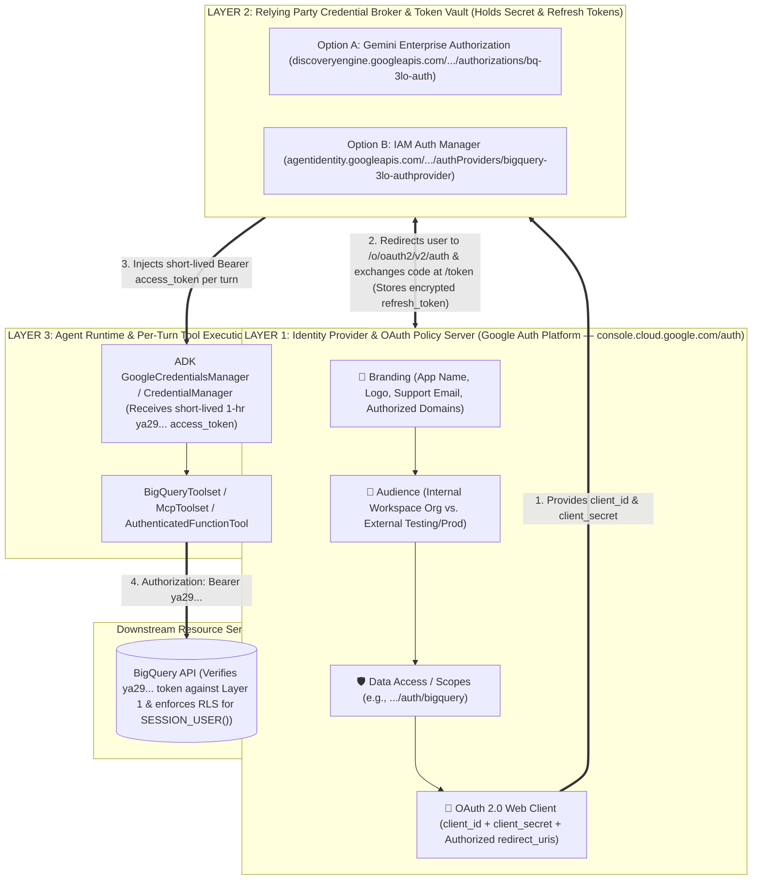
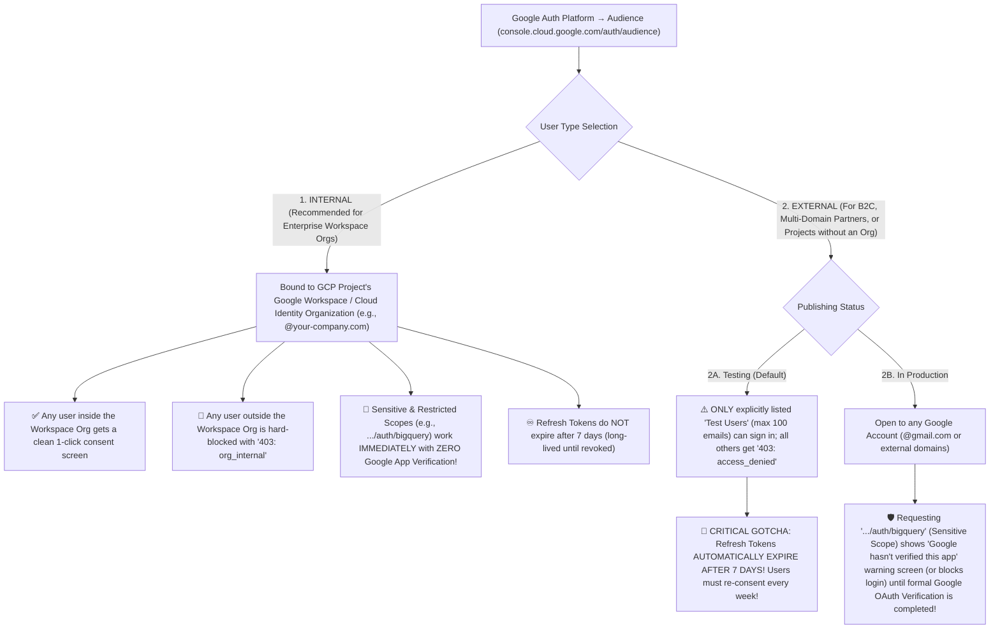

# Google Auth Platform: Branding, Audience, Token Brokers & OAuth Troubleshooting

**Customer Documentation Navigation**:
[🏠 Repository Hub (`README.md`)](../README.md) · [🛠️ Guide 1: Step-by-Step 3LO Setup](01_STEP_BY_STEP_BQ_3LO_SETUP_GUIDE.md) · [🏗️ Guide 2: 3LO Options & 2LO Comparison](02_3LO_ARCHITECTURAL_OPTIONS_AND_2LO_COMPARISON.md) · [🪪 Guide 3: Agent Identity vs. Service Accounts](03_AGENT_IDENTITY_VS_SERVICE_ACCOUNTS.md) · **Guide 4: Google Auth Platform & Troubleshooting** · [🌐 Guide 5: Extending 3LO & Security FAQ](05_EXTENDING_3LO_AND_SECURITY_FAQ.md)

---

When configuring **3-Legged OAuth (3LO)** in the **Google Cloud Console**, enterprise teams interact with the **Google Auth Platform** (`console.cloud.google.com/auth`—formerly known as the "OAuth Consent Screen" and "APIs & Services → Credentials"). Three common architectural questions arise during setup:
- *"What does the Google Auth Platform actually do versus Gemini Enterprise Authorizations or IAM Auth Manager?"*
- *"Is the **Branding** configuration only cosmetic for the consent popup, or does it enforce functional and security gates?"*
- *"How does the **Audience** setting (`Internal` vs. `External`) affect our Google Workspace organization, OAuth verification, and refresh token lifetimes?"*

This guide provides a comprehensive reference for all three layers, plus a rapid OAuth troubleshooting matrix.

---

## 1. The Three Layers of Google Cloud 3LO Authentication

Enterprise 3LO agent architectures cleanly separate **OAuth Policy & Client Issuance (Layer 1)**, **Credential Brokering & Refresh Token Vaulting (Layer 2)**, and **Stateless Per-Turn Tool Execution (Layer 3)**:

### Detailed Responsibilities Across the Three Layers

| Layer | Service Name & Console / API Endpoint | Core Responsibility in the 3LO Lifecycle | Does It Store User Refresh Tokens? |
| :--- | :--- | :--- | :--- |
| **Layer 1: OAuth 2.0 Authorization Server / IdP Config** | **Google Auth Platform** (`console.cloud.google.com/auth/*` & `accounts.google.com` / `oauth2.googleapis.com`) | • Defines **who** the requesting application is (**Branding**). • Defines **which user population** is allowed to sign in (**Audience**: `Internal` vs. `External`). • Defines **what permissions** can be requested (**Scopes**). • Issues the **OAuth 2.0 Web Client** (`client_id` + `client_secret`) and strictly enforces the **Authorized Redirect URI allowlist**. | **Issues** and **validates** tokens (and lists active user grants at `myaccount.google.com/permissions`), while delegating token storage to the Relying Party (Layer 2). |
| **Layer 2: Credential Broker / Token Vault (Relying Party)** | **Gemini Enterprise `Authorizations`** (`discoveryengine.googleapis.com/v1alpha/.../authorizations`) **OR** **IAM Auth Manager** (`agentidentity.googleapis.com/v1/.../authProviders`) | • Securely vaults your OAuth `client_id` and `client_secret`. • Initiates the `302` redirect to Google's `/authorize` endpoint when a user invokes a protected tool. • Receives the one-time authorization `code` at its callback (`/oauth-redirect` or `/oauthcallback`). • Exchanges the `code` + `client_secret` at `oauth2.googleapis.com/token` and **encrypts & stores the user's `refresh_token`**. | **Yes.** Encrypts and stores `(user_identity, auth_id) -> refresh_token` server-side and automatically mints fresh 1-hour `access_token`s on future turns. |
| **Layer 3: Agent Runtime & Tool Execution** | **ADK `GoogleCredentialsManager` / `CredentialManager`** (`retail-sales-agent` on Vertex AI Agent Runtime) | • Receives **only** the short-lived (3,600-second) Bearer `access_token` (`ya29...`) for the active user turn. • Attaches `Authorization: Bearer ya29...` to the outbound BigQuery API request (`jobs.query`). | **No.** Stateless per turn; never persists user refresh tokens or OAuth client secrets in session logs. |

---

## 2. How 3LO Primitives Map Across Agentic vs. Non-Agentic Workloads

AI agents on Google Cloud do **not** invent a proprietary authentication protocol. Instead, they use the **exact same Layer 1 Google Auth Platform primitives** (Branding, Audience, Scopes, and OAuth 2.0 Web Clients) used by traditional web applications and BI platforms:

| Workload Category | Layer 1: Google Auth Platform (`Branding`, `Audience`, `OAuth Client`) | Layer 2: Who Acts as the OAuth Relying Party (Token Vault) & Redirect URI? | Layer 3: How the Downstream API Uses the 3LO Token |
| :--- | :--- | :--- | :--- |
| **1. Traditional Web Apps / SPAs** *(e.g., React + FastAPI / Spring Boot Portal)* | Project Brand, `Internal` Audience, and OAuth 2.0 Web Client (`client_id` / `client_secret`). | **App Backend (BFF)**. Redirect URI: `https://app.your-company.com/oauth2/callback`. Stores refresh tokens in an encrypted backend session store. | Backend passes `Credentials(token=...)` when calling Google Drive, Calendar, or BigQuery APIs on behalf of the logged-in web user. |
| **2. BI & Analytics Tools** *(Looker, Looker Studio, Connected Sheets, Tableau)* | Google-managed or customer-managed OAuth Client requesting `.../auth/bigquery`. | **BI Platform Server** (e.g., Looker server or Looker Studio OAuth broker). Stores per-analyst OAuth tokens when "Run queries as viewer (OAuth)" is enabled on the connection. | Every dashboard query runs in BigQuery with the viewing analyst's 3LO token—enforcing the exact same `SESSION_USER()` BigQuery Row Access Policies. |
| **3. AI Agents in Gemini Enterprise** *(Option A — Used in [`app/agent.py`](../retail-sales-agent/app/agent.py))* | Project Brand + `Internal` Audience + OAuth 2.0 Web Client (`bq-3lo-agent-web-client`). | **Discovery Engine `Authorization` Resource** (`bq-3lo-auth`). Redirect URI: `https://vertexaisearch.cloud.google.com/oauth-redirect`. | Gemini Enterprise injects `state["bq-3lo-auth"] = "ya29..."` into the ADK Reasoning Engine call; `BigQueryToolset` runs SQL as `SESSION_USER()`. |
| **4. Custom AI Agents on Agent Runtime / Cloud Run / GKE** *(Option B — Used in [`app/agent_auth_manager_example.py`](../retail-sales-agent/app/agent_auth_manager_example.py))* | Project Brand + `Internal` Audience + OAuth 2.0 Web Client (or 3rd-party Snowflake/Jira OAuth Client). | **IAM Auth Manager (`authProviders`)**. Redirect URI: `https://agentidentitycredentials.googleapis.com/v1/projects/.../authProviders/.../oauthcallback` + `/validateUserId`. | `GcpAuthProvider` retrieves `ya29...` from Auth Manager and passes it to `McpToolset` (`bigquery.googleapis.com/mcp`) or `AuthenticatedFunctionTool`. |

---

## 3. Deep Dive: Branding Configuration (Aesthetic vs. Functional Impact)

In **Google Auth Platform → Branding** (`https://console.cloud.google.com/auth/branding?project=<YOUR_PROJECT_ID>`), configuration fields have both **user-facing UX effects** and **hard functional/security enforcement gates**:

| Branding Field (`console.cloud.google.com/auth/branding`) | Aesthetic / User-Facing UX Impact | Hard Functional & Security Impact (Non-Aesthetic!) |
| :--- | :--- | :--- |
| **1. Existence of the Brand Resource** (`iap.googleapis.com/v1/projects/{N}/brands`) | None until configured. | **🛑 Hard API Prerequisite Gate (`400 FAILED_PRECONDITION`)**: Google Cloud **blocks** the creation of any OAuth 2.0 Client ID in a GCP project until the project's Brand (Consent Screen) is initialized. *(This is why [`deploy/manage_ge_app.py`](../deploy/manage_ge_app.py) automatically calls `POST https://iap.googleapis.com/v1/projects/<NUM>/brands` to initialize the Brand if not yet present.)* |
| **2. App Name** *(e.g., `"OmniRetail 3LO Sales Assistant"`)* | Displayed prominently on the Google Sign-In & OAuth Consent Screen (*"**OmniRetail 3LO Sales Assistant** wants to access your Google Account"*) and in the user's Google Account Security audit list (`myaccount.google.com/permissions`). | • **Anti-Impersonation Policy Enforcement**: For `External` apps, App Names cannot contain `"Google"`, `"BigQuery"`, or misleading system terms without failing OAuth Brand Verification. • **Audit Trail Identification**: Security admins reviewing Workspace OAuth Token Audit Logs see this exact App Name alongside the Client ID. |
| **3. User Support Email** *(e.g., `admin@your-company.com`)* | Shown to end users when they click the app name on the consent screen so they know which internal team owns the agent. | **🛑 Mandatory Creation Validation**: The caller creating/updating the Brand **must** either be the exact email address entered here or be a manager/member of the specified Google Group; otherwise the API rejects the Brand creation with `400 INVALID_ARGUMENT`. |
| **4. App Logo** | Renders a custom 120×120px icon on the consent prompt. | **⚠️ Triggers Mandatory Google Trust & Safety Verification on `External` Apps!** Uploading an App Logo on an `External` In-Production app places the Brand into a verification queue (requiring domain ownership proof in Google Search Console) before the logo is shown. *(Tip: Use `Internal` Audience so custom logos work immediately without external verification, or leave App Logo blank for rapid PoCs.)* |
| **5. Authorized Domains** *(e.g., `google.com`, `your-company.com`)* | Not directly visible to the end user. | **🛑 Strict Redirect URI & Link Allowlist Enforcement (For `External` Apps)**: Google's OAuth server validates that the domain of every **Authorized Redirect URI** on your OAuth Web Clients (as well as your App Homepage, Privacy Policy, and Terms of Service URLs) belongs to the **Authorized Domains** list in Branding. If a domain is missing from Authorized Domains, the Console refuses to save the OAuth Client's Redirect URI. *(Note: `Internal` apps automatically trust internal/localhost/Google redirect URIs without manual domain verification.)* |
| **6. App Homepage, Privacy Policy & Terms of Service Links** | Shown as clickable footer links on the consent screen. | **🛑 Required for OAuth Verification (`External` Production Apps)**: You cannot submit an `External` app requesting sensitive scopes (`.../auth/bigquery`) for Google verification unless these URLs are publicly reachable and hosted on a verified **Authorized Domain**. |

---

## 4. Deep Dive: How Audience (`Internal` vs. `External`) Controls 3LO, Verification & Refresh Tokens

The most consequential architectural switch in **Google Auth Platform → Audience** (`https://console.cloud.google.com/auth/audience?project=<YOUR_PROJECT_ID>`) is choosing between **`Internal`** and **`External`**.

This setting directly connects your **GCP Project hierarchy**, your **Google Workspace / Cloud Identity Organization**, your **OAuth Scopes (`.../auth/bigquery`)**, and your **Refresh Token expiration lifecycle**:

### Complete Comparison: `Internal` vs. `External (Testing)` vs. `External (In Production)`

| Dimension | `Internal` *(Recommended for Enterprise)* | `External` — `Testing` Status | `External` — `In Production` Status |
| :--- | :--- | :--- | :--- |
| **Prerequisite on GCP Project** | Project **must** belong to a **Google Cloud Organization** (backed by Google Workspace or Cloud Identity). | Works on any GCP project (including standalone projects with "No Organization"). | Works on any GCP project. |
| **Who Can Complete the 3LO Flow?** | **Only** users whose Google identity belongs to the owning Workspace / Cloud Identity Organization (e.g., `alice@your-company.com`). | **Only** the specific email addresses manually added to the **Test users** list on the Audience page (hard cap of **100 users**). | Any Google Account (`@gmail.com` or any external Workspace domain). |
| **Error Shown to Unauthorized Users** | **`Error 403: org_internal`** *"This client is restricted to users within its organization."* | **`Error 403: access_denied`** *"<App> has not completed the Google verification process. The app is currently being tested, and can only be accessed by developer-approved testers."* | N/A (unless blocked by an unverified sensitive/restricted scope policy). |
| **Impact on Sensitive Scopes (`https://www.googleapis.com/auth/bigquery`)** | **Zero Friction**: No Google Trust & Safety review required, and no "Unverified App" warning screen is shown. Users see a clean, trusted enterprise consent card. | **Allowed for Test Users**, though users see an unverified developer test notice during consent. | **Triggers Mandatory Google OAuth App Verification!** Until Google reviews and approves your app (3–7+ business days), external users face the **"Google hasn't verified this app"** warning screen—or are blocked completely if their Workspace admin disables unverified 3rd-party apps. |
| **Impact on Restricted Scopes *(e.g., `gmail.readonly`, `drive` full)*** | **Zero External Review**: Allowed immediately within your own Workspace org. | Allowed only for listed Test Users. | Requires both Google OAuth App Verification **and** an annual 3rd-party **CASA (Cloud Application Security Assessment)** security audit. |
| **OAuth `refresh_token` Lifespan** | **Long-Lived**: Does not expire unless the user revokes access, the password/account is reset, or an admin sets a Workspace session-length policy. | **🧨 EXPIRES EVERY 7 DAYS!** Google's OAuth server hard-caps refresh tokens for `External (Testing)` apps at **604,800 seconds (7 days)**. Every 7 days, `oauth2.googleapis.com/token` returns `invalid_grant`, forcing users to re-click **Authorize**. | **Long-Lived** (subject to standard Google 100-refresh-token-per-client-per-user limit and 6-month inactivity expiration). |
| **Does Audience Affect 2-Legged OAuth (2LO / `AGENT_IDENTITY`)?** | **No (Zero Impact on 2LO)**: Branding and Audience only govern interactive human OAuth consent screens. In 2LO, there is no browser redirect, no consent screen, and no `refresh_token`—the machine identity mints fresh 1-hour `access_token`s directly from its workload credentials. | **No (Zero Impact on 2LO)**. | **No (Zero Impact on 2LO)**. |

---

## 5. Rapid Troubleshooting Matrix: Diagnosing OAuth Errors

If a user encounters an OAuth error popup during the 3LO flow, use the error code on the Google Sign-In screen to pinpoint the exact misconfiguration:

| OAuth Error Code / Symptom | Root Cause Layer | Exact Fix in Google Cloud Console |
| :--- | :--- | :--- |
| **`Error 400: redirect_uri_mismatch`** | **Layer 1: OAuth Client (`Clients`)** | Open `console.cloud.google.com/auth/clients?project=<YOUR_PROJECT_ID>` → click your Web Client → add the exact `redirect_uri` shown in the error details (`https://vertexaisearch.cloud.google.com/oauth-redirect` for Gemini Enterprise, or `http://localhost:8000/dev-ui/` with trailing slash for `adk web`). Wait 60–120 seconds for propagation. |
| **`Error 403: org_internal`** | **Layer 1: Audience (`Internal`)** | The user signed into the browser with an external `@gmail.com` or partner account instead of an identity inside the project's Workspace domain (`@your-company.com`). Either sign in with an organization account, or if cross-domain access is required, switch **Audience** to `External` and add the email under **Test users**. |
| **`Error 403: access_denied`** *(App is currently being tested)* | **Layer 1: Audience (`External — Testing`)** | Your project's Audience is set to `External (Testing)` and the signed-in email is not in the **Test users** table. Open `console.cloud.google.com/auth/audience?project=<YOUR_PROJECT_ID>` and either switch User Type to **`Internal`** (recommended) or click **+ Add Users** under Test users. |
| **`Error 401: invalid_client`** *(or token exchange fails silently after clicking Allow)* | **Layer 2: Discovery Engine `Authorization` / IAM Auth Manager** | The `clientSecret` stored in `bq-3lo-auth` (or `.env`) does not match the active secret on the OAuth Client in Google Auth Platform. Update `OAUTH_CLIENT_ID` / `OAUTH_CLIENT_SECRET` in `.env` (or download a fresh `client_secret_*.json` into the repo root) and re-run `./deploy/02_deploy_agent_and_ge.sh`. |
| **Users are forced to re-click `Authorize` once a week** | **Layer 1: Audience (`External — Testing`) OR Layer 2 (`authorizationUri`)** | 1. Verify **Audience** is `Internal` (not `External — Testing`, which enforces a 7-day refresh token TTL). 2. Verify the Discovery Engine `Authorization` `authorizationUri` includes `access_type=offline&prompt=consent` so Google issues a `refresh_token`. |

---

**Next Guide**: [🌐 Guide 5: Extending 3LO Across GCP Services, Non-ADK Frameworks, 3rd-Party SaaS & Security FAQ →](05_EXTENDING_3LO_AND_SECURITY_FAQ.md)
