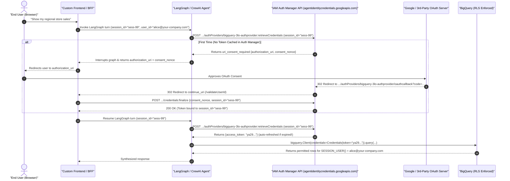
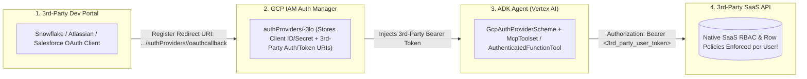

# Extending 3LO Across GCP Services, Non-ADK Frameworks, 3rd-Party SaaS & Security FAQ

**Customer Documentation Navigation**:
[🏠 Repository Hub (`README.md`)](../README.md) · [🛠️ Guide 1: Step-by-Step 3LO Setup](01_STEP_BY_STEP_BQ_3LO_SETUP_GUIDE.md) · [🏗️ Guide 2: 3LO Options & 2LO Comparison](02_3LO_ARCHITECTURAL_OPTIONS_AND_2LO_COMPARISON.md) · [🪪 Guide 3: Agent Identity vs. Service Accounts](03_AGENT_IDENTITY_VS_SERVICE_ACCOUNTS.md) · [🔐 Guide 4: Google Auth Platform & Troubleshooting](04_GOOGLE_AUTH_PLATFORM_AND_TROUBLESHOOTING.md) · **Guide 5: Extending 3LO & Security FAQ**

---

Once your team has implemented **3-Legged OAuth (3LO)** and **per-user Row-Level Security (RLS)** for BigQuery, the same architectural pattern can be extended across your broader enterprise stack. This guide provides implementation blueprints and reference code for:
1. **Extending 3LO to Other First-Party Google Cloud Services** (Cloud SQL, AlloyDB, Cloud Spanner, Cloud Storage, Google Drive/Workspace, Looker, Vertex AI Search, Dataplex, Apigee API Hub, and Application Integration).
2. **Implementing 3LO in Non-ADK Agent Frameworks** (LangGraph, LangChain, CrewAI, and custom FastAPI/Python agents via IAM Auth Manager REST APIs or Frontend/BFF Token Passthrough).
3. **Extending 3LO to 3rd-Party SaaS & Data Platforms** (Snowflake, Atlassian Jira & Confluence, Salesforce, ServiceNow, and GitHub via IAM Auth Manager v2).
4. **Enterprise Security & Architecture FAQ** (10 common CISO, Data Governance, and Platform Engineering questions).

---

## 1. Extending 3LO to Other Google Cloud Services (Beyond BigQuery)

### 1.1 Cloud SQL (PostgreSQL / MySQL), AlloyDB & Cloud Spanner

Relational and distributed databases on Google Cloud support two distinct 3LO enforcement patterns:

#### Pattern 1: Native IAM Database Authentication + PostgreSQL RLS (Cloud SQL & AlloyDB)
1. **Database Setup**:
   - Enable `cloudsql.iam_authentication = on` (or `alloydb.iam_authentication = on`).
   - Grant the human user `roles/cloudsql.instanceUser` (or `roles/alloydb.databaseUser` + `roles/alloydb.client`).
   - Create the IAM user inside PostgreSQL and attach native PostgreSQL Row-Level Security:
     ```sql
     CREATE USER "alice@your-company.com" WITH LOGIN;
     GRANT SELECT ON TABLE regional_orders TO "alice@your-company.com";
     ALTER TABLE regional_orders ENABLE ROW LEVEL SECURITY;

     CREATE POLICY north_only_policy ON regional_orders
       FOR SELECT
       TO "alice@your-company.com"
       USING (region = 'North');
     ```
2. **OAuth Scope**: Request `https://www.googleapis.com/auth/sqlservice.login` (Cloud SQL) or `https://www.googleapis.com/auth/cloud-platform` (AlloyDB).
3. **Agent Tool Code**: Pass the user's 3LO access token directly as the PostgreSQL `password` when opening a per-request connection (PostgreSQL `current_user` / `session_user` evaluates to `alice@your-company.com`):
   ```python
   import sqlalchemy
   from google.adk.tools.tool_context import ToolContext

   def query_cloudsql_with_3lo(sql_query: str, tool_context: ToolContext) -> list[dict]:
       """Executes a read-only PostgreSQL query as the 3LO human user via IAM DB Auth."""
       user_token = tool_context.state.get("bq-3lo-auth")
       user_email = tool_context.state.get("user_email")  # e.g., "alice@your-company.com"
       if not user_token or not user_email:
           raise PermissionError("Missing 3LO OAuth token or user email.")

       # In IAM DB Auth, the short-lived 3LO OAuth access token IS the database password
       engine = sqlalchemy.create_engine(
           sqlalchemy.engine.url.URL.create(
               drivername="postgresql+pg8000",
               username=user_email,
               password=user_token,
               host="10.128.0.5",  # Private IP or Cloud SQL Python Connector
               port=5432,
               database="retail_db",
           ),
           pool_pre_ping=True,
       )
       with engine.connect() as conn:
           conn.exec_driver_sql("SET SESSION CHARACTERISTICS AS TRANSACTION READ ONLY;")
           result = conn.exec_driver_sql(sql_query)
           return [dict(row._mapping) for row in result]
   ```

#### Pattern 2: Cloud Spanner Fine-Grained Access Control (FGAC)
1. **Database Setup**:
   - Create Spanner Database Roles (`CREATE ROLE north_analyst; GRANT SELECT ON TABLE store_sales TO ROLE north_analyst;`) or parameterized secure views.
   - Bind the user to `roles/spanner.fineGrainedAccessUser` with an IAM Condition restricting `resource.name.endsWith('/databaseRoles/north_analyst')`.
2. **OAuth Scope**: `https://www.googleapis.com/auth/spanner.data`.
3. **Agent Tool Code**:
   ```python
   import google.oauth2.credentials
   from google.cloud import spanner

   def query_spanner_3lo(project_id: str, sql_query: str, db_role: str, user_token: str) -> list[dict]:
       creds = google.oauth2.credentials.Credentials(token=user_token)
       client = spanner.Client(project=project_id, credentials=creds)
       instance = client.instance("retail-spanner")
       # Spanner enforces IAM FGAC verifying that user_token is allowed to assume `db_role`
       database = instance.database("sales-db", database_role=db_role)
       with database.snapshot() as snapshot:
           results = snapshot.execute_sql(sql_query)
           return [dict(zip([col.name for col in results.fields], row)) for row in results]
   ```

---

### 1.2 Google Cloud Storage (GCS) & Google Drive / Workspace APIs

Both GCS and Google Workspace APIs (Drive, Gmail, Calendar, Docs, Sheets) natively evaluate OAuth 2.0 Bearer tokens.

- **OAuth Scopes**:
  - **GCS**: `https://www.googleapis.com/auth/devstorage.read_only` (enforces Bucket IAM, **GCS Managed Folders**, and **IAM Conditions** on object prefixes such as `resource.name.startsWith("projects/_/buckets/company-reports/objects/north/")`).
  - **Google Drive**: `https://www.googleapis.com/auth/drive.readonly` (enforces exact Drive file and folder sharing ACLs for the signed-in human user).
- **Code Pattern A — Per-Request Python Tool (GCS & Drive)**:
  ```python
  import google.oauth2.credentials
  from google.cloud import storage
  from googleapiclient.discovery import build

  def read_user_gcs_report(project_id: str, bucket_name: str, blob_path: str, user_token: str) -> str:
      """Reads a GCS object using the end-user's 3LO token (enforces Managed Folder IAM)."""
      user_creds = google.oauth2.credentials.Credentials(token=user_token)
      storage_client = storage.Client(project=project_id, credentials=user_creds)
      blob = storage_client.bucket(bucket_name).blob(blob_path)
      return blob.download_as_text()

  def search_user_google_drive(query: str, user_token: str) -> list[dict]:
      """Searches Google Drive returning ONLY files shared with the signed-in human user."""
      user_creds = google.oauth2.credentials.Credentials(token=user_token)
      drive_service = build("drive", "v3", credentials=user_creds)
      resp = drive_service.files().list(
          q=f"name contains '{query}' and trashed = false",
          pageSize=10,
          fields="files(id, name, mimeType, owners)",
      ).execute()
      return resp.get("files", [])
  ```
- **Code Pattern B — Declarative `GoogleApiToolset` / `OpenAPIToolset`**:
  ADK also provides `GoogleApiToolset` (`from google.adk.tools.google_api_tool import GoogleApiToolset`), which auto-generates tools from Google Discovery Documents (e.g., `drive:v3`, `gmail:v1`, `calendar:v3`) and wires directly into `OAuth2Auth` or `GcpAuthProviderScheme`.

---

### 1.3 Looker, Vertex AI Search & Dataplex Catalog

| Service | OAuth Scope | How 3LO User Permissions Are Enforced |
| :--- | :--- | :--- |
| **Looker & Conversational Analytics API (`geminidataanalytics`)** | `https://www.googleapis.com/auth/bigquery` + `https://www.googleapis.com/auth/cloud-platform` | Pass the user's 3LO `Credentials(token=user_token)` to the Conversational Analytics client or Looker MCP server. Looker's semantic layer (`access_filter` in LookML) and BigQuery RLS both evaluate the human user's identity. |
| **Vertex AI Search (Discovery Engine Data Stores)** | Native Workspace login in Gemini Enterprise (`idpType: GSUITE`) or `https://www.googleapis.com/auth/cloud-platform` | When a Data Store with **Document-Level ACLs** (`acl_enabled=True`) is queried, Discovery Engine intersects the vector/keyword search results with the signed-in user's email and Google Groups (`aclInfo.readers`) inside the search index. |
| **Dataplex Universal Catalog** | `https://www.googleapis.com/auth/cloud-platform.read-only` | Calling `dataplex_v1.CatalogServiceClient(credentials=Credentials(token=user_token)).search_entries(...)` returns **only** metadata entries, glossary terms, and tables where the human user holds `dataplex.entryView` / `bigquery.tables.get`. |

---

### 1.4 Apigee API Hub & Application Integration (`APIHubToolset` & `ApplicationIntegrationToolset`)

Enterprises exposing internal microservices through **Apigee API Hub** or orchestrating ERP/CRM workflows via **Google Cloud Application Integration** can attach 3LO directly to ADK's built-in toolsets:

```python
from google.adk.tools.apihub_tool.apihub_toolset import APIHubToolset
from google.adk.tools.application_integration_tool.application_integration_toolset import (
    ApplicationIntegrationToolset,
)
from google.adk.integrations.agent_identity import GcpAuthProviderScheme

# 1. Apigee API Hub Toolset with per-user 3LO token forwarding
apigee_3lo_scheme = GcpAuthProviderScheme(
    name="projects/your-gcp-project-id/locations/us-central1/authProviders/apigee-3lo-provider",
    scopes=["https://www.googleapis.com/auth/cloud-platform"],
    continue_uri="https://portal.your-company.com/validateUserId",
)

order_management_api_tools = APIHubToolset(
    apihub_resource_name="projects/your-gcp-project-id/locations/us-central1/apis/order-service/versions/v1/specs/openapi",
    auth_scheme=apigee_3lo_scheme,
)

# 2. Application Integration Toolset (triggers Integration workflows or Connectors)
erp_integration_tools = ApplicationIntegrationToolset(
    project="your-gcp-project-id",
    location="us-central1",
    integration="sap-order-lookup-integration",
    triggers=["api_trigger/sap_order_lookup"],
    auth_scheme=apigee_3lo_scheme,
)
```

---

## 2. Implementing 3LO in Non-ADK Frameworks (LangGraph, LangChain, CrewAI, Custom Python)

Teams running **LangGraph**, **LangChain**, **CrewAI**, or **custom FastAPI agents** (hosted on Vertex AI Agent Runtime, Cloud Run, or GKE) can implement Google Cloud 3LO using **two proven architectural approaches**.



### Approach 2A — Direct Integration with IAM Auth Manager REST API (`agentidentitycredentials.googleapis.com/v1`)

In this architecture, your non-ADK agent delegates OAuth client secrets, token exchanges, encrypted refresh-token storage, and automatic token refreshes to **Google Cloud IAM Auth Manager**.

#### Step-by-Step Protocol Flow
1. **Step 1 (`:retrieveCredentials`)**: The LangGraph/LangChain agent (running with SPIFFE `AGENT_IDENTITY` or a Service Account holding `roles/agentidentity.user`) calls:
   `POST https://agentidentitycredentials.googleapis.com/v1/projects/{P}/locations/{L}/authProviders/{ID}:retrieveCredentials`
   passing the user's `session_id` (or principal identifier) and requested `scopes`.
2. **Step 2 (`uri_consent_required`)**: If the user has not yet consented, the API returns `uri_consent_required` with an `authorization_uri` and a `consent_nonce`.
3. **Step 3 (OAuth Redirect & `/oauthcallback`)**: Your frontend redirects the user to `authorization_uri`. After the user consents at Google (or a 3rd-party IdP), the IdP redirects to Auth Manager's managed callback (`https://agentidentitycredentials.googleapis.com/v1/projects/{P}/locations/{L}/authProviders/{ID}/oauthcallback`), which exchanges the code for tokens and redirects the user's browser to your `continue_uri` (`/validateUserId`).
4. **Step 4 (`:finalize`)**: Your `/validateUserId` backend route verifies the user's session and calls:
   `POST https://agentidentitycredentials.googleapis.com/v1/projects/{P}/locations/{L}/authProviders/{ID}/credentials:finalize` with the `consent_nonce`.
5. **Step 5 (Execute Tool with Bearer Token)**: The LangGraph tool node calls `:retrieveCredentials` again, receives the active `access_token`, and instantiates a request-scoped `bigquery.Client(credentials=Credentials(token=access_token))`.

#### Reference Python Implementation: LangGraph Tool Node Using IAM Auth Manager REST API

```python
import os
import google.auth
import google.auth.transport.requests
import google.oauth2.credentials
import httpx
from google.cloud import bigquery
from langchain_core.runnables import RunnableConfig
from langchain_core.tools import tool
from langgraph.types import interrupt

PROJECT_ID = os.environ.get("BQ_PROJECT_ID", "your-gcp-project-id")
LOCATION = os.environ.get("AUTH_PROVIDER_LOCATION", "us-central1")
AUTH_PROVIDER_ID = os.environ.get("AUTH_PROVIDER_ID", "bigquery-3lo-authprovider")
CONTINUE_URI = os.environ.get("AUTH_MANAGER_CONTINUE_URI", "https://sales-portal.your-company.com/validateUserId")

AUTH_MANAGER_BASE_URL = (
    f"https://agentidentitycredentials.googleapis.com/v1/"
    f"projects/{PROJECT_ID}/locations/{LOCATION}/authProviders/{AUTH_PROVIDER_ID}"
)


def _get_agent_plane1_headers() -> dict[str, str]:
    """Obtains the agent workload's Plane 1 (2LO / SPIFFE Agent Identity) token to call Auth Manager."""
    creds, _ = google.auth.default(scopes=["https://www.googleapis.com/auth/cloud-platform"])
    creds.refresh(google.auth.transport.requests.Request())
    return {
        "Authorization": f"Bearer {creds.token}",
        "Content-Type": "application/json",
        "x-goog-user-project": PROJECT_ID,
    }


def retrieve_3lo_token_from_auth_manager(session_id: str, scopes: list[str]) -> dict:
    """Calls IAM Auth Manager :retrieveCredentials for the current user session."""
    payload = {
        "clientIdentifier": {"sessionId": session_id},
        "scopes": scopes,
        "continueUri": CONTINUE_URI,
    }
    with httpx.Client(timeout=15.0) as client:
        resp = client.post(
            f"{AUTH_MANAGER_BASE_URL}:retrieveCredentials",
            headers=_get_agent_plane1_headers(),
            json=payload,
        )
        resp.raise_for_status()
        return resp.json()


def finalize_3lo_consent_in_auth_manager(session_id: str, consent_nonce: str) -> None:
    """Called by your frontend's /validateUserId endpoint after the user returns from OAuth consent."""
    payload = {
        "clientIdentifier": {"sessionId": session_id},
        "consentNonce": consent_nonce,
    }
    with httpx.Client(timeout=15.0) as client:
        resp = client.post(
            f"{AUTH_MANAGER_BASE_URL}/credentials:finalize",
            headers=_get_agent_plane1_headers(),
            json=payload,
        )
        resp.raise_for_status()


@tool
def langgraph_query_bigquery_3lo(sql_query: str, config: RunnableConfig) -> list[dict]:
    """Executes a read-only BigQuery SQL query in LangGraph using IAM Auth Manager 3LO."""
    session_id = config.get("configurable", {}).get("thread_id", "default-session")
    scopes = ["https://www.googleapis.com/auth/bigquery"]

    # Step 1: Request the user's 3LO token from IAM Auth Manager
    cred_response = retrieve_3lo_token_from_auth_manager(session_id=session_id, scopes=scopes)

    # Step 2: If consent is required, pause the LangGraph execution via `interrupt()`
    # and hand `authorization_uri` + `consent_nonce` back to the frontend
    if "uriConsentRequired" in cred_response or "uri_consent_required" in cred_response:
        consent_info = cred_response.get("uriConsentRequired") or cred_response["uri_consent_required"]
        interrupt(
            {
                "action": "oauth_3lo_consent_required",
                "authorization_uri": consent_info.get("authorizationUri") or consent_info.get("authorization_uri"),
                "consent_nonce": consent_info.get("consentNonce") or consent_info.get("consent_nonce"),
                "session_id": session_id,
            }
        )

    # Step 5: Extract the active Bearer access_token and execute BigQuery query with RLS
    access_token = (
        cred_response.get("accessToken")
        or cred_response.get("access_token")
        or cred_response.get("oauth2", {}).get("accessToken")
    )
    if not access_token:
        raise PermissionError(f"Auth Manager did not return an access token: {cred_response}")

    # Enforce read-only SELECT guardrail
    if not sql_query.strip().upper().startswith(("SELECT", "WITH")):
        raise ValueError("Only read-only SELECT/WITH queries are allowed.")

    user_creds = google.oauth2.credentials.Credentials(token=access_token)
    bq_client = bigquery.Client(project=PROJECT_ID, credentials=user_creds, location="US")
    rows = bq_client.query(sql_query).result()
    return [dict(row.items()) for row in rows]
```

---

### Approach 2B — Frontend / API Gateway (BFF) OAuth Token Passthrough

When your web application or Backend-for-Frontend (BFF)—or **Gemini Enterprise**—already performs the OAuth 2.0 Authorization Code + PKCE flow:
1. The Frontend/BFF exchanges the authorization code for the user's OAuth 2.0 `access_token` (and stores the `refresh_token` in its own encrypted session store or Discovery Engine `Authorization` resource).
2. On each agent request, the Frontend/BFF passes the short-lived `access_token` in the request payload or LangGraph `RunnableConfig` (`config={"configurable": {"bq-3lo-auth": user_access_token}}`).
3. Inside the LangGraph tool node, the tool extracts `config["configurable"]["bq-3lo-auth"]`, wraps it in `google.oauth2.credentials.Credentials(token=user_access_token)`, and calls `bigquery.Client(project=PROJECT_ID, credentials=user_creds)`.

> [!TIP]
> **When to Choose Approach 2A vs. Approach 2B**:
> - Choose **Approach 2A (IAM Auth Manager API)** when your agent connects to **multiple heterogeneous tools** (e.g., BigQuery + Snowflake + Jira + ServiceNow) and you want Google Cloud to centrally vault refresh tokens and manage multi-provider OAuth callbacks.
> - Choose **Approach 2B (BFF / Gemini Enterprise Token Passthrough)** when the agent is surfaced inside **Gemini Enterprise** or an existing enterprise web portal that already manages Google OAuth sessions.

---

## 3. Extending 3LO to 3rd-Party Platforms (Snowflake, Atlassian Jira / Confluence, Salesforce, ServiceNow, GitHub)

Neither Gemini Enterprise `Authorizations` nor Google Cloud **IAM Auth Manager (`agentidentity.googleapis.com`)** is limited to Google's OAuth server. Both act as universal **OAuth 2.0 Relying Party (RP) Credential Brokers** that can point to **any standards-compliant 3rd-party OAuth 2.0 `authorization_uri` and `token_uri`**.



### Step 1: Register the OAuth Client in the 3rd-Party Developer Portal
Create an OAuth 2.0 Client in the target 3rd-party platform and register Google Cloud IAM Auth Manager's callback URL as the **Authorized Redirect URI**:
```text
https://agentidentitycredentials.googleapis.com/v1/projects/<YOUR_PROJECT_ID>/locations/<LOCATION>/authProviders/<PROVIDER_NAME>/oauthcallback
```
*(Or, if surfacing exclusively through **Gemini Enterprise** using a Discovery Engine `Authorization` resource, register `https://vertexaisearch.cloud.google.com/oauth-redirect`.)*

- **In Snowflake**: Run the following SQL as `ACCOUNTADMIN` to create a custom OAuth Security Integration:
  ```sql
  CREATE OR REPLACE SECURITY INTEGRATION gcp_agent_snowflake_3lo
    TYPE = OAUTH
    ENABLED = TRUE
    OAUTH_CLIENT = CUSTOM
    OAUTH_CLIENT_TYPE = 'CONFIDENTIAL'
    OAUTH_REDIRECT_URI = 'https://agentidentitycredentials.googleapis.com/v1/projects/your-gcp-project-id/locations/us-central1/authProviders/snowflake-3lo-provider/oauthcallback'
    OAUTH_ISSUE_REFRESH_TOKENS = TRUE
    OAUTH_REFRESH_TOKEN_VALIDITY = 7776000;

  -- Retrieve the Client ID and Client Secret:
  SELECT SYSTEM$SHOW_OAUTH_CLIENT_SECRETS('GCP_AGENT_SNOWFLAKE_3LO');
  ```
- **In Atlassian Developer Console (Jira & Confluence Cloud)**:
  Create an **OAuth 2.0 (3LO)** integration at `https://developer.atlassian.com/console/myapps/`, enable Rotating Refresh Tokens, add granular scopes (`read:jira-work`, `read:confluence-content.all`, `offline_access`), and set the Callback URL to the `.../authProviders/atlassian-3lo-provider/oauthcallback` URI above.

### Step 2: Create the IAM Auth Manager Resource in Google Cloud

| 3rd-Party Platform | `authorization_uri` | `token_uri` | Recommended 3LO Scopes | Native 3rd-Party Security Enforced by Token |
| :--- | :--- | :--- | :--- | :--- |
| **Snowflake** | `https://<account>.snowflakecomputing.com/oauth/authorize` | `https://<account>.snowflakecomputing.com/oauth/token-request` | `session:role:ANALYST` *(or `refresh_token`)* | **Snowflake RBAC Roles**, **Row Access Policies**, & **Dynamic Data Masking** (`CURRENT_USER()`, `CURRENT_ROLE()`). |
| **Atlassian Jira & Confluence** | `https://auth.atlassian.com/authorize?audience=api.atlassian.com` | `https://auth.atlassian.com/oauth/token` | `read:jira-work` `read:confluence-content.all` `offline_access` | **Jira Project/Issue Permissions** & **Confluence Space/Page View Restrictions**. |
| **Salesforce** | `https://login.salesforce.com/services/oauth2/authorize` | `https://login.salesforce.com/services/oauth2/token` | `api` `refresh_token` `chatter_api` | **Salesforce Object/Field-Level Security (FLS)**, **Sharing Rules**, & **Role Hierarchy**. |
| **ServiceNow** | `https://<instance>.service-now.com/oauth_auth.do` | `https://<instance>.service-now.com/oauth_token.do` | `useraccount` | **ServiceNow Contextual ACLs** (`gs.getUserID()`) on Incidents, CMDB, and Knowledge Base articles. |
| **GitHub Enterprise / Cloud** | `https://github.com/login/oauth/authorize` | `https://github.com/login/oauth/access_token` | `repo` `read:org` `read:user` | **GitHub Repository Read/Write Permissions** & **Organization Team Visibility**. |

```bash
# Example: Registering Snowflake 3LO in GCP IAM Auth Manager
gcloud alpha agent-identity auth-providers create snowflake-3lo-provider \
  --project="${PROJECT_ID}" \
  --location="us-central1" \
  --oauth2-client-id="${SNOWFLAKE_OAUTH_CLIENT_ID}" \
  --oauth2-client-secret="${SNOWFLAKE_OAUTH_CLIENT_SECRET}" \
  --authorization-uri="https://xy12345.us-central1.gcp.snowflakecomputing.com/oauth/authorize" \
  --token-uri="https://xy12345.us-central1.gcp.snowflakecomputing.com/oauth/token-request"

# Example: Registering Atlassian Jira/Confluence 3LO in GCP IAM Auth Manager
gcloud alpha agent-identity auth-providers create atlassian-3lo-provider \
  --project="${PROJECT_ID}" \
  --location="us-central1" \
  --oauth2-client-id="${ATLASSIAN_CLIENT_ID}" \
  --oauth2-client-secret="${ATLASSIAN_CLIENT_SECRET}" \
  --authorization-uri="https://auth.atlassian.com/authorize?audience=api.atlassian.com&prompt=consent" \
  --token-uri="https://auth.atlassian.com/oauth/token"
```

### Step 3: Attach `GcpAuthProviderScheme` to ADK Tools (`McpToolset` or `AuthenticatedFunctionTool`)

```python
import snowflake.connector
from google.adk.auth.auth_credential import AuthCredential
from google.adk.auth.auth_tool import AuthConfig
from google.adk.auth.credential_manager import CredentialManager
from google.adk.integrations.agent_identity import GcpAuthProvider, GcpAuthProviderScheme
from google.adk.tools.authenticated_function_tool import AuthenticatedFunctionTool
from google.adk.tools.mcp_tool.mcp_session_manager import StreamableHTTPConnectionParams
from google.adk.tools.mcp_tool.mcp_toolset import McpToolset

CredentialManager.register_auth_provider(GcpAuthProvider())

# --- 3A. Snowflake 3LO Function Tool (enforces Snowflake Row Access Policies for CURRENT_USER()) ---
async def query_snowflake_3lo(credential: AuthCredential, sql_query: str) -> list[dict]:
    """Executes a read-only Snowflake query using the end-user's 3LO Snowflake OAuth token."""
    sf_token = credential.http.credentials.token
    conn = snowflake.connector.connect(
        account="xy12345.us-central1.gcp",
        authenticator="oauth",
        token=sf_token,
        warehouse="COMPUTE_WH",
        database="RETAIL_DW",
        schema="SALES",
    )
    try:
        cur = conn.cursor(snowflake.connector.DictCursor)
        cur.execute(sql_query)
        return cur.fetchall()
    finally:
        conn.close()

snowflake_3lo_tool = AuthenticatedFunctionTool(
    func=query_snowflake_3lo,
    auth_config=AuthConfig(
        auth_scheme=GcpAuthProviderScheme(
            name="projects/your-gcp-project-id/locations/us-central1/authProviders/snowflake-3lo-provider",
            scopes=["session:role:ANALYST"],
            continue_uri="https://sales-portal.your-company.com/validateUserId",
        )
    ),
)

# --- 3B. Atlassian Jira / Confluence 3LO via Remote MCP Server (`McpToolset`) ---
atlassian_3lo_mcp = McpToolset(
    connection_params=StreamableHTTPConnectionParams(url="https://mcp.atlassian.com/v1/sse"),
    auth_scheme=GcpAuthProviderScheme(
        name="projects/your-gcp-project-id/locations/us-central1/authProviders/atlassian-3lo-provider",
        scopes=["read:jira-work", "read:confluence-content.all", "offline_access"],
        continue_uri="https://sales-portal.your-company.com/validateUserId",
    ),
)
```

---

## 4. Enterprise Security & Architecture FAQ

### Q1: Where are the user's OAuth refresh tokens stored, and how are they protected at rest?
Neither the ADK container code nor the LLM ever sees or stores the user's long-lived `refresh_token`. The `refresh_token` is encrypted at rest inside Google Cloud's managed credential vault—either **Discovery Engine's `Authorization` token store** (for Gemini Enterprise) or **IAM Auth Manager** (`agentidentitycredentials.googleapis.com`). When an agent turn starts, the managed vault performs the token refresh server-side and injects **only a short-lived (1-hour) Bearer `access_token`** (`ya29...`) into the ephemeral tool execution context. Organizations requiring sovereign key control can also enable **CMEK (Customer-Managed Encryption Keys)** on Discovery Engine and Vertex AI.

### Q2: What happens when the 1-hour Google OAuth `access_token` expires? Does the user get prompted every hour?
**No.** Because the Discovery Engine `Authorization` URI includes `access_type=offline&prompt=consent`, Google's OAuth server issues a long-lived `refresh_token` during the user's very first consent click. Whenever the 3,600-second `access_token` expires, Gemini Enterprise (or IAM Auth Manager) silently exchanges the stored `refresh_token` at `https://oauth2.googleapis.com/token` in the background and passes a fresh `access_token` to the agent—with zero recurring popups for the user.
*(Note: Ensure your Google Auth Platform **Audience** is set to `Internal` rather than `External — Testing`, as `External — Testing` enforces a 7-day refresh token expiration; see [Guide 4](04_GOOGLE_AUTH_PLATFORM_AND_TROUBLESHOOTING.md#4-deep-dive-how-audience-internal-vs-external-controls-3lo-verification--refresh-tokens).)*

### Q3: How can a user or security administrator revoke an agent's 3LO access immediately if an employee changes roles or leaves?
Defense-in-depth revocation works at **four levels**:
1. **Role Change in Corporate IdP / Google Group**: If an employee moves from the North region to the West region, updating their Google Group membership immediately changes which BigQuery Row Access Policy matches `SESSION_USER()` on their very next query—without even needing token revocation.
2. **User Self-Revocation**: The user can revoke the app at any time at `https://myaccount.google.com/permissions`.
3. **Workspace Admin / Security Revocation**: Workspace Admins can revoke OAuth tokens for any user or disable the OAuth Client ID globally in the Google Admin Console or Google Auth Platform (`console.cloud.google.com/auth/clients`).
4. **Account Suspension**: Disabling the user in Google Workspace / Cloud Identity immediately invalidates all active OAuth access and refresh tokens across Google Cloud.

### Q4: Does instantiating a new `bigquery.Client(credentials=...)` per tool call add latency or hit connection limits?
Constructing a `google.oauth2.credentials.Credentials(token=...)` and `bigquery.Client()` object in Python is a lightweight in-memory operation (~1–2 milliseconds) because it does not perform a network handshake on instantiation—the token is already minted. Compared to LLM reasoning (1–3 seconds) and BigQuery SQL execution (300–800 ms), per-request client instantiation adds **<0.2% overhead**. For high-throughput agents (hundreds of QPS), you can pass a shared `requests.Session` connection pool while still binding per-request `Credentials(token=user_token)` headers.

### Q5: How does this architecture work inside a VPC Service Controls (VPC-SC) perimeter?
`aiplatform.googleapis.com` (Vertex AI Agent Runtime), `discoveryengine.googleapis.com` (Gemini Enterprise), and `bigquery.googleapis.com` are VPC-SC supported services. When all three reside in the same VPC-SC perimeter, no special egress rules are needed. If BigQuery datasets live in a separate Data Lake project perimeter while the Agent Runtime lives in an AI Platform perimeter, configure a **VPC-SC Ingress/Egress rule** allowing identity type `ANY_USER_ACCOUNT` (or specific Workspace groups) from the AI Platform project to access `bigquery.googleapis.com` in the Data Lake project. *(Note: While `AGENT_IDENTITY` is in Preview, workloads inside strict VPC-SC perimeters should use a dedicated least-privilege Service Account for Plane 1; see [Guide 3](03_AGENT_IDENTITY_VS_SERVICE_ACCOUNTS.md#call-out-4-preview-limitations--supported-services).)*

### Q6: If our BigQuery data lives in Project B (`data-warehouse-prod`) while agents run in Project A (`ai-agents-prod`), which project needs `roles/bigquery.jobUser` vs. `roles/bigquery.dataViewer`?
BigQuery cleanly separates **Compute (where the query job runs)** from **Storage (where the table lives)**:
- **Project A (`ai-agents-prod` — Compute Project)**: Configure `BigQueryToolConfig(compute_project_id="ai-agents-prod")`. Grant the human users `roles/bigquery.jobUser` on **Project A** so all agent query compute is billed to the AI project.
- **Project B (`data-warehouse-prod` — Storage Project)**: Grant the human users `roles/bigquery.dataViewer` on the dataset in **Project B**, and attach the **Row Access Policies** (`roles/bigquery.filteredDataViewer`) on the table in **Project B**. Users do **not** need `jobUser` on the production data warehouse project.

### Q7: Can a user bypass BigQuery RLS through prompt injection, CTEs, `FOR SYSTEM_TIME AS OF` time travel, or error-based side channels (like `1 / 0`)?
**No.** BigQuery evaluates Row Access Policy filter predicates at the **storage scan layer prior to any user SQL operator**:
- **Prompt Injection**: Even if the LLM is tricked into running `SELECT * FROM weekly_store_sales WHERE region = 'South'`, BigQuery rewrites the scan predicate to `WHERE (region = 'South') AND (region = 'North')`, returning `0 rows`.
- **Division-by-Zero / Error Side Channels**: BigQuery guarantees that RLS predicates execute *before* user `WHERE` or `SELECT` expressions, preventing an attacker from probing hidden row values via `WHERE 1/(salary - 100000) = 1`.
- **Time Travel (`FOR SYSTEM_TIME AS OF`)**: Non-admin filtered viewers cannot use time travel to read rows prior to the attachment of an RLS policy.

### Q8: What if our users authenticate with Okta, Microsoft Entra ID (Azure AD), or Ping Identity instead of Google Workspace?
There are two standard patterns for external Enterprise Identity Providers:
1. **Cloud Identity / Google Workspace Workforce Federation (Recommended)**: Most enterprise GCP organizations federate Entra ID or Okta into **Google Cloud Identity** via SAML/OIDC + SCIM group sync (`alice@your-company.com`). In that setup, this repository works **unchanged**—when Google OAuth prompts `alice@your-company.com`, Google automatically redirects to Okta/Entra ID for SSO and mints the Google 3LO token.
2. **Workforce Identity Federation (WIF) / External OIDC with IAM Auth Manager**: You can configure an external OIDC provider directly in IAM Auth Manager (`authProviders`) or Workforce Identity Pools (`principal://iam.googleapis.com/locations/global/workforcePools/...`), which BigQuery RLS also supports in `GRANT TO (...)`.

### Q9: Can an agent combine 2LO (shared public lookup tables) and 3LO (restricted user tables) in the same agent?
**Yes.** An ADK agent can register multiple toolsets side-by-side:
- A **3LO `BigQueryToolset`** (using the user's OAuth token) for sensitive tables governed by per-user Row-Level Security (e.g., regional sales, HR, customer financials).
- A **2LO `BigQueryToolset`** (using the agent's workload credentials) for company-wide reference tables (e.g., public product catalogs, store directories, or macroeconomic weather tables) where you do not want to manage per-user IAM bindings.

### Q10: Can the LLM see the user's raw OAuth `access_token` or leak it in the chat response?
**No.** In both Option A (`BigQueryToolset`) and Option B (`McpToolset` / `AuthenticatedFunctionTool`), the OAuth token lives inside `tool_context.state` or `CredentialManager`—**outside** the LLM's conversation history and tool parameter schema. When Gemini decides to call `execute_sql(query="SELECT ...")`, the LLM only generates the `query` string; the Python runtime intercepts the tool execution, retrieves the token from the session state or vault, attaches the `Authorization: Bearer` header to the BigQuery HTTPS call, and returns only the resulting data rows to the LLM.

---

**Return to Hub**: [🏠 Repository Hub (`README.md`)](../README.md) · [🛠️ Guide 1: Step-by-Step 3LO Setup](01_STEP_BY_STEP_BQ_3LO_SETUP_GUIDE.md) · [🏗️ Guide 2: 3LO Options & 2LO Comparison](02_3LO_ARCHITECTURAL_OPTIONS_AND_2LO_COMPARISON.md) · [🪪 Guide 3: Agent Identity vs. Service Accounts](03_AGENT_IDENTITY_VS_SERVICE_ACCOUNTS.md) · [🔐 Guide 4: Google Auth Platform & Troubleshooting](04_GOOGLE_AUTH_PLATFORM_AND_TROUBLESHOOTING.md)
